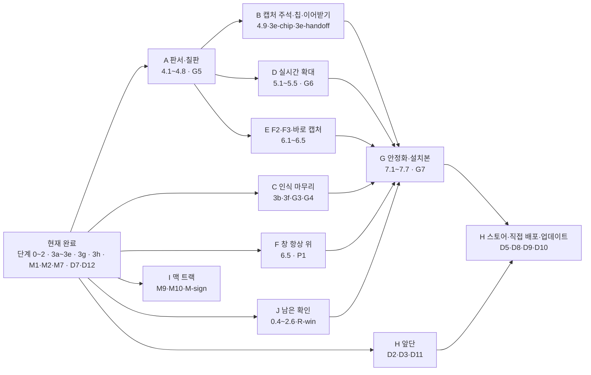

# screen-ink 남은 작업 전체 구현 시안 (2026-11-26)

기준 브랜치: `feat/foundation` · 진척 기준: [docs/progress/README.md](../../progress/README.md) (`progress.json` 기준 남은 항목 69개 · 환산 남은 작업일 23.39일)
성격: **구현 전 설계 시안(문서만)**. 코드·설정·기존 문서는 건드리지 않았다.

---

## 1. 묶음 한눈에 보기 (난이도 · 작업일 · 순서)

난이도 기준(`progress.json`): **상** = 새 OS API·성능 목표·설계 결정이 많음 · **중** = 아는 방법으로 여러 파일·실측 필요 · **하** = 작은 화면·문서·확인·측정 한 번.
작업일 표기: `항목 합계일 (환산 남은 일)` — `progress.json`의 상태 가중치(안 함 1.0 · 진행 중 0.5 · 확인 남음 0.2)로 환산했다.

| 순서 | 문서 | 포함 항목 (`progress.json` ID) | 플랫폼 | 난이도 | 작업일(환산 남은 일) | 관문 | 먼저 끝나야 할 것 |
|---:|---|---|---|---:|---:|---|---|
| 1 | [A-ink-engine.md](A-ink-engine.md) | `4.1`~`4.8` (8개) | 공통 | **상** | 3.00일 (3.00일) | **G5** | 단계 2 완료(끝남) |
| 2 | [B-capture-annotation.md](B-capture-annotation.md) | `4.9`, `3e-chip`, `3e-handoff` (3개) | 공통 | **상** | 1.35일 (1.35일) | — | `4.9`·`3e-handoff`는 **A** (`4.1`·`4.2`·`4.4`) · `3e-chip`은 독립 |
| 3 | [C-recognition-rest.md](C-recognition-rest.md) | `3b-dpi`, `3b-msaa`, `3a-rb1516`, `3f-docs`, `3f-frozen`, `3f-win-cases`, `3f-snipaste`, `3c-g3`, `3a-ci`, `3e-paste` (10개) | Windows·공통 | **상** | 2.65일 (2.35일) | **G3 · G4** | 단계 3a~3e 완료(끝남) |
| 4 | [D-live-zoom.md](D-live-zoom.md) | `5.1`~`5.5` (5개) | Windows·공통 | **상** | 2.00일 (2.00일) | **G6** | `5.3` Alt+1 전환은 **A** (`4.4`·`4.6`) · 나머지는 단계 2 |
| 5 | [E-window-record.md](E-window-record.md) | `6.1`~`6.5` (5개) | Windows·공통 | **상** | 3.00일 (3.00일) | — | 단계 3e(끝남), 녹화 위 판서 겹침 확인은 **A** |
| 6 | [F-window-pin.md](F-window-pin.md) | `6.5.1`~`6.5.3` (3개, P1) | Windows | **상** | 1.00일 (1.00일) | — | 단계 2 완료(끝남) · 일정 초과 시 후순위 |
| 7 | [I-mac.md](I-mac.md) | `M9`, `M10`, `M-sign`, `M3`~`M6`, `M8`, `M11` (9개) | 맥 | **상** | 5.00일 (2.65일) | — | M1·M2·M7 완료(끝남) · Windows 작업과 병렬 가능 |
| 8 | [J-verify-rest.md](J-verify-rest.md) | `0.4`, `0.4b`, `0.4c`, `1.3`, `1.6`, `2.2`, `2.5`, `2.6`, `R-win-regress` (9개) | 공통·Windows | **하** | 2.68일 (0.54일) | G1·G2 마감 | 이미 구현 완료, 단계 7 전에 수시 병행 |
| 9 | [G-stabilize.md](G-stabilize.md) | `7.1`~`7.7` (7개) | Windows·공통 | **중** | 2.50일 (2.50일) | **G7** | **A · B · C · D · E · (F) · J** 완료 |
| 10 | [H-distribution.md](H-distribution.md) | `D2`, `D3`, `D5`, `D8`, `D9`, `D10`, `D11` (+연계 `D1`, `D4`, `D6`, 총 10개) | Windows·공통 | **상** | 5.50일 (5.00일) | 스토어 인증 | `D2`·`D3`·`D11`은 병렬 가능 · `D5`·`D8`·`D9`는 **G** 및 사용자 `D1` 완료 후 |
| — | **합계** | **69개 항목** | — | — | **28.68일 (23.39일)** | — | — |

---

## 2. 의존 관계와 병렬 진행선

### 병렬 추천 배치 (Windows · 맥 · 공통)

| 갈래 | 먼저 할 일 | 이어서 할 일 |
|---|---|---|
| **공통 (핵심 경로)** | **A** (`4.1` → `4.2` G5 → `4.3`~`4.8`) | **B** (`4.9` 캡처 주석 → `3e-handoff`) → **G** (`7.7` 디자인 관문) |
| **Windows (학교 PC)** | **C** (`3e-paste` → `3b-dpi` → `3b-msaa` → `3f-win-cases` → `3f-snipaste` G3·G4) | **D** (`5.1`~`5.4`) → **E** (`6.1`·`6.3`·`6.5`) → **F** (`6.5`) → **G** (`7.1`~`7.6`) → **H** (`D2`·`D3`·`D5`·`D8`~`D10`) |
| **맥 (별도 기기)** | **I** (`M10` 권한 스마트 흐름 → `M9` AX 색인 → `M-sign` dmg) | `M3`~`M6`·`M8`·`M11` 확인 → A·B 맥 실기 확인 |
| **수시 병행** | **B** 중 `3e-chip` (독립, 0.15일) · **J** 확인 항목 | `D4` 스크린숏 확보(G 완료 시점) · `D11` SignPath 신청 |

---

## 3. 공통 아키텍처 불변 규칙 (모든 시안이 따르는 것)

1. **좌표 공간**: 모든 OS·서비스 경계는 가상 화면 물리 px(`PhysPoint`, `PhysRect`, 왼쪽 위 원점). CSS 논리 px·문서 px 변환은 순수 함수 한 곳에서만 한다(R-DPI-1).
2. **의존 방향**: `ink-domain`(순수 Rust) ← `ink-app`(유스케이스·포트 trait) ← `ink-platform-*`·`tauri-plugin-screen-ink` ← `apps/screen-ink`. UI(`packages/ink-ui`)는 오직 `@screen-ink/client`(`InkClient`)만 부른다(R-ARCH-1).
3. **순수 JS 엔진**: 판서 엔진(`packages/ink-ui/src/lib/ink/inkEngine.js`)은 DOM·Canvas·Tauri에 의존하지 않는 순수 JS 모듈로 두고 `node --test`로 검증한다.
4. **개인정보·네트워크 0**: 창 제목·창 안 글자·사용자 이름·파일 이름은 로그와 저장소에 쓰지 않는다(R-LOG-1). 앱 프로세스는 HTTP 클라이언트를 넣지 않는다(R-NET-2).
5. **화면 말투**: `04-screens.md`·`10-design-system.md`를 따른다. 동사·명사로 짧게("복사했어요", "판서를 보관했어요"), 느낌표·이모지 없음, 안내 UI는 검은 알약 **섬** 하나.

---

## 4. 구현 전에 사용자에게 확인이 필요한 결정 목록

각 묶음 시안에 `[확인 필요]`로 표시된 항목 중 **사용자 판단**이 필요한 것만 모았다.

| # | 관련 문서 | 결정할 내용 | 기본 시안안(미응답 시) |
|---:|---|---|---|
| 1 | A · B | 캡처 주석(R-CAP-28)의 **모자이크** 기본 블록 크기(물리 px vs 논리 px)와 강도 조절(Ctrl+휠) 여부 | 논리 10 px × 배율(범위 6~24 px), Ctrl+휠로 블록 크기 변경 |
| 2 | A | 판서 중 **도형 자동 보정(0.5초 멈춤)** 문구: `02 §3.3`("직선으로 바꿨어요 · Ctrl+Z로 원래 획", 즉시 변환) vs `04 S12`("원으로 바꿀까요? 그대로 쓰면 유지", 제안형) | 즉시 변환 + `Ctrl+Z`로 원본 획 복원(`02 §3.3`·`05 §6` 일치) |
| 3 | A | 판서 **복사·저장(Ctrl+C / Ctrl+S)** 시 확대 중인 화면을 "지금 보이는 확대 영역"으로 자를지, "모니터 전체(판서 포함)"로 낼지 | 지금 화면에 보이는 대로(확대 중이면 보이는 영역, 1×면 모니터 전체) |
| 4 | B | 결과 섬의 `[판서로]` 단추를 **항상** 보일지(결과 섬 폭 520 px 안에 `[저장] [판서로] [HEX 칩]` 3개가 들어가는지) | 기본 `[저장]` + `[판서로]`, 단색 HEX 칩은 주 단추 옆 보조 칩 1개로(폭 초과 시 칩 우선·키캡 생략) |
| 5 | E | F3 녹화 범위로 **창**을 골랐을 때 창이 움직이면 따라갈지(`02 §5` WGC `CreateForWindow`), 아니면 처음 고른 화면 사각형만 녹화할지 | 창 클릭 확정 = `CreateForWindow`(창 추적), 드래그/모니터 = 모니터 크롭 녹화 |
| 6 | F | 일정 압박(+3일 초과) 시 단계 6.5(창 항상 위 고정, P1)를 1차에서 뺄지 유지할지 | 07 §5 규칙대로 P1로 뒤 배치, 일정 여유 시 포함 |
| 7 | H | **앱 최종 이름**(스토어 표시 이름·MSIX `DisplayName`)과 아이콘 확정본(게시자 이름 `찰떡쌤`은 확정, `D1` 신분증 인증 대기) | 코드·패키지 ID는 `screen-ink` / `kr.screenink.desktop` 유지, 스토어 표시 이름만 확정 후 주입 |
| 8 | H | **D10 업데이트 팝업** 도입에 따른 PRD `R-NET-1` 문구 수정 승인(Windows OS API 호출로 업데이트 확인·설치) | `11-distribution.md §7.2` 결정대로 OS API 경로 채택 |
| 9 | I | 맥 첫 실행 시트에 **"fn+F1 또는 표준 기능 키 설정"** 안내를 기본 노출할지, 첫 F1 미감지 시에만 띄울지 | 미감지/맥 첫 실행 시트에 짧은 보조 한 줄로 함께 안내 |
