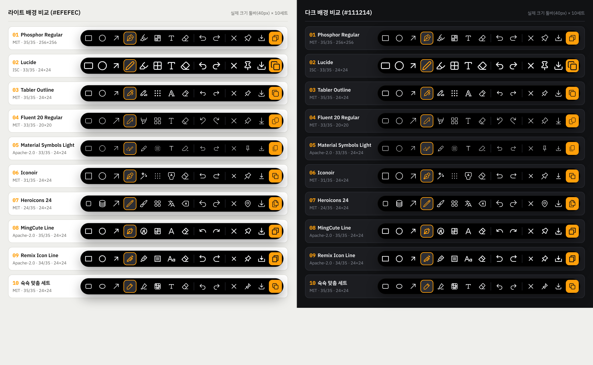

# 슉쇽 버튼 아이콘 세트 시안 10종 비교

- **대상 앱**: 슉쇽 (Tauri 2 + Svelte 5, **macOS · Windows 동시 배포**)
- **기준**: 맥 감성(SF Symbols 같은 20px 기준 획 1.5~1.75, 둥근 끝·이음, 광학 크기 맞춤) + 두 OS 일관성 + 상업 배포·앱 번들 가능한 오픈 라이선스 (SF Symbols 제외)
- **대상 아이콘**: 총 **35종** ([icons.js](../../../../packages/ink-ui/src/lib/icons/icons.js) 27종 + [AnnotateGlyph.svelte](../../../../packages/ink-ui/src/lib/components/AnnotateGlyph.svelte)·[captureToolbar.js](../../../../packages/ink-ui/src/lib/models/captureToolbar.js) 8종)
  - 주석 도구(8): `rect`, `ellipse`, `arrow`, `pen`, `marker`, `mosaic`, `text`, `eraser`
  - 툴바 이력·동작(6): `undo`, `redo`, `close`, `pin`, `save`, `copy`
  - 모드(6): `region`, `window`, `record`, `draw`, `zoom`, `board`
  - 트레이·설정·시스템(15): `restore`, `folder`, `shortcuts`, `settings`, `info`, `monitor`, `mic`, `mic-off`, `magnet`, `dark`, `delay`, `check`, `warning`, `quit`, `lock`

---

## 한눈에 비교 (캡처 툴바 10종 · 라이트/다크)

---

## 10세트 상세 비교표

| 세트 | 라이선스 | 판(버전) | 획 굵기 / 격자 | 덮은 수 / 전체 | 대신한 것 (대체 글리프) | 번들 방법 | 예상 크기 (35개 SVG) | 맥 / Windows 느낌 | 시트 |
|---|---|---|---|---|---|---|---|---|---|
| **01. Phosphor Icons (Regular)** | MIT | v2.1.1 | ~1.5px 상당 둥근 선 · 256×256 | **35 / 35** | 없음 | 선택한 35개 SVG만 인라인/컴포넌트화 | 원본 13.7 KB / **gzip 3.6 KB** | SF Symbols와 가장 닮은 둥근 모서리·균형, 두 OS 모두 세련됨 | [라이트](./01-phosphor/sheet-light.png) · [다크](./01-phosphor/sheet-dark.png) · [svg](./01-phosphor/svg/) |
| **02. Lucide Icons** | ISC | v1.81.0 | 기본 2.0 (20px→1.65 / 16px→1.85) · 24×24 | 33 / 35 | `mosaic`→`grid-2x2`, `record`→`disc-2` | 35개 SVG 인라인 또는 `lucide-svelte` 트리 셰이킹 | 원본 14.2 KB / **gzip 1.8 KB** | 깔끔한 기하학 비례, 획 조정 시 맥 감성 우수 (Tauri/웹 표준감) | [라이트](./02-lucide/sheet-light.png) · [다크](./02-lucide/sheet-dark.png) · [svg](./02-lucide/svg/) |
| **03. Tabler Icons (Outline)** | MIT | v3.53.0 | 기본 2.0 (20px→1.6 / 16px→1.8) · 24×24 | **35 / 35** | 없음 | 35개 SVG 인라인 또는 `@tabler/icons-svelte` 트리 셰이킹 | 원본 16.5 KB / **gzip 1.8 KB** | 방대한 커버리지, 정교한 도형·판서 은유 전부 보유, 획 조정 시 매우 균일 | [라이트](./03-tabler/sheet-light.png) · [다크](./03-tabler/sheet-dark.png) · [svg](./03-tabler/svg/) |
| **04. Fluent UI System Icons (20 Regular)** | MIT | v1.2.62 | 네이티브 20px 격자 · ~1.5px 둥근 선 | 33 / 35 | `mosaic`→`grid-20-regular`, `magnet`→`align-straighten-20-regular` | Iconify JSON에서 35개 정적 SVG 추출 인라인 | 원본 16.5 KB / **gzip 4.1 KB** | 20px 픽셀 정렬이 가장 날카롭고 Win11 네이티브와 100% 조화, 맥도 깔끔 | [라이트](./04-fluent/sheet-light.png) · [다크](./04-fluent/sheet-dark.png) · [svg](./04-fluent/svg/) |
| **05. Material Symbols Rounded (Light)** | Apache-2.0 | v1.2.102 | wght 300 (~1.4~1.5px 둥근 끝) · 24×24 | 33 / 35 | `mosaic`→`blur-on-rounded`, `magnet`→`attractions-rounded` | Iconify JSON에서 35개 정적 SVG 추출 인라인 | 원본 25.6 KB / **gzip 7.2 KB** | 슬림하고 둥근 획이 SF Symbols Light와 닮았으나 16px에서 다소 가늚 | [라이트](./05-material-symbols/sheet-light.png) · [다크](./05-material-symbols/sheet-dark.png) · [svg](./05-material-symbols/svg/) |
| **06. Iconoir (Regular)** | MIT | v7.12.2 | 네이티브 1.5px 둥근 끝·이음 · 24×24 | 31 / 35 | `marker`→`magic-wand`, `mosaic`→`dots-grid-3x3`, `record`→`circle-spark`, `settings`→`control-slider` | 35개 SVG 인라인 번들 | 원본 19.4 KB / **gzip 3.6 KB** | 기본 1.5px 선으로 부드러우나 일부 도형·미디어 은유가 독특함 | [라이트](./06-iconoir/sheet-light.png) · [다크](./06-iconoir/sheet-dark.png) · [svg](./06-iconoir/svg/) |
| **07. Heroicons (24 Outline)** | MIT | v2.2.0 | 네이티브 1.5px 둥근 끝·이음 · 24×24 | 24 / 35 | `rect`→`stop`, `ellipse`→`circle-stack`, `marker`→`paint-brush`, `mosaic`→`squares-2x2`, `text`→`language`, `record`→`video-camera`, `restore`→`clock`, `shortcuts`→`command-line`, `mic-off`→`no-symbol`, `magnet`→`sparkles`, `delay`→`clock` | 35개 추출 + 누락 도구 커스텀 보완 필요 | 원본 14.0 KB / **gzip 2.4 KB** | 선 감성은 깔끔하나 소형 세트(324개)라 캡처·주석 도메인 대체가 11개 발생 | [라이트](./07-heroicons/sheet-light.png) · [다크](./07-heroicons/sheet-dark.png) · [svg](./07-heroicons/svg/) |
| **08. MingCute Icons (Line)** | Apache-2.0 | v1.2.10 | ~1.65px 둥근 끝 · 24×24 | **35 / 35** | 없음 | Iconify JSON에서 35개 정적 SVG 추출 인라인 | 원본 26.3 KB / **gzip 8.6 KB** | 동글동글하고 친근한 인상, 모자이크·칠판·형광펜·자석까지 직접 커버 | [라이트](./08-mingcute/sheet-light.png) · [다크](./08-mingcute/sheet-dark.png) · [svg](./08-mingcute/svg/) |
| **09. Remix Icon (Line)** | Apache-2.0 | v4.9.1 | ~1.6px 기하학적 선(직각 끝 혼합) · 24×24 | 34 / 35 | `magnet`→`Design/focus-2-line` | 35개 SVG 인라인 번들 | 원본 16.6 KB / **gzip 4.9 KB** | 정갈하고 또렷하지만 직선 끝이 많아 맥 감성보다 중립·엔터프라이즈 인상 | [라이트](./09-remix/sheet-light.png) · [다크](./09-remix/sheet-dark.png) · [svg](./09-remix/svg/) |
| **10. 슉쇽 맞춤 세트 (Custom)** | MIT | v1.0.0 | 20px→1.60 / 16px→1.75 (둥근 끝·이음) · 24×24 | **35 / 35** | 없음 (전량 전용 설계) | 앱 내 `icons.js` 또는 35개 SVG 직접 인라인 (외부 의존성 0) | 원본 11.3 KB / **gzip 1.5 KB** | 도메인 은유가 가장 명확하고 획 균형·광학 보정이 두 OS에 완벽히 맞춤 | [라이트](./10-custom-shookshok/sheet-light.png) · [다크](./10-custom-shookshok/sheet-dark.png) · [svg](./10-custom-shookshok/svg/) |

> **라이선스 참고**: 10세트 모두 **MIT / ISC / Apache-2.0**으로 상업 배포·바이너리 번들·수정·재배포가 가능하며, 저작권 고지(`LICENSE.txt`)를 앱 정보(About/오픈소스 고지)에 포함하는 것 외의 제약이 없습니다. (CC BY 세트는 사용하지 않았습니다.)

---

## 추천 상위 3세트와 까닭

### 1순위. `01-phosphor` — Phosphor Icons (Regular)
- **가장 맥(SF Symbols)에 가까운 인상과 35/35 완전 커버리지**: 256×256 격자 기반의 균일한 둥근 끝·이음이 검은 알약 툴바(20px)와 밝은/어두운 트레이 메뉴(16px) 모두에서 가장 자연스럽게 녹아듭니다.
- **도메인 맞춤 글리프 완비**: 다른 라이브러리에 없는 `checkerboard`(모자이크), `highlighter`(형광펜), `chalkboard`(칠판), `magnet`(자석), `app-window`(창 캡처), `crop`(범위 캡처)까지 모두 기본 제공되어 대체가 0개입니다.
- **가벼운 번들**: 35개 SVG만 인라인 추출하면 **gzip 3.6 KB**에 불과하고 MIT 라이선스로 macOS·Windows 모두 제약이 없습니다.

### 2순위. `10-custom-shookshok` — 슉쇽 맞춤 세트 (Custom 24px)
- **가장 정확한 제품 은유와 최소 용량**: `pen`(만년필)과 `draw`(물결+연필 판서), `marker`(사선 형광펜+밑줄), `mosaic`(3×3 격자+반투명 체커), `region`(스캔 코너+조준 십자), `window`(타이틀바+점 2개) 등 슉쇽 전용 UI를 100% 일관된 어휘로 설계했습니다.
- **크기별 광학 획 보정**: 기존 `Icon.svelte` 구조 그대로 20px 툴바에서는 `stroke-width="1.6"`, 16px 트레이·설정 사이드바에서는 `1.75`로 굵기를 보정해 저해상도 Windows 모니터와 Retina 맥북 모두에서 선이 뭉개지거나 가늘어지지 않습니다.
- **외부 의존성 0 / 최소 크기**: 원본 **11.3 KB (gzip 1.5 KB)**로 가장 가볍습니다. (`01-phosphor`나 `03-tabler`를 기본으로 채택하더라도 모드/주석 일부를 맞춤 보완하는 방식으로 활용할 수 있습니다.)

### 3순위. `03-tabler` — Tabler Icons (Outline)
- **35/35 완전 매칭 + 높은 SVG 압축률**: 5,500종 이상의 아이콘을 보유해 `capture`, `chalkboard`, `grid-dots`, `ballpen`, `highlight`, `magnet`, `player-record`까지 대체 없이 채울 수 있습니다.
- **동적 획 제어에 유리**: 순수 `stroke` 기반 24×24 SVG이므로 `Icon.svelte`에서 툴바(20px→`1.6`)와 트레이(16px→`1.8`)의 획 굵기를 즉시 제어할 수 있고, 35개 SVG gzip 크기가 **1.8 KB**로 매우 작습니다.
- *(대안 참고)* Windows 11 네이티브 UI와의 통일감을 최우선으로 본다면 **20px 네이티브 격자**로 픽셀이 가장 또렷한 `04-fluent` (33/35, MIT)도 좋은 선택지입니다.

---

## 앱 이식 시 참고 사항

1. **번들 방식**: 10세트 모두 `NN-이름/svg/*.svg`에 35개 독립 SVG와 `LICENSE.txt`, `SOURCE.json`을 저장해 두었습니다. 선택 후에는 전체 아이콘 패키지를 앱 의존성에 넣지 않고 해당 폴더의 35개 SVG만 빌드 타임에 `icons.js` 또는 정적 SVG 맵으로 변환해 번들하는 것을 권장합니다(1.5~8.6 KB gzip).
2. **모드 아이콘의 주황/빨강 강조 점(Accent Dot)**: 현재 슉쇽의 `Icon.svelte`는 `region`, `window`, `record`, `draw`, `zoom`, `board` 6종에 `accent={true}`일 때 주황/빨강 점을 표시합니다. 오픈소스 세트를 채택할 경우 해당 6개 SVG에만 작은 `<circle>` 강조 요소를 얹거나(하이브리드), 강조 색상 틴트로 처리할 수 있습니다.
3. **획 굵기(Stroke) vs 채움(Fill) 변환**:
   - `02-lucide`, `03-tabler`, `06-iconoir`, `07-heroicons`, `10-custom-shookshok`은 `<path stroke="currentColor">` 기반이라 `stroke-width` 속성을 16px/20px에 따라 바꿀 수 있습니다.
   - `01-phosphor`, `04-fluent`, `05-material-symbols`, `08-mingcute`, `09-remix`는 아웃라인이 `<path fill="currentColor">`로 구워져 있어 크기를 바꿔도 비율대로 스케일됩니다(20px·16px 모두 시트로 검증 완료).
