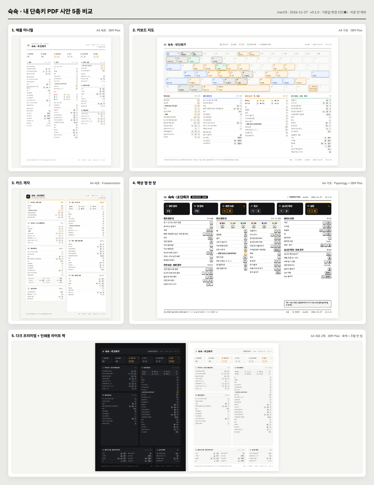

# 슉쇽 단축키 PDF 시안 5종

설정 › 단축키 화면의 **「내 단축키를 PDF로 받기」** 기능에 쓸 인쇄용 A4 시안 5가지입니다.
실제 앱 데이터(`docs/shortcuts/catalog-v1.json`, `docs/shortcuts/defaults-v1.json`)의 **macOS 기준 55개 활성 단축키**를 반영했고, 시안 검증을 위해 아래 조건을 함께 적용했습니다.

- **비운 칸 제외**: Windows 전용 `topmost`(`창 항상 위`)와 비운 예시 `delay`(`지연 캡처`)는 `combo: ""` 처리 후 출력에서 자동 제외.
- **기본값 변경 표시(●)**: 3개 슬롯(`record` → `⌥R`, `board` → `⌥B`, `d-spot` → `F`)을 기본값에서 바꾼 상태로 가정해 주황 점(`●`) 및 키캡 강조로 구분.
- **머리·바닥글**: `"슉쇽 · 내 단축키"`, `"macOS · 2026-11-27 · v0.1.0"` 고정. 사람 이름·이메일 등 개인정보 미포함.
- **벡터 출력 검증**: 5개 `sheet.pdf` 모두 Chromium `page.pdf`로 생성했으며 `pdffonts`로 `CID TrueType` 벡터 글꼴 임베드 확인(그림으로 굽지 않음).

---

## 한눈에 비교

| # | 시안 | A4 방향 · 쪽수 | 글꼴 | 핵심 특징 | 파일 |
|---|---|---|---|---|---|
| 1 | **애플 미니멀** | 세로 · 1쪽 | IBM Plex Sans KR / Mono | 흰 바탕, 넉넉한 여백, 극세선, 모드별 3열 | [template.html](./1-apple-minimal/template.html) · [sheet.pdf](./1-apple-minimal/sheet.pdf) · [preview.png](./1-apple-minimal/preview.png) |
| 2 | **키보드 지도** | 가로 · 1쪽 | IBM Plex Sans KR / Mono | Mac 키보드 벡터 지도 + 모드별 색 코딩 + 4열 목록 | [template.html](./2-keyboard-map/template.html) · [sheet.pdf](./2-keyboard-map/sheet.pdf) · [preview.png](./2-keyboard-map/preview.png) |
| 3 | **카드 격자** | 세로 · 1쪽 | Freesentation + IBM Plex Mono | 둥근 카드 + `icons.js` SVG 머리 + 2열 균형 격자 | [template.html](./3-card-grid/template.html) · [sheet.pdf](./3-card-grid/sheet.pdf) · [preview.png](./3-card-grid/preview.png) |
| 4 | **책상 옆 한 장** | 가로 · 1쪽 | Paperlogy + IBM Plex Sans KR / Mono | 큰 글자·고대비, 자주 쓰는 6개 상단 초대형 타일 | [template.html](./4-desk-reference/template.html) · [sheet.pdf](./4-desk-reference/sheet.pdf) · [preview.png](./4-desk-reference/preview.png) |
| 5 | **다크 프리미엄** | 세로 · 2쪽 | IBM Plex Sans KR / Mono | 1쪽 화면 공유용 다크 + 2쪽 인쇄용 라이트 짝 | [template.html](./5-dark-premium/template.html) · [sheet.pdf](./5-dark-premium/sheet.pdf) · [다크](./5-dark-premium/preview.png) · [라이트](./5-dark-premium/preview-light.png) |

---

## 시안별 상세 설명

### 1. 애플 미니멀 (`1-apple-minimal/`)
- **의도**: Apple 공식 단축키 참고표처럼 순백 여백과 가는 구분선, 밝은 회색 둥근 키캡으로 시각 피로를 최소화하고, 상단 6개 핵심 모드를 6등분 요약 띠로 둔 뒤 본문을 캡처·판서·확대/녹화 3열로 정갈하게 나열했습니다.
- **장점**: 어떤 프린터(흑백/컬러 레이저·잉크젯)에서도 가장 깨끗하게 인쇄되고 토너 소모가 적습니다. 정보 위계가 차분하며 앱 기본 디자인 언어(`tokens.css`)와 이질감이 없습니다.
- **단점**: 정보 밀도가 고르게 흩어져 있어, 책상 멀리서 한두 개 키만 빠르게 집어내는 용도로는 시안 4보다 눈에 덜 띌 수 있습니다.
- **글꼴**: `IBM Plex Sans KR` (400/500/600/700) + `IBM Plex Mono` (400/500/600). 저장소 내장 글꼴만 사용.
- **A4 방향**: 세로 (1쪽).

### 2. 키보드 지도 (`2-keyboard-map/`)
- **의도**: 상단에 실제 Mac ANSI 키보드 배열을 벡터로 그려 쓰이는 키를 모드 색(전역 회색 · 캡처 파랑 · 판서 주황 · 확대/녹화 초록)으로 칠하고, 두 모드 이상에서 겹쳐 쓰이는 키(`Esc`, `R`, `S`, `C`, `B`)는 우상단 색 점으로 표시했습니다. 하단 4열은 전체 범례 목록입니다.
- **장점**: "내 키보드에서 어느 영역이 어떤 모드인지" 공간 기억으로 즉시 익힐 수 있어 첫 사용자 온보딩·강의 배포용으로 뛰어납니다.
- **단점**: 사용자가 커스텀 단축키를 특이한 조합(예: `⌃⌥⇧K`)으로 바꾸면 키보드 위 짧은 라벨과 겹칠 여지가 있고, Windows JIS/한영키 등 배열 변형 대응이 추가로 필요합니다.
- **글꼴**: `IBM Plex Sans KR` + `IBM Plex Mono`.
- **A4 방향**: 가로 (1쪽).

### 3. 카드 격자 (`3-card-grid/`)
- **의도**: 앱 설정 화면(`Group` + `icons.js` 아이콘)의 친숙한 카드 UI를 A4 세로 2열 격자로 옮겼습니다. 카드 머리에 모드 SVG 아이콘을 넣고 브랜드 주황은 아이콘 점과 핵심 카드 상단 선, `●` 변경 표시에서만 절제했습니다.
- **장점**: 앱 안 설정 창·`S16 단축키 한 장` 화면과 시각 연속성이 가장 높고, 그룹별 경계가 뚜렷해 원하는 기능을 찾기 쉽습니다.
- **단점**: 2열 스택 구조상 사용자가 단축키를 많이 비우거나 그룹 길이가 달라질 때 좌우 열 높이 균형을 동적으로 맞추기 어렵습니다.
- **글꼴**: `Freesentation` (400/500/600/700, 외부 `~/Desktop/Architecture/fonts/` 참조) + 키캡 `IBM Plex Mono`. 둥글고 단정한 화면용 산세리프 인상을 비교할 수 있습니다.
- **A4 방향**: 세로 (1쪽).

### 4. 책상 옆 한 장 (`4-desk-reference/`)
- **의도**: 프린트해 키보드 옆에 놓거나 모니터 아래에 붙여 두고 팔 길이(50~60cm)에서도 바로 읽히도록 큰 글자와 두꺼운 키캡 테두리로 고대비 설계했습니다. 상단에 가장 자주 쓰는 6개(`범위 캡처`, `창 캡처`, `화면 녹화`, `판서`, `실시간 확대`, `칠판`)를 다크 히어로 타일로 키웠습니다.
- **장점**: 발표 중이나 작업 중 시선 이동 0.5초 만에 키를 읽을 수 있는 실전성이 가장 높습니다. `Paperlogy` 제목체가 인쇄물에서 강렬한 존재감을 줍니다.
- **단점**: 가로 A4 3열에 큰 글씨를 채우느라 후속 슬롯(`화면에 붙이기`, `핀 숨기기·보이기`, `타이머`) 3개는 바닥글 한 줄 요약으로 내렸습니다.
- **글꼴**: `Paperlogy` (600/700/800, 외부 `~/Desktop/Architecture/fonts/` 참조) + 본문 `IBM Plex Sans KR` + 키캡 `IBM Plex Mono`.
- **A4 방향**: 가로 (1쪽).

### 5. 다크 프리미엄 + 인쇄용 라이트 짝 (`5-dark-premium/`)
- **의도**: 태블릿·듀얼 모니터·메신저 공유용 다크 테마(1쪽)와 실제 프린터 인쇄용 라이트 테마(2쪽)를 하나의 PDF에 짝으로 묶었습니다. `tokens.css`의 `[data-theme='dark']` 흑백 팔레트에 브랜드 주황(`#FF9F0A`) 한 점만 강조했습니다.
- **장점**: 화면에서 볼 때의 고급스러움(S16 `CheatSheet` 오버레이와 100% 톤 일치)과 종이 인쇄 시 잉크 절약 두 요구를 동시에 만족합니다.
- **단점**: 2페이지 PDF이므로 사용자가 1쪽만 무심코 인쇄하면 검은 배경 토너를 많이 씁니다(앱에서 "인쇄용 1쪽 / 화면용 1쪽" 따로 받기 또는 라이트 기본 인쇄 옵션 제공으로 해결 가능).
- **글꼴**: `IBM Plex Sans KR` + `IBM Plex Mono`.
- **A4 방향**: 세로 (2쪽 — 1쪽 다크, 2쪽 라이트).

> **글꼴 라이선스 주의**: 시안 3(`Freesentation`)과 시안 4(`Paperlogy`)는 비교 테스트용으로 `~/Desktop/Architecture/fonts/`를 `file://`로만 참조했으며 저장소에 복사하지 않았습니다. 실제 앱 번들에 쓰려면 배포 전 각 글꼴의 상업적/앱 임베딩 라이선스 확인이 필요합니다. `IBM Plex Sans KR` / `IBM Plex Mono`는 이미 저장소에 포함된 SIL OFL 1.1 글꼴입니다.

---

## 앱 구현 메모

### 1. 데이터 연결 (`shortcuts.json` → 앱 이식)
- 각 `template.html`은 `window.__SHORTCUTS_DATA__ || await fetch('./shortcuts.json').then(r => r.json())` 구조로 동작합니다.
- 선택된 시안을 앱으로 옮길 때는 `InkClient.getState()`의 `state.shortcuts`, `state.platform`과 `defaults-v1.json`을 비교해 `modified: combo !== defaultCombo`를 계산한 JSON을 템플릿에 주입하면 됩니다.

### 2. PDF 생성 경로 비교: 웹뷰 인쇄 vs Rust 네이티브 PDF

| 비교 항목 | **OS 웹뷰 인쇄 API (추천)** | Rust 네이티브 PDF (`krilla` / `printpdf` / `typst`) |
|---|---|---|
| **구현 방식** | 숨김 WebView에 HTML/CSS 로드 후 macOS `WKWebView.createPDF`, Windows WebView2 `CoreWebView2.PrintToPdfAsync` 호출 | Rust 크레이트로 PDF 좌표·글꼴·선·SVG를 직접 그리거나 Typst 엔진 내장 |
| **장점** | 시안 HTML/CSS(`@page`, Grid, SVG 아이콘, `@fontsource`)를 그대로 재사용. 한글 조판·키캡 정렬 품질이 브라우저와 100% 동일. 앱 바이너리 용량 증가 0. | WebView 창 생성 오버헤드 없이 수십 ms 내 생성 가능. |
| **단점** | 비동기 WebView 렌더 대기(`document.fonts.ready`) 필요. OS별 PDF 출력 세부 옵션 차이 확인 필요. | CSS Grid·다크/라이트·키보드 일러스트·한글 줄바꿈을 Rust 코드로 다시 구현·유지보수해야 함. 바이너리 크기 증가. |
| **권장** | **1순위 채택**: 대화상자 없이 바로 파일 저장 대화(`NSSavePanel` / `IFileSaveDialog`)로 연결하는 `createPDF` / `PrintToPdfAsync` API 사용 (`window.print()`는 사용자 대화상자가 2번 뜨므로 비추천). | 웹뷰가 없는 CLI/배치 도구가 필요해질 때만 고려. |

### 3. macOS vs Windows 구현 차이 체크리스트
1. **키 표기 및 전용 슬롯**:
   - macOS: `⌥⌘⇧⌃`, `↑↓↩⇥` 수식 기호 사용. `SF Pro` / `-apple-system` 기호 폴백으로 또렷하게 렌더. 바닥글에 `fn` + `F1–F7` 안내 유지.
   - Windows: `Alt Ctrl Shift Win` 문자 키캡 사용, `Segoe UI Symbol` / `IBM Plex Mono` 조합으로 화살표(`↑↓`) 처리. `windowsOnly: true`인 `topmost`(`창 항상 위`) 슬롯 포함.
2. **웹뷰 PDF 출력 엔진 차이 (WebKit vs Blink)**:
   - **배경 인쇄**: `print-color-adjust: exact`와 `-webkit-print-color-adjust: exact`를 모두 유지해야 시안 4 히어로 타일과 시안 5 다크 페이지 배경이 빠지지 않습니다.
   - **여백 제어**: Windows WebView2 `PrintToPdfAsync`는 `CoreWebView2PrintSettings`에서 `MarginTop/Bottom/Left/Right = 0`, `ShouldPrintBackgrounds = true`, `ShouldPrintHeaderAndFooter = false`를 코드로 명시하고, macOS `WKWebView.createPDF(configuration:)`는 `rect`를 A4 포인트 크기(`595.28 × 841.89 pt` 또는 가로 `841.89 × 595.28 pt`)로 지정해야 `@page` 여백과 정확히 일치합니다.
   - **시안 2(키보드 지도)**: Windows 버전에서는 하단 1열 수식키 배열을 `Ctrl / Win / Alt / Space / Alt / Ctrl`로 분기하는 플랫폼별 키맵 테이블만 추가하면 됩니다.
