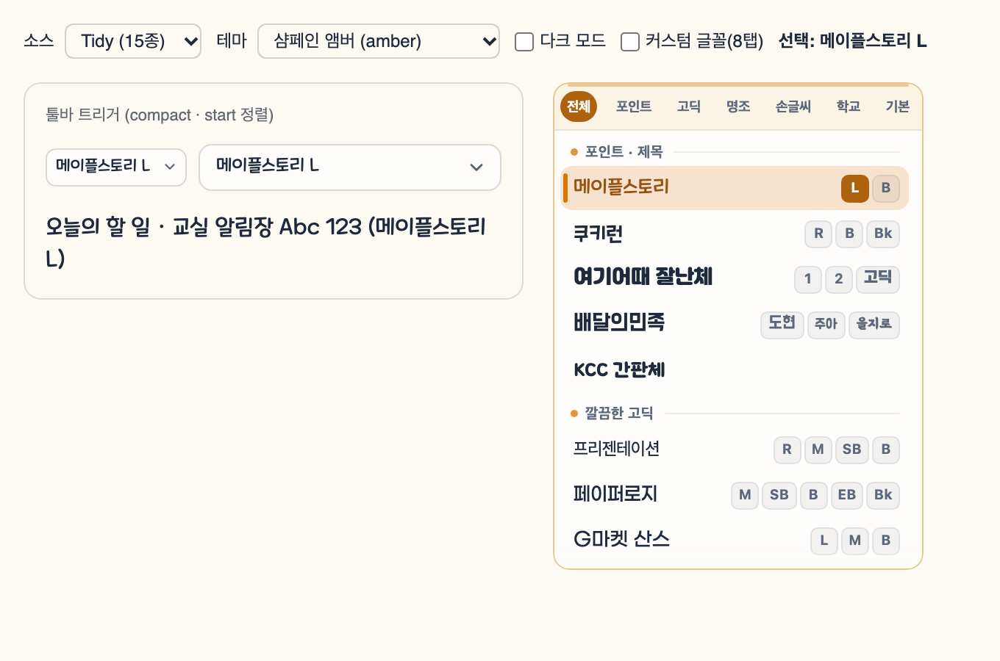
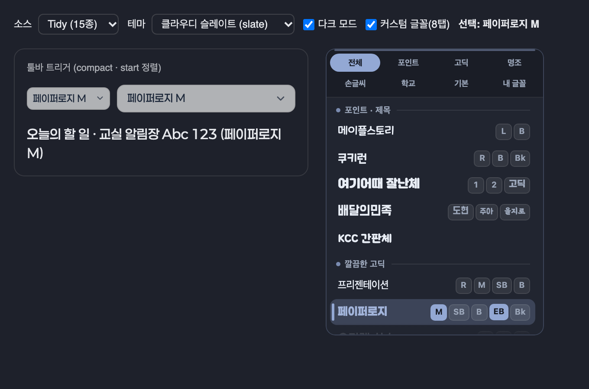
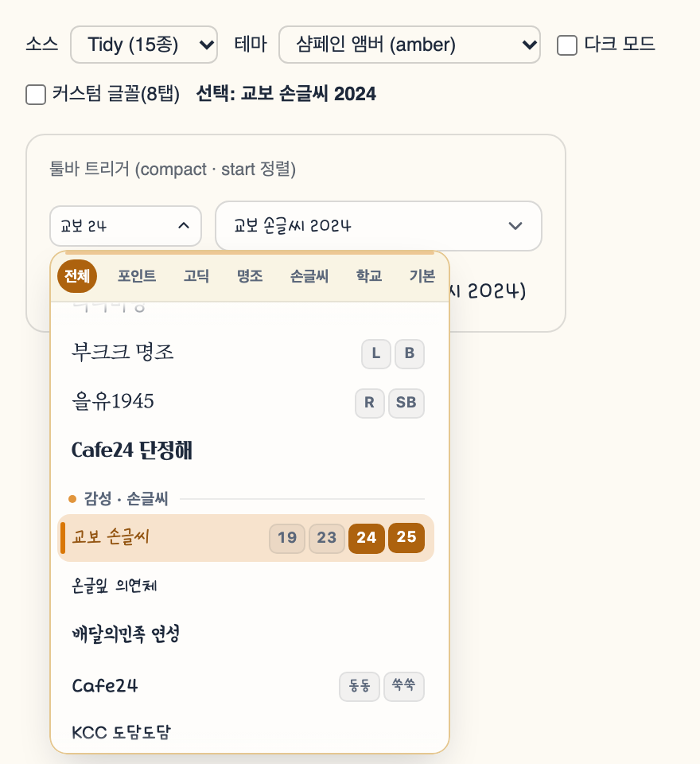
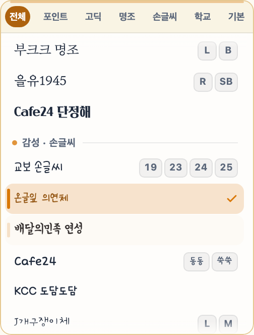

# Tidy Task 글꼴 선택기 분석 및 슉쇽(screen-ink) 텍스트 주석 글꼴 설계 초안

- 작성일: 2026-11-27
- 대상 저장소:
  - 분석(읽기): `Tidy-Task-Local`
  - 설계 적용(목표): `screen-ink` (`feat/foundation`)
- 범위: 조사 · UI/UX 분석 · 설계 초안 · 2배 해상도 참고 스크린숏(소스 코드 변경 없음)

---

## 1. 핵심 요약

### Tidy 글꼴 고르기 핵심 5줄
1. **좁은 창 탈출 + 인라인 겸용 이중 호스트**: 본창·설정에서는 `FontPickerTrigger`가 비이동(`Non-Draggable`)·무그림자(`Zero-Halo Flush Edge`) 별도 Tauri 창(`font-picker`)을 2px 간격으로 수직 밀착해 띄우고, 우클릭 메뉴(`ctx-menu`) 같은 보조 창 안에서는 `FontPickerPanel(variant="inline")`을 직접 펼쳐 이중 팝업 충돌을 피한다.
2. **72종 → 43패밀리 2단 압축(카테고리 탭 + 인라인 굵기 캡슐)**: 6카테고리(커스텀 있으면 7번째 `내 글꼴`) 미니 탭과 패밀리 행 내 굵기·시리즈 캡슐(`L·M·SB·B·EB·Bk`, `19·23·24·25`, `도현·주아·을지로`)로 묶어 검색창 없이도 252×332px 패널 안에 한눈에 수납했다.
3. **실시간 WYSIWYG 미리보기와 선택 영역 보존**: 별도 미리보기 문장 대신 각 행의 글꼴 이름 자체를 해당 서체로 렌더링하고, 칩 호버/포커스 시 해당 행만 즉시 굵기를 바꿔 보여 준다. 에디터 서식 툴바에서는 `mousedown.preventDefault()` + `saveSelection()`으로 드래그 선택을 깨뜨리지 않는다.
4. **기계적 대비 보증과 다중 모니터 정밀 배치**: `fontPickerTheme.js`가 `light-dark()`/`color-mix()` 없이 42개 테마 조합을 explicit hex/rgba로 계산해 WCAG 대비(`ink ≥ 7.0:1`, `muted/accent ≥ 4.5:1`)를 전수 테스트로 보장하고, `placeFontPicker`는 200px 이상이면 옆으로 튕기지 않고 높이만 압축해 버튼에 붙는다.
5. **부드러운 성능·복원 장치**: `app.css` 62종 `.woff2`의 `font-display: swap`, 앱 시작 1.8초 후 유휴 시간(`requestIdleCallback`) 백그라운드 창 프리워밍, 창별 `FontFace` 지연 등록(160ms 상한), 호스트 창 이동·스크롤·blur 2단계 감시로 고아 창과 잔상을 차단한다.

### 슉쇽 추천 안
- **추천: 안 가 — `AnnotateOptions` 1줄 다크 알약(`글꼴 트리거 ▾ │ 크기 슬라이더 │ 색`) + 트리거 밀착 팝오버(`264×320px`)**.
- **까닭**: 캡처 오버레이(`CaptureOverlay.svelte`)는 이미 전체 화면 창이므로 별도 OS 창 없이 **단일 창 안 DOM 팝오버**로 충분하다. 사용자가 직전 글꼴로 곧바로 타이핑하고 `Enter`로 복사하는 속도를 해치지 않으면서, 글꼴을 바꾸고 싶을 때만 Tidy의 **카테고리 탭 + 인라인 굵기 캡슐 + 좌측 주황 막대 + 실시간 호버 미리보기**를 1클릭으로 열어 쓸 수 있고, 판서(`DrawOverlay.svelte`)·설정(`DrawZoomPage.svelte`)과도 같은 `FontPickerPanel` 부품을 그대로 공유한다.

---

## 2. Tidy Task 글꼴 고르기 정밀 분석

### 2.1 미리보기 실측 스크린숏 (2x DPR)

| 라이트 테마 기본 패널 + 트리거 (amber) | 다크 테마 + 8탭(내 글꼴) + 칩 호버 프리뷰 (slate) |
|---|---|
|  |  |

| 툴바 트리거(`교보 24` 축약) → 2px 밀착 포탈 열림 | 스크롤 상·하단 페이드 및 선택 체크·행 프리뷰 |
|---|---|
|  |  |

---

### 2.2 배치 (트리거 → 패널) 및 할일 화면 부착 방식

#### 트리거 (`src/components/fontPicker/FontPickerTrigger.svelte`)
- **역할**: `role="combobox"`, `aria-haspopup="listbox"`, `aria-expanded={isOpen}`을 가진 버튼. 버튼 텍스트 자체를 `resolveFontFamilyStack(value, customFonts)`로 렌더링해 현재 서체를 바로 인지시키고, 우측 `ChevronDown` 아이콘은 열림 시 180° 회전한다.
- **3가지 `variant`**:
  - `toolbar`: 상단 서식 툴바용(`padding: 0 5px 0 6px`).
  - `toolbar-compact`: 플로팅 미니 툴바용(`padding: 0 4px 0 5px; gap: 2px`, 초축약 라벨).
  - `field`: 설정 폼 필드용(`width: 100%; padding: 0 9px 0 11px`, 아이콘 14px).
- **접두어 지능 축약 (`compactFontLabel` in `fontCatalog.js`)**:
  - 좁은 툴바에서 `학교안심 가을소풍 L`이나 `교보 손글씨 2024`가 말줄임표로 잘리지 않도록 반복 접두어만 줄인다(`settings` 등 `compact=false`에서는 원문 유지).
  - 예: `교보 손글씨 2024` → `교보 24`, `학교안심 가을소풍 L` → `가을소풍 L`, `배달의민족 을지로` → `배민 을지로`, `여기어때 잘난체 고딕` → `잘난 고딕`, `엘리스 DX 널리 M` → `엘리스 M`. `ultraCompact`에서는 `메이플스토리 L` → `메이플 L`, `프리젠테이션 R` → `프리젠 R`까지 축약한다.
- **런타임 분기**:
  - Tauri 실기(`isTauri()`): `fontPicker.open(...)` IPC로 독립 창 `font-picker`를 연다.
  - 브라우저 프리뷰(`!isTauri()`): `use:portal`로 `document.body`에 `.fp-portal-float`를 띄우고 `FontPickerPanel(variant="portal")`을 실기와 동일한 `placeFontPicker` 좌표로 배치한다.

#### 할일·메모 화면 부착 지점
`TodoList.svelte` 자체에는 글꼴 트리거가 직접 붙지 않는다(`TodoList.svelte`는 마감일 `datePicker`에만 `pickerAppearance()`로 현재 UI 글꼴·`customFonts`를 넘긴다). 대신 할일·메모 본문을 편집할 때 아래 4개 경로에서 `FontPickerTrigger` 또는 `FontPickerPanel`이 붙는다.

| 부착 위치 | 파일 | 사용 부품 · `variant` | 핵심 UX 장치 |
|---|---|---|---|
| **상단 서식 바** | `src/components/MainToolbar.svelte` | `FontPickerTrigger` (`variant="toolbar"`, `align="start"`) | `preserveEditorSelection=true` · `onbeforeopen={saveSelection}`으로 `FontSizeInput` 좌측에 나란히 배치 |
| **선택 텍스트 플로팅 바** | `src/components/FloatingRTE.svelte` | `FontPickerTrigger` (`variant="toolbar-compact"`, `w-[72px] h-[20px]`) | `fontPicker.openKey` 확인으로 글꼴 창이 열린 동안 플로팅 툴바가 자동 숨김되지 않게 가드 |
| **우클릭 서식 카드** | `src/components/context-menu/ContextFormatBar.svelte` | `FontPickerPanel` (`variant="inline"`, `maxHeight={216}`) | 별도 창(`ctx-menu`) 안에서 또 다른 OS 팝업 창을 띄우면 포커스/Z-order가 충돌하므로 카드 3줄 인라인 드로어로 펼침 |
| **설정 창 (메모·화면 글자)** | `src/components/SettingsModal.svelte` | `FontPickerTrigger` (`variant="field"`, `align="end"`) | `uiFontFieldEl` 기준으로 `holdAnchorInPlace()` 호출해 글꼴 변경으로 창 레이아웃이 흔들려도 앵커 위치 보정 |
| *(기타 공용 소비자)* | `ArchiveToolbar.svelte`, `NoticeboardApp.svelte`, `MealSettingsWindow.svelte`, `ToolkitSettings.svelte` | `FontPickerTrigger` | 급식창(`MealSettingsWindow`)은 `extraOptions: [{ value: 'follow', label: '메인 창과 동일' }]`을 상단에 추가 |

- **에디터 선택 보존 메커니즘 (`preserveEditorSelection`)**:
  - 트리거 `onpointerdown` → `onbeforeopen()`(`saveSelection()`으로 `Range` 복제).
  - 트리거 `onmousedown` → `e.preventDefault()`로 WebView2/Chromium이 `contenteditable`에서 포커스를 빼앗아 선택 영역이 풀리는 것을 차단.
  - 글꼴 선택 완료 후 `fontPickerClient.#onClosed`는 `closed.reason === 'select' && request.preserveEditorSelection`이면 트리거 버튼으로 포커스를 되돌리지 않고 `onSelect`가 에디터 선택·포커스를 복원하게 둔다(`Escape` 취소 시에만 트리거로 초점 복귀).

---

### 2.3 목록 구조 (최근 · 추천 · 묶음 · 검색 · 미리보기 글)

| 항목 | Tidy Task 구현 여부 및 세부 구조 |
|---|---|
| **묶음 (카테고리 · 패밀리)** | **핵심 구조 (`fontCatalog.js`)**. 내장 72종(62 `.woff2` + 10 시스템)을 **6개 카테고리 · 43개 패밀리 행**으로 압축:<br>① `포인트 · 제목`(탭 `포인트`, 5행) ② `깔끔한 고딕`(탭 `고딕`, 6행) ③ `단정한 명조`(탭 `명조`, 4행) ④ `감성 · 손글씨`(탭 `손글씨`, 6행) ⑤ `학교안심 꾸밈`(탭 `학교`, 12행 — 라벨에서 반복 접두어 `학교안심 ` 생략) ⑥ `시스템 기본`(탭 `기본`, 10행).<br>커스텀 글꼴이 1개 이상 있으면 7번째 섹션 `내 글꼴`(`custom`)이 동적으로 추가되고, 상단 탭 바는 기본 7탭 1줄(`flex`)에서 **8탭 4×2 그리드(`is-multi-row`)**로 자동 전환된다. |
| **인라인 굵기/시리즈 캡슐** | 패밀리 내 변형이 2개 이상이면 한 행 우측에 `.fp-wchips` 알약을 가로로 배치한다:<br>- 굵기: `L`, `M`, `SB`, `B`, `EB`, `Bk` (예: 페이퍼로지 5칩)<br>- 연도/버전: `19`, `23`, `24`, `25` (교보 손글씨), `1`, `2`, `고딕` (잘난체)<br>- 단어 칩(`isWordChip: true`): `도현`, `주아`, `을지로`, `동동`, `쑥쑥`, `고딕` — 칩 라벨 자체도 해당 서체로 표시.<br>행 본문을 클릭하면 활성 변형 또는 `defaultVariant`가 즉시 적용되고, 칩을 직접 클릭하면 해당 변형이 적용된다. |
| **특수 상단 옵션 (`extraOptions`)** | `activeCat === 'all'`일 때만 최상단 구분선 위에 표시(예: 급식창 `메인 창과 동일`). |
| **미리보기 글** | **패널 내부에 별도 샘플 문장 칸 없음**. 각 행의 글꼴 이름(`fp-name`) 자체가 해당 서체로 렌더링되는 WYSIWYG 방식이며, 다중 칩 행에서는 칩에 마우스 호버·키보드 포커스 시 해당 행 이름의 `font-family`만 실시간으로 바뀐다(`preview` state). 별도 문장 미리보기(`오늘 할 일 · Abc 123`)는 `SettingsModal`에만 있다. |
| **최근 사용 · 추천 · 검색** | **세 가지 모두 의도적으로 없음**. 72종을 43행으로 묶고 상단 7탭 1클릭 필터를 제공해 검색 입력창과 최근/추천 섹션 없이도 빠른 탐색과 단순한 키보드 동선을 유지했다. *(단, 향후 시스템 설치 글꼴 전체를 노출할 슉쇽에서는 이 한계가 그대로 드러나므로 검색·최근 추가가 필수적이다.)* |

---

### 2.4 키보드 · 스크롤

- **열기 (`FontPickerTrigger`)**:
  - `ArrowDown` / `ArrowUp` 또는 `Space`/`Enter`(`e.detail === 0`)로 열면 `viaKeyboard = true` 전달.
  - `focusAndReveal(viaKeyboard)`는 매 열기마다 `activeCat = 'all'`, `preview = null`로 초기화한 뒤 현재 선택 행(`[data-selected="true"]`)으로 스크롤하고, `viaKeyboard`이면 해당 행에 즉시 포커스한다.
  - 마우스로 연 뒤(`variant === 'window'`일 때 `rootEl` 포커스) 사용자가 `ArrowDown`/`ArrowUp`을 누르면 `focusSelectedOrFirst()`가 선택 행 또는 첫 행으로 포커스를 옮긴다.
- **탭 바 (`role="tablist"`)**:
  - `ArrowRight` / `ArrowLeft`: 7(또는 8)개 탭 순환 이동 + 즉시 필터링(`scrollTop = 0`).
  - `ArrowDown`: 목록 첫 행으로 이동.
  - 활성 카테고리를 마우스로 다시 클릭하면 `전체`로 되돌아간다(`selectCategory`).
- **목록 (`role="listbox"`)**:
  - `ArrowDown` / `ArrowUp`: 행 이동 (`preview` 초기화).
  - `Home` / `End`: 첫 행 / 마지막 행 점프.
  - `ArrowRight` / `ArrowLeft`: 다중 굵기 행에서는 `.fp-wchip` 사이를 이동하며 실시간 굵기 프리뷰(`onfocus` → `preview` 갱신). 첫 번째 칩에서 `ArrowLeft`를 누르면 행 본문으로 복귀.
  - `Enter` / `Space`: 현재 행 기본 변형 또는 포커스된 칩 즉시 선택.
  - `Escape`: 패널 닫기 + 트리거로 포커스 복귀(`returnsFocus('escape') === true`).
- **스크롤 구현 디테일 (`scrollRowIntoList`)**:
  - 브라우저 기본 `Element.scrollIntoView()`를 **의도적으로 피하고** `scrollEl.getBoundingClientRect()` 차이로 `scrollEl.scrollTop`을 직접 계산한다. 이유: `scrollIntoView`가 조상 스크롤 컨테이너까지 연쇄 스크롤해 호스트 창의 `scroll`-to-close 감시기가 오작동하는 문제를 막기 위해서다.
  - 열릴 때 선택 행은 중앙(`'center'`), 키보드 이동 시에는 최근접(`'nearest'`, 위아래 4px 여유) 정렬.
  - **시각 힌트**: `STANDARD_HEIGHT = 332px`은 탭 바(약 34px) + 약 **9.5행** 높이라 마지막 행이 반쯤 걸쳐 아래로 더 있음을 암시한다. `scrollbar-gutter: stable`, 5px 얇은 스크롤바, 상·하단 14px 그라데이션 페이드 마스크(`.fp-fade-top` / `.fp-fade-bottom`, `ResizeObserver` + `onscroll`)로 스크롤 가능 여부를 알린다.

---

### 2.5 사용자 글꼴 (파일 추가)

1. **업로드 (`SettingsModal.svelte::handleFontUpload`)**:
   - `.ttf`, `.otf` 파일을 `<input type="file" accept=".ttf,.otf">`로 선택한다.
   - `file.name`에서 확장자와 특수문자를 제거해 글꼴 이름을 만들고 비어 있으면 사전에 거부한다.
   - `Array.from(bytes)` 직렬화 시 JSON 크기가 약 3.6배 부풀어 모든 창이 멈추던 문제를 피하기 위해 `new Uint8Array(await file.arrayBuffer())` **원본 바이너리 바이트**로 `invoke('save_custom_font', bytes, { headers: { name: encodeURIComponent(file.name) } })`를 호출한다.
   - 저장 후 `emit('req-add-custom-font', { name: fontName, path: fullPath })`를 보내면 매니저가 `tidy-task-config.json`의 `customFonts`에 기록하고 모든 창에 `custom-font-added` 이벤트를 전파한다.
2. **창별 등록 (`src/lib/fonts.js::registerFontFace`)**:
   - Tauri는 창마다 독립된 웹뷰 문서(`document.fonts`)를 가지므로 한 창에서 등록한 글꼴이 다른 창에 보이지 않는다.
   - 따라서 `appState`, `FontPickerWindow`, `ContextMenu`, `DatePickerWindow`, `NoticeboardApp`, `MealApp`, `DdayControlModal`, `DdayWidget`, `ToolkitSettings` 등 각 창이 개별적으로 `new FontFace(name, \`url(\${convertFileSrc(path)})\`)` → `document.fonts.add(await face.load())`를 호출한다.
   - `FontPickerWindow.svelte`는 열릴 때마다 요청 창이 보낸 `req.customFonts`를 권위 목록으로 삼아 `watchedCustomFonts`보다 우선 적용하고, 등록은 최대 `FONT_WAIT_MS = 160ms` 상한으로 기다린다.
3. **안전장치 (`fontCatalog.js::buildFontCatalog`)**:
   - 내장 72종과 이름이 겹치거나 커스텀 내 중복된 항목은 제외하며, CSS 인젝션 문자(`" \ ; { } < >`)를 제거한다.

---

### 2.6 테마 토큰 (`src/lib/fonts/fontPickerTheme.js`)

- **42개 테마 조합 전수 계산**: Tidy 테마 15종 × 라이트/다크(30) + Toolkit 테마 6종 × 라이트/다크(12).
- **`light-dark()` / `color-mix()` 전면 금지**: 배포 빌드(lightningcss) + 인라인 `color-scheme` 조합에서 변수가 소실되던 회귀 때문에, 모든 색상을 순수 JS(`mixHex`, `parseHex`, `ensureContrast`, `contrastRatio`)로 계산해 **6자리 Hex 및 `rgba(r,g,b,a)` 18개 `--fp-*` CSS 변수**로 직렬화한다.
- **D1 에어리 포스트잇 스킨**:
  - 라이트: 배경(`surface`)은 흰색과 테마 바탕색을 `54~68%` 혼합해 글꼴 가독성을 우선하고, 테두리(`edgeSolid`)는 테마 테두리+강조색 혼합, 상단 탭 바(`catbar`)는 은은한 섹션 색조.
  - 다크: 중립 slate/종이 warm dark(`#212530` / `#24211d`)에 강조색을 `6~7%`만 섞고, 툴킷 다크 강조색은 파스텔(`#5eead4`, `#7dd3fc`, `#c4b5fd` 등)로 보정.
- **자동 WCAG 대비 보정 + 정적 검증 (`fontPickerTheme.test.js`)**:
  - `ink / surface ≥ 7.0:1`, `muted / surface ≥ 4.5:1`, `muted / catbar ≥ 4.5:1`, `accentInk / [surface, catbar, hover, selected] ≥ 4.5:1`, `onAccent / accentSolid ≥ 4.5:1`을 42개 조합 전수에 대해 자동 테스트한다.
  - IPC로 넘어온 테마 문자열은 `sanitizeFontPickerThemeStyle()`로 `--fp-*` 색상 선언만 통과시켜 외부 URL/괄호/중괄호 주입을 차단한다.
- **Zero-Halo Flush Edge**:
  - 투명 창(`transparent: true, shadow: false`)에서 OS 그림자나 반투명 외곽 헤일로가 고DPI 경계에 번지지 않도록 패널 외곽 여백을 `0px`로 두고, `::after`로 불투명 내측 1px 림(`box-shadow: inset 0 0 0 1px var(--fp-edge-solid)`)을 그린다.
  - 트리거와 맞닿는 변(`data-side="below"`이면 상단, `"above"`이면 하단)에는 1.5px 높이의 포인트 심(`.fp-root::before`)을 그려 버튼과 일체감을 준다.

---

### 2.7 창 밖 패널 (별도 창) 배치 규칙

(`fontPickerProtocol.js` · `FontPickerWindow.svelte` · `fontPickerClient.svelte.js`)

- **왜 별도 창인가**: Tidy 메모 창은 세로 최소 높이가 `210px`까지 줄어들어, 창 내부 드롭다운(`332px`)을 쓰면 창 경계 밖으로 잘렸다. 이를 해결하기 위해 비데이터 상주 숨김 창 `font-picker`를 둔다.
- **창 계약 (`FONT_PICKER_WINDOW_OPTIONS` + 정적 테스트)**:
  - `decorations: false`, `transparent: true`, `shadow: false`, `resizable: false`, `alwaysOnTop: true`, `skipTaskbar: true`, `visible: false`, `focus: false`.
  - **비이동(Non-Draggable) 엄수**: `fontCatalog.test.js`에서 `FontPickerWindow.svelte` 소스에 `windowDrag`, `startDragging`, `data-tauri-drag-region`이 들어 있지 않음을 정적 단언으로 검사한다.
- **규격 상수 (논리 px)**:
  - 너비: `STANDARD_WIDTH = 252` (내부 218px에 5칩·광폭 3칩·7탭 1줄 수납), `MAX_WIDTH = 288` (`resolvePickerWidth`: 트리거가 넓으면 1:1 맞추되 288px 상한).
  - 높이: `STANDARD_HEIGHT = 332` (탭 34px + 9.5행), `MIN_SNAP_HEIGHT = 200` (탭 34px + 5.5행).
  - 간격/여백: `ANCHOR_GAP = 2`, `EDGE_PADDING = 6`.
- **5단계 수직 밀착 배치 (`placeFontPicker`)**:
  1. **아래 정사이즈**: `availBelow ≥ 332px` → `side = 'below'`, `y = anchorBottom + 2px`.
  2. **위 정사이즈**: 아래가 부족하고 `availAbove ≥ 332px` → `side = 'above'`, `y = anchor.y - 2px - 332px`.
  3. **아래/위 중 넓은 쪽 높이 압축**: 둘 다 `332px` 미만이지만 `max(availBelow, availAbove) ≥ 200px`이면 **옆으로 튕기지 않고** 넓은 쪽(아래 우선)에 밀착시킨 채 높이만 가용 공간으로 줄여 내부 스크롤로 처리한다(기존 `placePopup`의 1px 부족 시 옆으로 튕기는 문제 해결).
  4. **우/좌**: 위아래 모두 `200px` 미만일 때만 `right` → `left`로 배치.
  5. **`overlay`**: 마지막 폴백으로 작업영역 안 클램프.
  - 가로는 `align === 'start' ? anchor.x : anchorRight - width`를 작업영역(`area.x .. areaRight - width`) 안으로 클램프한다.
- **다중 모니터 · 고DPI 보정**:
  - 호스트 창이 `win.innerPosition()` + `rect * dpr`로 **물리 px 앵커**를 보내고, `FontPickerWindow`는 모니터 목록(`getMonitorGeometries()`)에서 해당 모니터 배율(`scale`)을 찾아 계산한다.
  - 현재 창 배율과 대상 모니터 배율이 `0.01` 초과로 다르면 `applyGeometry()`가 **`setSize` → `setPosition`을 2회(2-Pass)** 실행하고, `win.show()` 직후 `verifyGeometry()`가 실제 `outerPosition`/`outerSize` 오차(`> 1px` 또는 `> 2px`)를 감지해 `PhysicalSize`/`PhysicalPosition`으로 1회 재보정한다.
- **수명주기와 고아·깜빡임 방지**:
  - **직렬 큐(`ops = createSerialQueue()`)**: 고속 재열기/닫기 경쟁 제거.
  - **2단계 `revealed` 표시/숨김**: 열기 준비 중 `revealed = false`로 숨겼다가 `show()` 직후 `true`, 닫을 때는 `revealed = false` → `await tick()` → `await nextFrame()` 후 `win.hide()`로 Windows 이전 프레임 번쩍임을 막는다.
  - **2단계 blur 확인(`BLUR_STEPS_MS = [60, 160]`)**: WebView2 자식 창 초점 튐 오작동을 걸러내기 위해 60ms·160ms 두 차례 `win.isFocused()`를 확인해 닫는다.
  - **호스트 도킹 감시(`#watchHostDocking`)**: 호스트 창 `onMoved`/`onResized`(물리 `3px` 초과 이동 시), `scroll`(열기 직후 `100ms` 관성 스크롤 유예), `visibilitychange`, 바깥 `pointerdown`, `tidy-context-menu-open`, `requester-destroyed` 시 즉시 닫아 허공에 뜬 고아 창을 0건으로 막는다.
  - **토글 유예(`TOGGLE_GRACE_MS = 450ms`)** + **ACK 재전송(`ACK_TIMEOUT_MS = 1500ms`)**: 열린 버튼 재클릭 시 닫힘과 동시에 다시 열리는 토글 깜빡임을 막고, `opened` 응답이 없으면 1회 재준비 후 재전송한다.

---

### 2.8 성능 (글꼴 미리 불러오기 및 프리워밍)

- **내장 62종 `.woff2` 지연 로딩**: `src/app.css`의 모든 `@font-face`(총 28MB, 62파일)에 `font-display: swap`을 지정해, 앱 초기 구동 시 미사용 서체까지 전부 디코딩하지 않고 패널이나 본문에서 실제로 해당 패밀리를 그릴 때만 디코딩한다.
- **유휴 시간 창 프리워밍 (`fontPicker.schedulePrewarm(1800)`)**:
  - `FontPickerTrigger` 마운트 후 `1800ms` 뒤 `window.requestIdleCallback(..., { timeout: 4500 })`로 숨긴 `font-picker` 웹뷰 창을 미리 생성해 둔다. 첫 클릭 시 웹뷰 부팅 지연을 없애 즉각 열리게 하는 핵심 장치다.
- **커스텀 글꼴 등록 타임아웃 가드**: `registerCustomFontList`는 `Promise.race([Promise.all(...), delay(160)])`로 느린 디스크에서도 팝업 표시가 `160ms` 이상 멈추지 않게 막는다.

---

## 3. 슉쇽(screen-ink) 텍스트 주석 글꼴 설계 초안

### 3.1 현행 슉쇽 구조 점검 및 설계 전제

현재 `screen-ink`의 관련 코드를 확인한 결과는 다음과 같다.
- **`packages/ink-ui/src/lib/ink/inkEngine.js` & `canvasRender.js`**:
  - `TextItem` 모델에 이미 `fontFamily: string`과 `fontSize: number`가 정의되어 있다.
  - 현재 기본값은 `DEFAULT_FONT_FAMILY = 'IBM Plex Sans KR'`, 크기는 `(this.widthPx * TEXT_SIZE_MUL) / this.view.s`(굵기 2·4·8 × 6 = 12·24·48px)로 고정된다.
  - `canvasRender.js::fontOf(fontSize, fontFamily)`는 `${fontSize}px "${fontFamily}", sans-serif`를 쓰고, `createCanvasTextMeasurer`가 캔버스로 글자 상자(`w`, `h`)를 측정한다.
  - *참고 구현 포인트*: `InkEngine.commitText()`(1159행)는 현재 `it.text === e.text && it.color === e.color`만 비교해 조기 반환하므로, 수정 시 `fontFamily`·`fontSize` 변경 비교와 `setFontFamily()` / `setFontSize()` 명령을 추가해야 한다.
- **`packages/ink-ui/src/lib/models/captureToolbar.js` & `AnnotateOptions.svelte`**:
  - `annotOptionsKind(toolId)`는 현재 `'mosaic'` 아니면 모두 `'stroke'`로 분기해, `text` 도구를 골라도 선 굵기(2·4·8px 가로선) 칩과 색 6개만 뜬다.
  - `CaptureToolbar.svelte`(높이 40px) 바깥 `4px` 간격에 `AnnotateOptions.svelte`(높이 28px)가 `placeToolOptions`로 배치된다.
- **`packages/ink-ui/src/lib/screens/CaptureOverlay.svelte` & `AnnotateLayer.svelte`**:
  - `CaptureOverlay`는 모니터 전체를 덮는 단일 오버레이 창(`ink-overlay-<id>`)이다.
  - `handleCommitRequest`는 현재 `exportAnnotation(...)`을 동기로 실행해 RGBA 바이트와 모자이크 사각형을 Rust에 넘긴다.

> [!IMPORTANT]
> **핵심 아키텍처 결정 — 슉쇽은 Tidy식 별도 OS 창(`font-picker`)을 쓰지 않는다**
> Tidy는 210px까지 작아지는 메모 창이라 OS 별도 창이 필수였지만, 슉쇽의 `CaptureOverlay`와 `DrawOverlay`는 **이미 모니터 전체를 덮는 최상위 오버레이 창**이다. 여기에 또 다른 OS 창을 띄우면 ① 오버레이/입력창 포커스 이탈 ② macOS 창 레벨·클릭 통과 경합 ③ `annotKeyRoute` Esc 2단계 해제 충돌 ④ 두 번째 웹뷰 메모리·초기화 지연이 발생한다. 따라서 **오버레이 창 내부 DOM 팝오버(Tidy의 `FontPickerPanel(variant="portal")` 패턴)** 로 구현하는 것이 두 OS에서 가장 빠르고 안전하다.

---

### 3.2 설계 안 2개 및 와이어프레임

공통 선행 계약: `annotOptionsKind('text')`를 `'stroke'`에서 분리해 **`'text'`** 로 신설하고, `AnnotateOptions.svelte`에 `kind === 'text'` 분기를 둔다.

#### 안 가: 툴바 보조 알약(`AnnotateOptions`) + 밀착 팝오버 목록 *(Tidy H3+D1 직계 이식)*

- **동작 흐름**:
  1. `CaptureToolbar`에서 `T(글자)` 도구를 고르면 툴바 바깥 `4px`에 높이 `32px` 다크 HUD 알약(`AnnotateOptions kind="text"`)이 뜬다: **`[ 글꼴 트리거 ▾ │ 크기 슬라이더 + px │ 색 6(+W/K) ]`**.
  2. 이 상태 그대로 캔버스를 클릭하면 **직전에 쓰던 글꼴·크기·색**으로 바로 입력 상자(`<textarea>`)가 열려 군더더기 없이 즉시 타이핑할 수 있다.
  3. 글꼴을 바꾸고 싶을 때만 알약 왼쪽의 **`글꼴 트리거 ▾`** 을 누르면, 트리거 바로 아래(모자라면 위, `placeFontPicker`의 수직 밀착 + 높이 압축 규칙 적용) `4px` 간격에 **`264 × 320px` 다크 반투명 유리 팝오버**가 열린다.
  4. 팝오버는 Tidy의 H3+D1 구조를 슉쇽 다크 아일랜드 토큰(`--ink-island`, `--ink-accent: #FF9F0A`, `backdrop-filter: blur`)으로 재해석한다: **상단 검색줄(시스템 폰트 대응) + 미니 탭(`전체 · 최근 · 앱 · 시스템`) + 패밀리 행 + 인라인 굵기 캡슐(`R/M/SB/B`) + 좌측 2.5px 주황 막대**.
  5. 편집 중(`editing !== null`)이거나 텍스트 선택 중일 때 행/칩에 마우스를 올리면 캔버스 위 `<textarea>` 서체가 실시간 미리보기되고, 클릭하면 즉시 적용되며 `<textarea>` 포커스가 유지된다(`onmousedown.preventDefault()`).

```text
[닫힌 상태: T 도구 선택 직후]
  ┌──────────────────────────────────────────────────────────────────────┐
  │ [□][○][↗][✎][🖍][▦][T*][⌫] │ [↶][↷] │ [✕][📌][💾][복사]              │  CaptureToolbar (h=40)
  └──────────────────────────────────────────────────────────────────────┘
                                                                    ↕ 4px
                  ┌──────────────────────────────────────────────────────┐
                  │ [ 프리젠테이션 R  ▾ ] │ Aa ━━●━━━ 24px │ ● ● ● ● ● ● ● ● │  AnnotateOptions (h=32)
                  └──────────────────────────────────────────────────────┘
                    ▲ 클릭 시 아래/위 팝오버 토글            ▲ 빨·노·초·주·파·연 + 검·흰

[열린 상태: 글꼴 트리거 클릭 시 — 4px 아래(화면 끝이면 위) 밀착 팝오버]
                  ┌──────────────────────┐
                  │ [ 프리젠테이션 R  ▴ ] │ ... (알약 유지)
                  └──────────────────────┘
                    ↕ 4px
                  ┌──────────────────────────────────────────┐ 264px
                  │ 🔍 글꼴 이름 검색...              [×]    │ ← 상단 얇은 검색줄
                  ├──────────────────────────────────────────┤
                  │ [전체]  최근   앱 글꼴   시스템          │ ← 4탭 1줄 (미니 필)
                  ├──────────────────────────────────────────┤
                  │ • 최근 사용                              │
                  │   IBM Plex Sans KR             [R] [B]   │
                  │ • 앱 기본 (한글·라틴 추천)               │
                  │ ┃ 프리젠테이션  ✓       [R] [M] [SB] [B] │ ← 2.5px 주황 막대 + 인라인 굵기 칩
                  │   페이퍼로지                [M] [B] [EB] │
                  │   리디바탕                               │
                  │   IBM Plex Mono                 [R] [M]  │
                  │ • 이 컴퓨터 글꼴                         │
                  │   Apple SD Gothic Neo   [R] [M] [SB] [B] │
                  │   맑은 고딕                     [R] [B]  │
                  │   SF Pro                        [R] [B]  │
                  │ ░░░░░░░░░░░░░░░░░░░░░░░░░░░░░░░░░░░░░░░░ │ ← 하단 스크롤 페이드
                  └──────────────────────────────────────────┘ max 320px (min 180px 수직 압축)
```

#### 안 나: 작은 별도 플로팅 인스펙터 패널 *(Text Inspector Card)*

- **동작 흐름**:
  1. `T` 도구를 고르면 툴바 옆(또는 선택 범위 우측 상단 모서리 바깥)에 `256 × 360px`짜리 작은 독립 플로팅 패널이 **항상 함께 열린다**(상단 헤더 드래그로 살짝 비켜 놓거나 접기 단추로 알약화 가능).
  2. 패널 상단 고정 영역에 **색 팔레트 8색 + 크기 슬라이더(`12~96px`)**를 두고, 중간에 검색창 + 탭, 하단에 글꼴 목록을 한 카드 안에 통합한다.
  3. 별도 2단 클릭(트리거 → 팝오버) 없이 글꼴 목록이 바로 노출되어, 여러 글꼴을 연속으로 찍어 보며 비교할 때 클릭 수가 1번 줄어든다.

```text
┌──────────────────────────────────────────────────────────────────────┐
│ [□][○][↗][✎][🖍][▦][T*][⌫] │ [↶][↷] │ [✕][📌][💾][복사]              │  CaptureToolbar (h=40)
└──────────────────────────────────────────────────────────────────────┘
                                             ↕ 6px (또는 범위 옆)
                               ┌────────────────────────────────────────┐ 256px
                               │ ⠿ 글자 모양                     [접기] │ ← 드래그 손잡이
                               ├────────────────────────────────────────┤
                               │ 색   ● ● ● ● ● ● ○ ●                   │
                               │ 크기 ━━━━●━━━━━━━  28 px               │
                               ├────────────────────────────────────────┤
                               │ 🔍 글꼴 검색...                        │
                               │ [전체]  최근   앱   시스템             │
                               ├────────────────────────────────────────┤
                               │ ┃ 프리젠테이션  ✓      [R][M][SB][B]   │
                               │   페이퍼로지              [M][B][EB]   │
                               │   리디바탕                             │
                               │   Apple SD Gothic Neo  [R][M][SB][B]   │
                               │   맑은 고딕                   [R][B]   │
                               │ ░░░░░░░░░░░░░░░░░░░░░░░░░░░░░░░░░░░░░░ │
                               └────────────────────────────────────────┘ 360px
```

#### 안 가 vs 안 나 비교 및 추천

| 비교 기준 | 안 가 (보조 알약 + 밀착 팝오버) | 안 나 (독립 플로팅 인스펙터 카드) |
|---|---|---|
| **캡처 화면 가림** | 매우 적음 (평소 32px 1줄 알약만 노출, 필요할 때만 목록 열림) | 큼 (`256×360px` 카드가 처음부터 화면/선택 영역 주변을 가림) |
| **빠른 주석 속도** | 최상 (직전 글꼴 유지 → 클릭 즉시 타이핑 → `Enter` 복사) | 보통 (패널이 시선·포인터 영역을 차지해 접기/이동 필요) |
| **다수 글꼴 비교 탐색** | 1클릭 추가 필요(단, 열린 뒤엔 칩 호버·방향키로 즉시 비교) | 0클릭 바로 보임 |
| **기존 슉쇽 배치와 일관성** | `placeToolOptions` + 다크 HUD 알약(`CaptureToolbar`·`AnnotateOptions`)과 100% 일치 | 새로운 드래그 패널·접힘 상태·범위 충돌 회피 로직 필요 |
| **구현 복잡도 · 위험** | 낮음 (드래그/접힘/충돌 회피 불필요, `Esc` 단계만 명확) | 높음 (드래그 위치 기억, 선택 범위와 겹침 처리, 작은 화면 배치) |
| **판서(`DrawOverlay`) 재사용** | 매우 높음 (판서 `Island`·미니 바에 동일 트리거+팝오버 부착) | 어색함 (판서는 상단 검은 알약 섬 중심 UI라 사이드 카드가 이질적) |

- **추천: 안 가 (보조 알약 + 밀착 팝오버)**
  1. 캡처 도구 사용자 대부분은 한 번 고른 글꼴(예: 기본 고딕)을 유지한 채 **크기·색만 바꿔가며 빠르게 주석을 달고 복사(`Enter`)** 한다. 평소에는 32px 알약 1줄로 캔버스를 넓게 열어 두고, 글꼴을 바꿀 때만 팝오버를 여는 안 가가 슉쇽의 "빠른 캡처·즉시 복사" 정체성에 맞는다.
  2. 200px 이하의 좁은 화면(노트북 하단 캡처)에서도 `placeFontPicker`의 **수직 밀착 + 높이 압축(min 180px)** 규칙을 그대로 가져오면 툴바가 범위 위·아래·안쪽 어디로 가든 깨지지 않는다.
  3. 다크 알약(`--ink-island`)과 주황 포인트(`--ink-accent: #FF9F0A`)를 그대로 써서 `CaptureToolbar` · `Island` · `AnnotateOptions` 전체 디자인 언어가 하나로 묶인다.

---

### 3.3 크기 슬라이더 · 색과의 배치 세부 설계

- **크기 제어 (`widthPx × 6` 3단 칩 → 실용적인 `px` 슬라이더)**:
  - 현재 `AnnotateOptions`는 선 굵기 3단(`2·4·8px`)만 있어 글자는 `12·24·48px` 세 단계로만 뛰고 슬라이더가 없다.
  - 안 가의 `AnnotateOptions(kind="text")`에서는 가운데 구획에 **직관적인 크기 슬라이더(`12px ~ 96px`, step `1` 또는 `2`, 기본 `24px`)** 와 고정폭 숫자 배지(`24px`, `font-variant-numeric: tabular-nums`)를 둔다.
  - **휠 연동**: 캔버스 위 `Ctrl(맥 Cmd)+휠`(`annotWheelStep`)은 현재 `changeWidth(dir)`로 `6px`씩(`TEXT_SIZE_MUL`) 조절하므로, 슬라이더 값(`editing.fontSize` / `engine.textSizePx`)과 양방향 동기화한다.
  - **초소형 화면 폴백**: 선택 범위가 아주 좁거나 모니터 폭이 작아 알약이 화면 밖으로 넘치려 하면 슬라이더 폭을 `76px → 56px`로 줄이거나 `16 / 24 / 36` 3단 칩으로 축약할 수 있다.
- **색 배치 (`ANNOT_COLORS` 6색 + `K` 검정 · `W` 흰색)**:
  - 기존 캡처 주석은 `R·Y·G·O·B·L` 6색만 노출하지만(`captureToolbar.js`), 글자는 밝은 스크린숏(문서·웹페이지) 위에 **검정(`K: #1A1A1A`)**, 어두운 화면(IDE·터미널) 위에 **흰색(`W: #FFFFFF`)** 수요가 매우 높다.
  - `inkEngine.js`의 `INK_COLORS`에는 이미 `W`·`K`가 정의되어 있으므로, `kind === 'text'`일 때는 `[R, Y, G, O, B, L, W, K]` 8색 도트(`W`는 얇은 테두리, `K`는 밝은 링)를 알약 우측에 둔다.
- **포커스 · IME 보호 (Tidy 패턴 이식 + M16 대응)**:
  - `AnnotateOptions`와 글꼴 팝오버의 모든 버튼·트리거에는 `onmousedown={(e) => e.preventDefault()}`를 걸어(단, 검색 `<input>` 제외) 글꼴·크기·색을 클릭해도 캔버스 위 `<textarea>`의 포커스와 커서가 날아가지 않게 한다.
  - 슬라이더(`<input type="range">`) 조작 중 `pointerup`/`change` 시점에 편집 중이던 `<textarea>`가 열려 있으면 자동으로 `.focus({ preventScroll: true })`를 복원한다.
  - 검색창을 클릭했을 때는 임시로 키 라우팅(`annotKeyRoute`)이 `capture`로 새지 않도록 `e.stopPropagation()`으로 감싸고, `Escape`는 팝오버만 닫은 뒤 `<textarea>`(편집 중이면) 또는 트리거로 포커스를 돌려준다.

---

### 3.4 글꼴 목록 범위 · OS 시스템 글꼴 조회 · 개인정보 주의

#### 1) 글꼴 목록 범위: 앱 번들(4~6종) + 이 컴퓨터 글꼴
`PRD-2차-고도화.md` R2-FONT-3은 앱 번들 글꼴 크기를 **+2 MB 이하**로 제한하고 있다. 따라서 Tidy처럼 62종(28MB)을 통째로 번들할 수 없으며, 역할별 대표 서체 **4~6종(SIL OFL 1.1 검증 완료)** 만 번들하고 나머지는 사용자 컴퓨터의 설치 글꼴로 채운다.

| 구분 | 포함 항목 | 역할 및 비고 |
|---|---|---|
| **앱 내장 글꼴** (SIL OFL 1.1) | ① **고딕 기본**: `Freesentation` (400/600) 또는 `Pretendard` (400/600) *(한글 11,172자 완비)*<br>② **강조/제목**: `Paperlogy` (700 Bold / 800 ExtraBold) *(초경량 160KB/종; 2,780자 밖 한글은 폴백 스택 처리)*<br>③ **명조**: `RIDIBatang` (400)<br>④ **고정폭**: `IBM Plex Mono` (400/500, 32KB) | 어떤 PC에서 열어도 동일하게 보이는 기준 서체. 2MB 예산 안에서 부분집합 또는 핵심 굵기만 번들. |
| **최근 사용** (`최대 5개`) | 로컬 설정(`settings`)에 저장한 최근 선택 패밀리명 | Tidy에 없던 기능 — 슉쇽은 시스템 폰트까지 포함해 목록이 길어지므로 상단 최근 5개 고정이 체감 속도를 크게 높인다. |
| **이 컴퓨터 글꼴** (OS 조회) | macOS CoreText / Windows DirectWrite에서 조회한 사용자 설치 글꼴 | 패밀리 단위로 묶고 굵기(`R/M/SB/B` 등)를 인라인 칩으로 통합(Tidy 방식). |

#### 2) macOS · Windows에서 시스템 글꼴 목록을 얻는 방법 (R2-OS-0 두 OS 동등)
- **브라우저 `window.queryLocalFonts()`를 쓰지 않는 이유**:
  - macOS `WKWebView`에서는 Local Font Access API가 지원되지 않고, Windows WebView2에서는 권한 프롬프트가 뜰 수 있으며, 다중 오버레이 창마다 중복 권한/조회 문제가 생긴다.
- **권장 경로: Rust Tauri 커맨드 `list_system_fonts()` (1회 스캔 + 앱 메모리 캐시)**:
  - **macOS (`crates/ink-platform-macos`)**:
    - CoreText `CTFontCollectionCreateFromAvailableFonts` (또는 `CTFontManagerCopyAvailableFontFamilyNames` + `CTFontDescriptorCopyAttribute`) 사용.
    - `kCTFontFamilyNameAttribute` (CSS `font-family`에 쓸 영문/정규 패밀리명)와 `kCTFontDisplayNameAttribute` / 지역화 이름(`ko` 로케일 우선, 예: `"Apple SD 산돌고딕 Neo"`), 그리고 패밀리 내 스타일/굵기(`CTFontWeightTrait`)를 추출한다.
    - 이름이 `.`으로 시작하는 OS 내부 숨김 폰트(`.AppleSystemUIFont`, `.SFNS*`, `LastResort`)와 이모지·심볼 전용 비트맵 폰트는 기본 목록에서 제외(또는 하단 분리)한다.
  - **Windows (`crates/ink-platform-windows`)**:
    - DirectWrite `IDWriteFactory::GetSystemFontCollection(false)` 호출 → 각 `IDWriteFontFamily`의 `GetFamilyNames()`에서 현재 언어(`ko-kr`) 및 `en-us` 이름을 읽는다(예: `"맑은 고딕"` / `"Malgun Gothic"`).
    - 각 `IDWriteFont`의 `GetWeight()`(`DWRITE_FONT_WEIGHT`)와 `GetStyle()`(Normal/Italic)을 읽어 인라인 굵기 칩(`L/R/M/SB/B/EB`)과 매핑한다.
    - *(대안 참고)*: 순수 Rust 크레이트 `fontdb`를 쓰면 크로스플랫폼 코드가 1벌로 줄지만, Windows/macOS 폰트 디렉터리 전체 파일을 열어 파싱하므로 초기 스캔이 수백 ms 더 느리고 OS 지역화 패밀리명 규칙이 네이티브 API(CoreText/DirectWrite)보다 덜 정확할 수 있다. 앱 초기 1회 비동기 호출 후 `Mutex<Option<Vec<SystemFontFamily>>>`에 캐시하고, 툴바 열기 때는 캐시만 넘긴다.

#### 3) 개인정보 주의 (`PRD-2차-고도화.md` §0 원칙 3 · R-LOG-1 · R-NET-1 준수)
설치된 글꼴 목록은 브라우저/기기 **핑거프린팅(지문 추적) 식별자**로 악용될 수 있으며, 폰트 파일 경로에는 **OS 사용자 계정 이름(`C:\Users\<이름>\AppData\Local\Microsoft\Windows\Fonts`, `/Users/<이름>/Library/Fonts`)** 이 직접 들어간다.
1. **경로 비노출**: Rust에서 프론트엔드로 폰트 파일 경로(`path`)를 넘기지 않는다. UI에는 `{ id, family, displayName, scriptGroup, weights }` 메타데이터만 전달한다.
2. **로그 · 사례 · 네트워크 금지**: 시스템 글꼴 전체 목록과 사용자가 고른 폰트 이름을 로그(`ink-store` 진단 로그), 크래시 보고, `bench/recog` 사례 JSON, 네트워크 요청에 **절대 기록·전송하지 않는다**.
3. **로컬 설정 최소화**: 설정 JSON에는 `draw.fontFamily`(기본 글꼴 1개)와 `draw.recentFonts`(최근 패밀리명 최대 5~6개 문자열)만 저장한다.
4. **PDF·배포 라이선스 분리**: 시스템 글꼴은 화면 주석과 래스터 이미지 합성에는 자유롭게 쓰되, **앱 바이너리 재배포나 PDF 폰트 임베딩에는 절대 추출·포함하지 않는다**.

---

### 3.5 저장 이미지 · 클립보드 · 핀 · PDF에 글꼴이 굽히는 방식 (캔버스 로딩 대기)

#### 1) 저장 이미지(PNG) · 클립보드 복사 · 화면 고정(핀)
현재 `CaptureOverlay.svelte::handleCommitRequest()`와 `DrawOverlay.svelte::exportImage()`는 `exportAnnotation()` / `renderDocument()`를 **동기**로 부른 뒤 바로 `getImageData`를 읽는다. 만약 사용자가 방금 고른 앱 번들 `.woff2` 글꼴이 아직 메모리에 디코딩되지 않았거나(`font-display: swap`), 캔버스에 그리기 전에 내보내기가 실행되면 **기본 폴백 글꼴(`sans-serif`)로 잘못 구워지거나 빈 글자로 내보내질 위험**이 있다.

이를 막기 위한 3단계 글꼴 보장 파이프라인:
1. **선택 즉시 프리로드 (편집 중 치수 오차 방지)**:
   - 사용자가 글꼴을 고르면 `document.fonts.load(\`\${weight} 24px "\${family}"\`, sampleText)`를 즉시 실행한다.
   - 로드가 끝나면 `engine.measureText`로 편집 중 상자 크기(`w`, `h`)를 다시 재고, `AnnotateLayer` / `DrawCanvas`를 `redraw()`한다.
2. **내보내기 직전 비동기 로딩 대기 (`ensureFontsLoaded`)**:
   - `handleCommitRequest` / `exportImage`를 `async`로 바꾸고, 그리기 전에 `items` 안에 들어 있는 `kind === 'text'` 항목들의 고유 `(fontFamily, fontWeight)` 목록만 추린다.
   - 각 항목에 대해 `document.fonts.load(\`\${weight} \${Math.round(fontSize)}px "\${safeFamily}"\`, text)` + `await document.fonts.ready`를 실행하되, 손상된 폰트로 캡처 저장이 멈추지 않도록 **`Promise.race([..., delay(500)])` 500ms 상한**을 둔다.
   - 시스템 설치 글꼴은 `document.fonts.load`가 즉시 빈 배열/완료로 반환하므로 추가 지연이 0ms다.
3. **안전한 `fontOf` 스택 및 창 간 동기화**:
   - `canvasRender.js::fontOf(fontSize, fontFamily, fontWeight = 400)`를 확장해 CSS 특수문자(`"`, `\`)를 이스케이프하고, 영문 전용 시스템 폰트나 2,780자 제한 폰트(`Paperlogy`)에서 빠진 한글이 깨지지 않도록 뒤에 앱 기본 한글 번들 폰트와 OS 한글 폰트를 폴백으로 붙인다:
     - 예: `400 24px "Paperlogy", "Freesentation", "Apple SD Gothic Neo", "Malgun Gothic", sans-serif`
   - 다중 모니터 환경에서는 `ink-overlay-0`·`ink-overlay-1`·`DrawOverlay`가 각각 별도 웹뷰이므로, **각 창이 앱 번들 `@font-face` CSS(`fonts.css`)를 공통 임포트**해야 어느 모니터에서 저장해도 동일한 글꼴이 캔버스에 구워진다.

#### 2) PDF 내보내기
슉쇽 2차 PRD(§7 `R2-PDF-3`)의 PDF 생성은 **숨은 웹뷰 창 + OS 네이티브 PDF API**(`macOS WKWebView createPDFWithConfiguration:`, `Windows WebView2 PrintToPdf`)를 쓴다.
- **단축키 표 PDF (`R2-PDF`)**: HTML 템플릿에서 SIL OFL 1.1 번들 글꼴(`Freesentation` / `Pretendard` + `IBM Plex Mono`)만 사용하고, 네이티브 PDF 호출 직전 웹뷰가 `await document.fonts.ready` + `requestAnimationFrame` 2회를 마친 뒤 신호를 보내면 벡터 글자·글꼴 임베딩으로 깔끔하게 구워진다.
- **캡처/판서 결과 PDF 저장(향후 확장 시)**: 사용자가 임의의 상용 시스템 글꼴(예: 유료 폰트, 맑은 고딕 등 임베딩 제한 폰트)로 텍스트 주석을 넣을 수 있으므로, 벡터 텍스트 그대로 PDF에 폰트를 임베딩하면 라이선스 위반이나 OS 간 줄바꿈 어긋남이 생길 수 있다. 따라서 캡처/판서 결과를 PDF로 저장할 때는 **위 1) 파이프라인으로 캔버스에 고해상도 래스터로 구워낸 PNG/비트맵을 PDF 페이지에 배치**하는 방식을 기본으로 권장한다(벡터 텍스트 PDF는 앱 내장 OFL 폰트 사용 시에만 제한 허용).

---

### 3.6 판서 글자 도구(`packages/ink-ui/src/lib/ink/`) 공용 부품 재사용성

`CaptureOverlay`의 주석 층(`AnnotateLayer.svelte`)과 `DrawOverlay`의 판서 캔버스(`DrawCanvas.svelte`)는 이미 **동일한 `InkEngine`과 `canvasRender.js`** 를 공유하고 있다. 따라서 글꼴 기능도 엔진·모델·UI 3층 모두 재사용할 수 있다.

| 계층 | 공용 부품 / 모듈 | 캡처 주석 (`CaptureOverlay`) 사용 방식 | 판서 · 칠판 (`DrawOverlay`) 사용 방식 |
|---|---|---|---|
| **엔진 (`inkEngine.js`)** | `TextItem.fontFamily`, `engine.fontFamily`, `engine.fontWeight`, `setFontFamily()`, `setTextSize()`, `setAttr` 명령, `settings['draw.fontFamily']` | 도구 선택 시 엔진 공유, `Ctrl+Z`로 글꼴/크기 변경까지 Undo/Redo | 동일 엔진 API 사용; 보관 판서(`keptInk`) JSON에도 `fontFamily` 자동 직렬화(스키마 v1 이미 필드 존재) |
| **렌더 (`canvasRender.js`)** | `fontOf()`, `drawText()`, `createCanvasTextMeasurer()`, `ensureFontsLoaded()` | `AnnotateLayer` 미리보기 및 `exportAnnotation` 시 사용 | `DrawCanvas` 1·2층 및 `renderDocument` 내보내기 시 동일 함수 사용 |
| **카탈로그 모델** | `models/fontCatalog.js` (Tidy `fontCatalog.js` 모델 이식: 앱 번들 + 시스템 + 최근 5개 + 검색 필터) | `AnnotateOptions` 팝오버 데이터 | 판서 UI 및 설정(`DrawZoomPage.svelte`)에서 동일 카탈로그 공유 |
| **UI 부품** | `FontPickerPanel.svelte` (다크 HUD 테마) + `FontPickerTrigger.svelte` | `AnnotateOptions(kind="text")` 알약 안 트리거 → 밀착 팝오버 | ① `T` 도구/편집 중 `<textarea>` 위 `8px` 거리에 뜨는 미니 서식 알약(글꼴 트리거 + 크기 + 색)<br>② 또는 상단 `Island.svelte`의 글꼴 칩 클릭 시 `FontPickerPanel` 펼침<br>③ 설정 › 판서(`DrawZoomPage.svelte`) 기본 글꼴 선택에 `FontPickerTrigger(variant="field")` 재사용 |

- **판서 재사용 시 주의점 2가지**:
  1. **확대(`view.s`) 반영**: 판서 모드는 1×~8× 확대가 있으므로 `InkEngine.openText`의 `fontSize = textSizePx / view.s`로 문서 좌표를 계산하고, 편집 `<textarea>` 위에 미니 서식 알약을 띄울 때는 `docToView` 화면 좌표 기준으로 배치한다.
  2. **한글 IME 조합 보호 (PRD M16)**: `DrawCanvas.svelte`와 `AnnotateLayer.svelte`의 `<textarea>` 모두 `oncompositionstart` / `oncompositionend` 및 `onmousedown.preventDefault()` 포커스 보호를 공통 헬퍼로 묶어 두면 캡처 주석과 판서 양쪽의 한글 조합 끊김을 함께 막을 수 있다.
