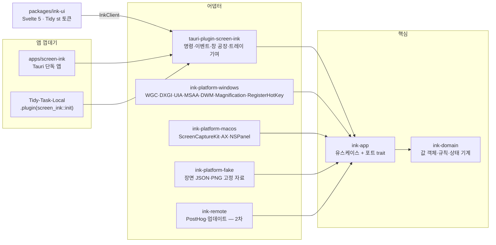
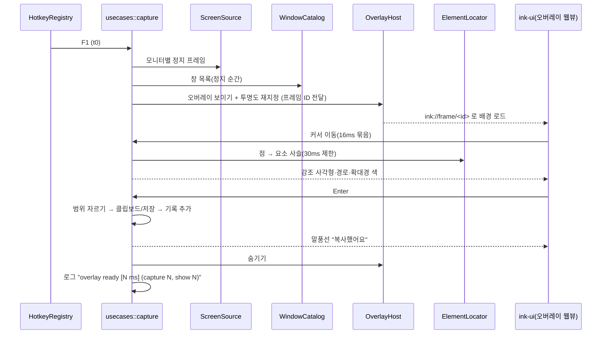

# 03. 구조 — 클린 아키텍처 · Tidy Task에 붙일 수 있게

2026-11-25 · PRD v3.0 부속 · 목표: ① 단독 앱 screen-ink로 먼저 내고 ② **코드를 고치지 않고** Tidy-Task-Local 안에 플러그인으로 넣을 수 있게 한다. 근거: Tidy 구조 조사(같은 날, `src-tauri/src/analytics.rs`·`app_update.rs`·`tray.rs`·`scores.rs`·`src/lib/windows/*` 등).

## 1. 원칙

1. **의존 방향은 안쪽으로만**: `ink-domain` ← `ink-app` ← 어댑터(`ink-platform-*`, `tauri-plugin-screen-ink`) ← 앱 껍데기(`apps/screen-ink`, 또는 Tidy). 안쪽 층은 바깥(Tauri·windows-rs·웹뷰)을 모른다.
2. **OS·네트워크는 포트(trait) 뒤에**: 캡처·요소 인식·단축키·클립보드·저장·분석·업데이트 모두 trait. 시험은 가짜 구현으로, Tidy 안에서는 Tidy가 주는 구현으로 바꿔 끼운다.
3. **화면(UI)은 얇게**: Svelte 컴포넌트는 `InkClient` 인터페이스만 부른다(Tauri `invoke` 직접 호출 금지). Tidy의 `classroom/repository.js`처럼 브라우저 미리보기용 가짜 클라이언트를 함께 둔다.
4. **Tidy 규칙을 그대로 따른다**: 한국어 "왜" 주석, 파일을 쓰는 Rust 명령은 `command(async)`, 이진 데이터는 원본 바이트 IPC, 테스트는 `node --test` + `cargo test` + `svelte-check`(Tidy `claude.md`·`package.json`).

## 2. 층과 패키지



```
screen-ink/
├─ Cargo.toml                    # cargo workspace
├─ package.json                  # npm workspaces (packages/*, apps/*)
├─ crates/
│  ├─ ink-domain/                # 순수 규칙 — 의존성: serde 정도
│  │  ├─ geometry.rs             # PhysPoint/PhysRect/MonitorLayout/DpiScale, to_logical
│  │  ├─ capture/                # Chain, LevelIntent, Snapping, Selection 상태 기계, Suggestion
│  │  ├─ ink/                    # Stroke, Tool, InkDocument, UndoStack(명령 패턴), OneEuro, Rdp, ShapeFit
│  │  ├─ zoom.rs                 # 확대 단계·고정점·가두기
│  │  ├─ shortcuts.rs            # Accelerator 파싱·정규화, 충돌 판정, 추천
│  │  ├─ naming.rs               # 파일 이름 규칙 파싱·검증·렌더
│  │  ├─ settings/               # Settings v3 스키마, 기본값, 검증, 마이그레이션(v1→v3)
│  │  ├─ recording.rs            # 녹화 세션 상태 기계
│  │  └─ telemetry.rs            # 허용 이벤트 enum과 속성 타입(보내는 코드는 없음)
│  ├─ ink-app/                   # 유스케이스 — 의존성: ink-domain
│  │  ├─ ports.rs                # trait 묶음(아래 3절)
│  │  └─ usecases/               # capture.rs, window_capture.rs, draw.rs, live_zoom.rs, record.rs, shortcuts.rs, settings.rs, history.rs
│  ├─ ink-platform-windows/      # windows-rs, xcap, windows-capture, uiautomation, global-hotkey
│  ├─ ink-platform-macos/        # screencapturekit-rs, axuielement-rs (macOS 단계)
│  ├─ ink-platform-fake/         # 시험·미리보기용
│  ├─ ink-remote/                # (2차) Tidy analytics.rs·app_update.rs 이식
│  └─ tauri-plugin-screen-ink/   # Tauri 2 플러그인: commands, events, 창 공장, 프레임 전송 프로토콜
├─ packages/
│  ├─ ink-ui/                    # Svelte 컴포넌트(오버레이·설정 페이지·말풍선), 순수 모델(js) + node --test
│  └─ ink-client/                # InkClient 인터페이스, TauriInkClient, FakeInkClient
└─ apps/
   └─ screen-ink/                # 단독 앱: src-tauri(main.rs = 플러그인 조립), src(Svelte 진입점)
```

## 3. 포트(trait)

| 포트 | 책임 | Windows 어댑터 | 가짜 | Tidy 안에서 |
|---|---|---|---|---|
| `ScreenSource` | 모니터별 정지 프레임, 창 한 장 | xcap(GDI 기본·`wgc` 기능) · windows-capture | PNG 고정 자료 | 같은 어댑터 |
| `WindowCatalog` | Z 순서 창 목록(DWM 경계·숨김·응답 없음·cloaked) | windows-rs | 장면 JSON | 같음 |
| `ElementLocator` | 점 → 요소 사슬(시간 제한) | uiautomation-rs + MSAA | 장면 JSON 트리 | 같음 |
| `MonitorProbe` | 배치·배율·변경 이벤트 | `QueryDisplayConfig`·`GetDpiForMonitor` | 고정 배치 | 같음 |
| `OverlayHost` | 모니터별 오버레이 창 만들기·보이기·숨기기·투명도 재지정·캡처 제외 | Tauri 창 + `SetWindowDisplayAffinity` | 기록만 | **Tidy 창 라벨 규칙**(`ink-overlay-<n>`)으로 만듦 |
| `Magnifier` | 실시간 확대 창·원본 사각형·필터 목록 | Magnification API | 기록만 | 같음 |
| `Recorder` | 범위·창 녹화 시작·중지·상태 | windows-capture `VideoEncoder`(MediaTranscoder) | 가짜 파일 | 같음 |
| `HotkeyRegistry` | 등록·해제·실패 원인 | tauri global-shortcut(global-hotkey) | 메모리 표 | **Tidy가 이미 쓰는 키와 함께 판정** |
| `ProcessProbe` | 실행 중인 알려진 앱(프로세스 이름만) | `CreateToolhelp32Snapshot` | 고정 목록 | 같음 |
| `WindowPinner` | 창 항상 위 고정·풀기·표시 확인·남은 표시 정리·테두리(R-TOP) | windows-rs `SetWindowPos`·`SetProp`·`SetWinEventHook` | 메모리 표 | 같음 (맥 = `Unsupported`) |
| `Clipboard` | 이미지(DIB+PNG)·텍스트·색 | tauri clipboard-manager / windows-rs | 메모리 | 같음 |
| `FileSink` | 저장 폴더·이름 규칙 적용·중복 처리 | std::fs + 원자적 쓰기 | 임시 폴더 | 같음 |
| `SettingsStore` | 설정 읽기·쓰기(schemaVersion·revision·백업) | JSON 원자적 쓰기(Tidy `scores.rs` 방식) | 메모리 | **Tidy 저장 파일의 `screen-ink` 구역** |
| `HistoryStore` | 범위 기록(사각형만) | JSON | 메모리 | Tidy 구역 |
| `Notifier` | 말풍선·트레이 알림 | 말풍선 창 이벤트 | 기록만 | Tidy 알림 말씨 공유 |
| `Clock` | 시간 | 시스템 | 고정 시계 | 같음 |
| `Telemetry` | 허용 이벤트 보내기 | (1차) `Noop` / (2차) `ink-remote` | 기록만 | **Tidy `analytics.rs` 엔진** |
| `Updater` | 새 버전 확인·받기·설치 | (1차) `Noop` / (2차) tauri-plugin-updater | 고정 응답 | **Tidy 업데이터가 담당**(screen-ink는 저장 응답만) |
| `SystemEvents` | 잠금·절전·보안 데스크톱·디스플레이 변경 | WTS·전원·`OpenInputDesktop` | 수동 발생 | 같음 |

유스케이스는 포트 묶음 `Ports`를 받아 동작하며 상태는 `AppState`(모드 상태 기계 하나)에 둔다:

```
Idle ─F1→ RegionCapture{Hovering|Dragging|Selected} ─확정/취소→ Idle
Idle ─F2→ WindowPick ─클릭→ Idle
Idle ─F3→ RecordPick → Recording ─F3→ Finalizing → Idle
Idle ─Alt+1→ Draw{Pen|Pan|Text|Select} ─Esc→ Idle(보관)
Idle ─Alt+2→ LiveZoom ─Alt+1→ Draw   ─Esc→ Idle
Idle ─Alt+3→ Board(Draw의 배경만 다름)
(Recording 중에는 Draw·LiveZoom 진입 가능 — 녹화 위에 겹침)
```

한 번에 한 모드만 받는다(Recording은 예외로 겹칠 수 있음). 모드 중 같은 단축키 = 그 모드 끝, 다른 모드 키 = 지금 모드를 끝내고 전환.

## 4. 흐름 예시 — F1 범위 캡처



**프레임 전송**: 정지 이미지는 base64로 보내지 않는다. 플러그인이 `ink://frame/<id>` 사용자 URI 프로토콜로 메모리의 BGRA/PNG 바이트를 바로 내준다(Tidy의 "원본 바이트 IPC" 규칙). 프레임은 모드가 끝나면 즉시 버린다.

**정지 화면은 네이티브 창이 그린다(단계 2 실측으로 결정, 2026-11-25)**: 웹뷰로 1080p BMP를 넘기면 사용자 프로토콜에서 한 장 ~160 ms가 들어 진입 p50이 258 ms였다. 그래서 Windows는 모니터마다 네이티브 팝업(`ink-platform-windows::freeze`)이 캡처한 BGRA를 `SetDIBitsToDevice`로 바로 그린다 — 처음부터 **50% 어둡게**, 강조 사각형만 원본으로 밝게 뚫는다(강조 이동 = 바뀐 두 사각형만 다시 그림). 웹뷰 오버레이(`ink-overlay-<n>`)는 그 위 투명 층으로 테두리·꺾쇠·확대경·크기만 그리고, 이미지는 확대경용으로 첫 그림 뒤에 늦게 읽는다(`OverlaySession.nativeFrame`). 오버레이 창의 보이기·숨기기는 Win32로 직접 해 WebView2 렌더러를 깨워 둔다. 결과(학교 PC, 1080p×2, n=100): **p50 60 · p95 69 ms**([bench/results/2026-11-25-m1-overlay.md](../../bench/results/2026-11-25-m1-overlay.md)). 맥은 같은 계약으로 `nativeFrame=false`(웹뷰가 이미지 + 어둡게)부터 시작한다.

**스레드**: 단축키 메시지 루프 · UIA 전용 COM 스레드 · 캡처 작업 · 녹화(프레임 풀+인코더) · 웹뷰(UI). 유스케이스는 tokio 위에서 돌고 포트 호출은 시간 제한을 둔다.

## 5. UI 층 (packages/ink-ui)

- **디자인 토큰**: Tidy `SettingsModal.svelte`의 `--st-*` 변수(밝은·다크 두 벌)와 `themes.js`의 테마 15종을 그대로 쓴다. 단독 앱은 사본을 두고, Tidy 안에서는 Tidy의 것을 넘겨받는다(`themeId`, `isDarkMode`).
- **부품 재사용**: 설정 페이지는 Tidy의 `SettingsPanel`·`SettingsSection`·`SwitchRow`·`IconBubble`·`ThemeSwatches`와 같은 모양·이름으로 만든다(Tidy에 붙일 때 Tidy 부품으로 바꿔 끼우면 됨). 말풍선은 `UndoToast` 말씨(점무늬·딱지 받침·남은 시간 실선), 시간 규칙은 `undoToastModel.js`를 옮겨 쓴다.
- **화면**: `CaptureOverlay`(마스크·선택 테두리·크기 배지·경로 말풍선·확대경·결과 알약), `DrawCanvas`(획 엔진은 순수 JS 모듈 `inkEngine.js` + 렌더러), `ModeBubble`, `ZoomBadge`, `RecordPill`, `CheatSheet`, `ShortcutTable`, `NamingField`. 시안: [04-screens](04-screens.md).
- **설정 적용 방식**: Tidy처럼 탭에 "적용 전 변경" 점 + 아래 줄 [취소]·[적용]·[완료]. 설정 창은 저장소에 직접 쓰지 않고 `InkClient.applySettings(patch)`만 부른다.

## 6. Tidy에 붙이는 방법 (2차, 코드 변경 없이 설정만)

```rust
// Tidy-Task-Local/src-tauri/src/lib.rs
.plugin(tauri_plugin_screen_ink::Builder::new()
    .host(TidyHost::new())          // Telemetry=Tidy analytics, Updater=Tidy 업데이터, SettingsStore=Tidy 구역
    .label_prefix("ink-")           // 창 라벨
    .tray(ContributeTo::TidyTray)   // Tidy 트레이 메뉴에 "screen-ink" 하위 메뉴 추가
    .build())
```

Tidy 쪽에서 함께 고칠 지점(Tidy 조사로 확인):

| Tidy 지점 | 할 일 | 근거 |
|---|---|---|
| `tray.rs` `TRANSIENT_LABELS` | `ink-overlay-*`, `ink-bubble`을 넣는다 — 빠지면 "좌표 초기화"가 빈 투명 창을 띄움 | `tray.rs:40` |
| `lib.rs` 작업 창 판정 | screen-ink 창은 "작업 창"으로 세지 않되, 녹화 중에는 앱이 꺼지지 않게 | `lib.rs:376` |
| `app_update.rs` 저장 확인 | 녹화·판서 중이면 `update_prepare_ack`를 미룸(설치가 녹화를 끊지 않게) | `app_update.rs:155` |
| `analytics.rs` `window_kind` | `ink-*` 라벨을 `screen_ink`로 분류, 허용 이벤트 표에 screen-ink 이벤트 추가 | `AGENTS.md:11` |
| `factory_reset.rs` | screen-ink 구역은 앱 데이터 폴더 안이라 자동 포함(확인만) | `claude.md:162` |
| `capabilities/default.json` | 플러그인 권한(`screen-ink:default`) 추가 | — |
| Tidy 툴킷 | "캡처"·"판서" 버튼 → `InkClient.start('region'|'draw')`(R-CLI-1과 같은 문) | — |

## 7. 시험 전략

| 층 | 도구 | 무엇을 |
|---|---|---|
| ink-domain | `cargo test` | [02-smart-logic](02-smart-logic.md) 8절 목록 전부(순수 함수) |
| ink-app | `cargo test` + `ink-platform-fake` | 유스케이스 흐름: F1 확정→클립보드+기록, 단축키 트랜잭션 롤백, 설정 마이그레이션, 녹화 중 잠금 → 저장 |
| ink-ui | `node --test`(순수 모델) · `svelte-check` | inkEngine, 단축키 문자열, 이름 규칙 미리보기, 말풍선 시간 규칙 |
| 화면 | 시안 자동 조작 시험(`docs/mockups/qa.ps1`) → 구현 뒤에는 같은 시나리오를 `FakeInkClient`로 띄운 ink-ui에 | 키·휠·클릭 동작 |
| 플랫폼 | 수동 + 벤치(`bench/`) | M1~M9, 시나리오 카드 S1~S15, 혼합 배율 |
| 릴리스 | 체크리스트 | R-NET-2(네트워크 0), R-LOG-1(창 제목 0건), 표준 사용자 실행 |

## 8. 의존성 (1차)

Rust: `tauri` 2.10 · `tauri-plugin-global-shortcut` · `tauri-plugin-single-instance` · `tauri-plugin-autostart` · `tauri-plugin-clipboard-manager` · `windows` 0.62 · `xcap` 0.9 · `windows-capture` 2 · `uiautomation` 0.25 · `serde`·`serde_json` · `tokio` · (시험) `insta`.
JS: `svelte` 5 · `vite` · `tailwindcss` 4 · `@tauri-apps/api` 2 · `lucide-svelte` · (Tidy와 같은 판). `perfect-freehand`는 측정으로 채택 결정(R-DRAW-6).
**쓰지 않는 것**(1차): `reqwest`·`tauri-plugin-updater`·`tauri-plugin-store`(설정은 Rust 원자적 JSON) — R-NET-2 검사 대상.
