# 04. 화면 명세 — 최종 디자인(그래파이트 + 다크 아일랜드)

2026-11-25 · PRD v3.0 부속 · **확정 디자인**: 라이트 = E 그래파이트, 다크 = B 아일랜드, 강조 = 주황 하나(사용자 결정, 2026-11-25). 토큰·아이콘·부품 규칙은 [10-design-system](10-design-system.md), 고른 과정은 [09-design-directions](09-design-directions.md).

- **최종 시안**: 캔버스 "최종 — 그래파이트 + 다크" 페이지 https://claude.ai/artifact/1WMRkEX8nkA8tUkUwjhWFm (비공개) · 원본 [docs/mockups/v3/](../mockups/v3/) · 이미지 [docs/mockups/v3/png/](../mockups/v3/png/) · 모아보기 [contact.png](../mockups/v3/png/contact.png)
- **동작 시험용 옛 시안**: [screen-ink-mockups.html](../mockups/screen-ink-mockups.html)(v1 디자인, 자동 조작 시험 56개). 동작은 아래 명세가 우선하고, 모양은 v3 이미지가 우선한다.
- 모든 화면이 지키는 것: 한 화면 초점 하나 · 인덱스 제목 아래 묶음 목록 · 라벨 한 줄 · 강조 주황 하나 · 화면 위 안내는 **섬**(검은 알약) 하나 · 설정은 **바로 반영**.

## 화면 목록

| # | 화면 | 그림 | 테마 | 주요 요구사항 |
|---|---|---|---|---|
| S01 | 트레이 팝오버 | [F03](../mockups/v3/png/F03-tray.png) | 라이트·다크 | R-SET-0, R-KEY-3 |
| S02 | 설정 · 단축키 | [F04](../mockups/v3/png/F04-keys.png) | 라이트 | R-KEY-2·3·5 |
| S03 | 설정 · 캡처·녹화 | [F05](../mockups/v3/png/F05-capture-set.png) | 다크 | R-CAP-7·12·15, R-OUT-1~3, R-REC-3 |
| S04 | 설정 · 판서·확대 | [F06](../mockups/v3/png/F06-draw-set.png) | 라이트 | R-DRAW-6·9·10, R-ZOOM-6 |
| S05 | 설정 · 일반 | [F07](../mockups/v3/png/F07-general.png) | 다크 | R-SET-1, R-UI-2, R-TOP-2·3 |
| S06 | 첫 실행 | [F08](../mockups/v3/png/F08-first.png) | 다크 | R-FIRST-1, R-KEY-2 |
| S07 | F1 범위 고르기 | [F09](../mockups/v3/png/F09-pick.png) | 섬 | R-CAP-1~6·17~21 |
| S08 | F1 결과 | [F10](../mockups/v3/png/F10-done.png) | 섬 | R-CAP-7·14·26 |
| S09 | F1 드래그 · 자석 | (S07 체계) | 섬 | R-CAP-6·18 |
| S10 | F2 창 캡처 | [F11](../mockups/v3/png/F11-window.png) | 섬 | R-WIN-1~3 |
| S11 | F3 녹화 중 | [F12](../mockups/v3/png/F12-record.png) | 섬 | R-REC-1~3 |
| S12 | Alt+1 판서 | [F13](../mockups/v3/png/F13-draw.png) | 섬 | R-DRAW-0~5 |
| S13 | Alt+2 실시간 확대 | [F14](../mockups/v3/png/F14-zoom.png) | 섬 | R-ZOOM-1~6 |
| S14 | Alt+3 칠판 | [F15](../mockups/v3/png/F15-board.png) | 섬 | R-BOARD-1·2 |
| S15 | 창 항상 위 고정 | [F16](../mockups/v3/png/F16-pin.png) | 섬 | R-TOP-1~4 |
| S16 | 단축키 한 장(?) | [F17](../mockups/v3/png/F17-cheat.png) | 다크 | R-FIRST-1 |
| S17 | 섬 상태 모음 | [F18](../mockups/v3/png/F18-island.png) | 섬 | R-UI-1·5 |
| — | 아이콘 체계 · 토큰·부품 | [F01](../mockups/v3/png/F01-icons.png) · [F02](../mockups/v3/png/F02-tokens.png) | — | R-UI-2~4 |

---

## S01 트레이 팝오버

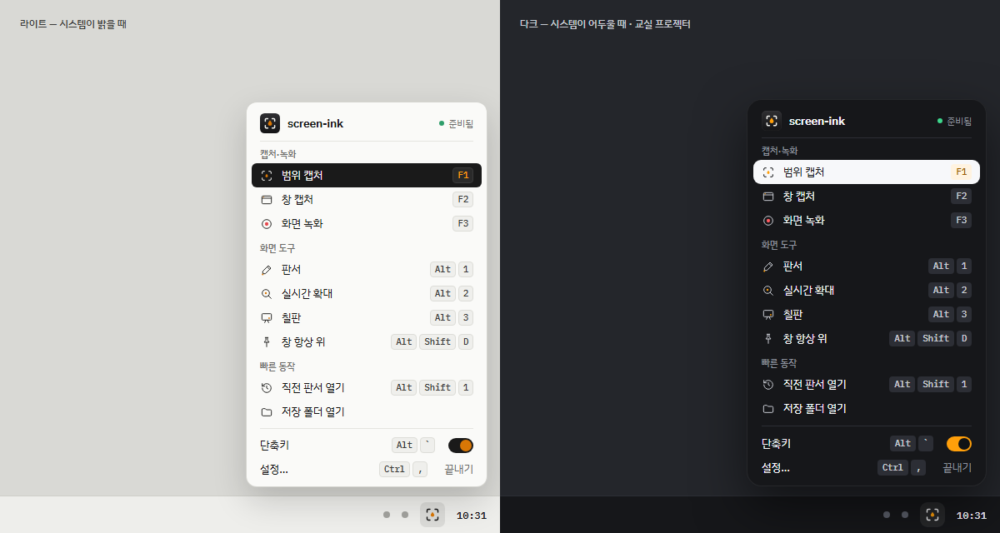

| 항목 | 명세 |
|---|---|
| 열기 · 닫기 | 트레이 아이콘 왼쪽 클릭 = 열기/닫기. 오른쪽 클릭도 같은 팝오버(Windows 관례). 바깥 클릭·Esc·항목 실행 = 닫기. 위치는 트레이 아이콘 기준(작업 표시줄 위치·모니터 배율 자동, `tauri-plugin-positioner`) |
| 구역 | 머리(앱 아이콘 · screen-ink · 상태 점) / **캡처·녹화** 3 / **화면 도구** 4 / **빠른 동작** 2 / 바닥(단축키 스위치 · 설정… · 끝내기). 항목 9개, 폭 288 |
| 상태 점 | 준비됨(초록) · 단축키 꺼짐(빈 원, 회색) · 녹화 중(빨강, 문구 "녹화 중 00:42") · 겹침 있음(주황, 문구 "키 2개 겹침" → 누르면 S02) |
| 행 | 아이콘 16 + 라벨 + 오른쪽 키캡. 올림 = 옅은 면, 키보드 포커스 = 반전(라이트 검정 / 다크 흰색) + 키캡 주황. 단축키가 꺼져 있으면 키캡만 흐림(실행은 됨) |
| 상황 따라 바뀌는 줄 | 녹화 중이면 "화면 녹화" 줄이 "녹화 중지"로 · 고정한 창이 있으면 "창 항상 위" 오른쪽에 개수(2)와 [모두 풀기] · 맥에서는 창 항상 위 줄 없음 |
| 키보드 | ↑↓ 이동 · Enter 실행 · 첫 글자 점프 없음(한글 IME 충돌 방지) |
| 움직임 | 열기 140 ms(투명도 + 0.98→1, 아래에서 4px), 닫기 100 ms. 줄임 모드 = 투명도만 |
| 다크 | 시스템 다크면 B 아일랜드 피부: 모서리 18, 행 9, 흰 반전 선택 |

## S02 설정 · 단축키

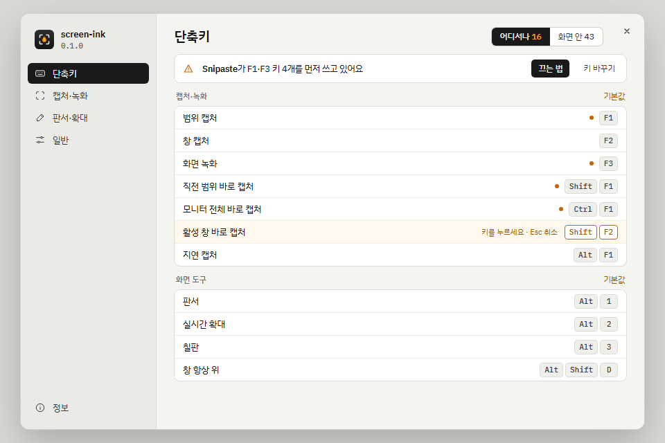

| 항목 | 명세 |
|---|---|
| 창 | 900×600, 크기 고정, 화면 가운데. 사이드바 196: 단축키 · 캡처·녹화 · 판서·확대 · 일반 · (아래) 정보. 닫기 = 오른쪽 위 ✕ 또는 Esc(키 입력 중이 아닐 때) |
| 나눔 | [어디서나 16 \| 화면 안 43]. 화면 안은 캡처 11 · 판서 29 · 확대 3 묶음 |
| 묶음 | 캡처·녹화 7 · 화면 도구 4 · 빠른 동작 3(직전 판서 · 단축키 켜기·끄기 · 핀 등 후속은 "후속" 딱지) — 묶음 제목 오른쪽 [기본값] |
| 겹침 알림 | 맨 위 한 줄: "Snipaste가 F1·F3 키 4개를 먼저 쓰고 있어요" [끄는 법] [키 바꾸기]. 해당 줄(F1 · F3 · Shift F1 · Ctrl F1)은 주황 점(`--ink-attn`). 원인이 대체 앱 하나면 [끄는 법]이 첫 단추(R-KEY-5) |
| 키 바꾸기 | 줄 클릭 → 줄이 옅은 주황, 키캡 주황 테두리, "키를 누르세요 · Esc 취소" → 조합을 누르는 순간 **등록 시도**: 성공 = 바로 저장·섬 "Shift F2로 바꿨어요 [되돌리기]", 실패 = 옛 키 유지 + 줄 아래 이유 + 추천 키 3개(줄마다 다르게) |
| 비우기 | 키 입력 중 Backspace → 비움("트레이 메뉴로 시작할 수 있어요") |
| 판정 | 입력표와 같은 `shortcuts::analyze`: 막힘 = 등록 안 함 + 이유 / 주의 = 등록하되 이유 한 줄(예: "워드 서식 보기가 막혀요") |
| 되돌리기 | 설정 창 안 Ctrl+Z = 마지막 변경 되돌리기(이번에 연 동안의 변경 기록) |
| 맥 | 같은 자리 키(Ctrl→⌘, Alt→⌥) 표시, 창 항상 위 줄 숨김 |

## S03 설정 · 캡처·녹화 (다크로 그림)

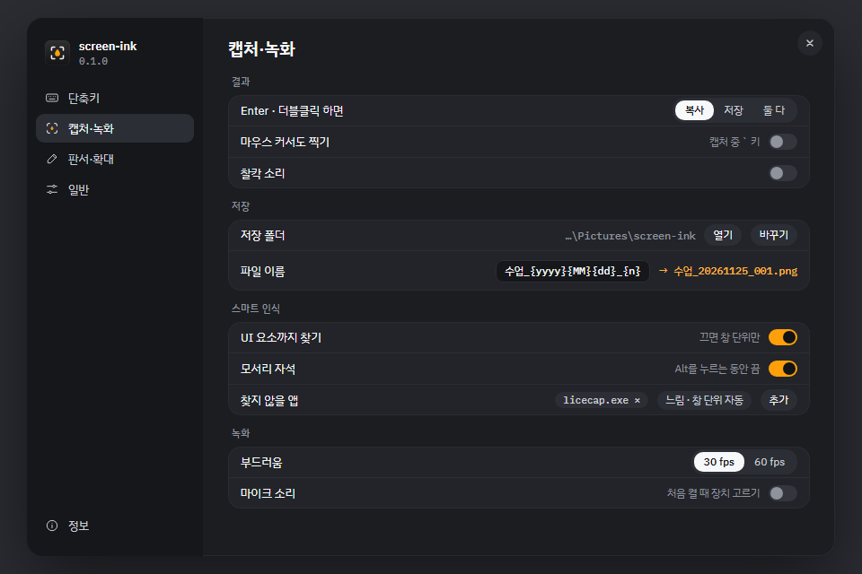

| 묶음 | 줄 | 값 · 규칙 |
|---|---|---|
| 결과 | Enter · 더블클릭 하면 | [복사 \| 저장 \| 둘 다], 기본 복사 |
| | 마우스 커서도 찍기 | 끔 · 캡처 중 `` ` `` 키로 그때그때 |
| | 찰칵 소리 | 끔 |
| 저장 | 저장 폴더 | 경로(고정폭, 앞을 줄임) [열기] [바꾸기] — 사라지면 사진 폴더로 + 섬 안내 |
| | 파일 이름 | 토큰 칸 + 오른쪽에 실시간 결과(주황). 금지 글자 = 칸 빨간 테두리 + "\\ / : * ? \" < > \| 는 쓸 수 없어요" |
| 스마트 인식 | UI 요소까지 찾기 | 켬 · 끄면 창 단위만 |
| | 모서리 자석 | 켬 · Alt 누르는 동안 끔 |
| | 찾지 않을 앱 | 칩(exe 이름 ×) + 자동 추가 칩("느림 · 창 단위 자동") + [추가] |
| 녹화 | 부드러움 | [30 fps \| 60 fps] |
| | 마이크 소리 | 끔 · 처음 켤 때 장치 고르기 시트 |
| (아래) | 캡처 기록 | 개수 0~50, [기록 지우기] → 섬 "기록 20개를 지웠어요 [되돌리기]"(6초) |

## S04 설정 · 판서·확대

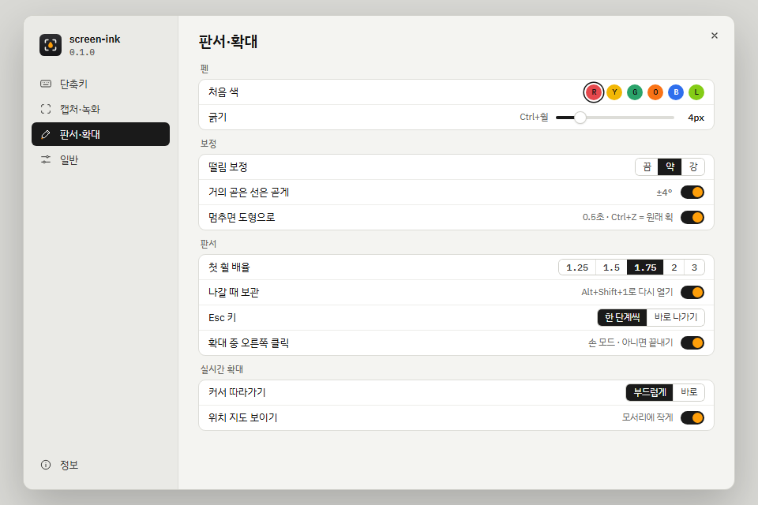

| 묶음 | 줄 | 값 · 규칙 |
|---|---|---|
| 펜 | 처음 색 | 색 동그라미 6개 + 글자 키(R Y G O B L), 고른 것 = 검은 고리 |
| | 굵기 | 슬라이더 1~30 + 고정폭 값 `4px` · 판서 중 Ctrl+휠 |
| 보정 | 떨림 보정 | [끔 \| 약 \| 강] 기본 약 |
| | 거의 곧은 선은 곧게 | 켬 · `±4°` |
| | 멈추면 도형으로 | 켬 · 0.5초 · Ctrl+Z = 원래 획 |
| 판서 | 첫 휠 배율 | [1.25 \| 1.5 \| 1.75 \| 2 \| 3] 기본 1.75 |
| | 나갈 때 보관 | 켬 · Alt+Shift+1로 다시 열기 |
| | Esc 키 | [한 단계씩 \| 바로 나가기] |
| | 확대 중 오른쪽 클릭 | 켬 = 손 모드, 확대 안 했으면 끝내기(스마트 우클릭) |
| 실시간 확대 | 커서 따라가기 | [부드럽게 \| 바로] |
| | 위치 지도 보이기 | 켬 — 오른쪽 아래 작은 지도(R-ZOOM-6) |

## S05 설정 · 일반 (다크로 그림)

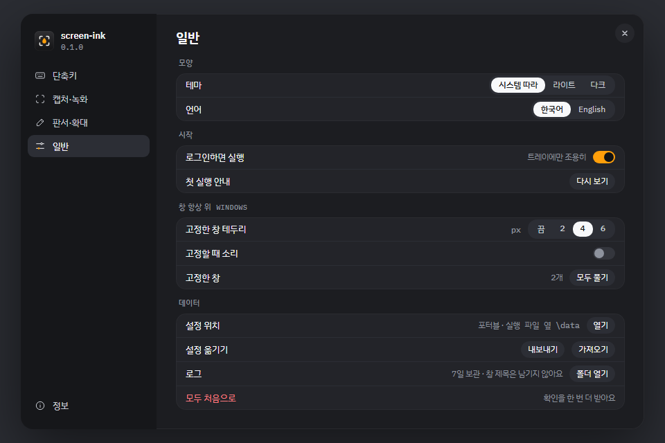

| 묶음 | 줄 | 값 · 규칙 |
|---|---|---|
| 모양 | 테마 | [시스템 따라 \| 라이트 \| 다크] 기본 시스템 — 라이트 = 그래파이트, 다크 = 아일랜드 |
| | 언어 | [한국어 \| English] |
| 시작 | 로그인하면 실행 | 켬 |
| | 첫 실행 안내 | [다시 보기] |
| 창 항상 위(Windows) | 고정한 창 테두리 | [끔 \| 2 \| 4 \| 6 px] 기본 4, 주황 |
| | 고정할 때 소리 | 끔 |
| | 고정한 창 | 개수 + [모두 풀기] |
| 데이터 | 설정 위치 | 포터블 / 설치 + [열기] |
| | 설정 옮기기 | [내보내기] [가져오기] — 가져오면 바뀌는 항목 수를 시트로 보여 주고 확인 뒤 반영 |
| | 로그 | "7일 보관 · 창 제목은 남기지 않아요" [폴더 열기] |
| | 모두 처음으로 | 빨간 글자 → 확인 시트(두 번째 단추 3초 뒤 활성) |
| 정보(사이드바 아래) | | 버전 · 오픈소스 고지 · 2차 "연결"(통계·업데이트) 자리 — 1차는 잠김 |

## S06 첫 실행

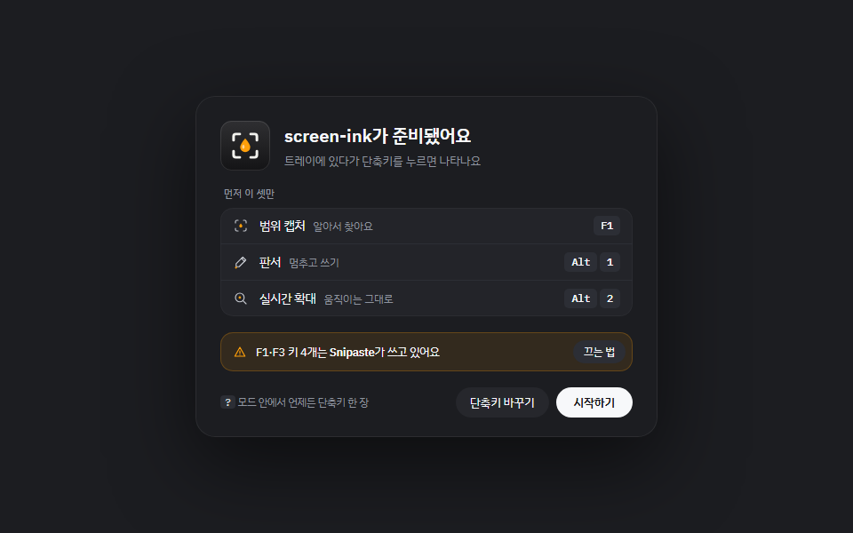

| 항목 | 명세 |
|---|---|
| 언제 | 설치 뒤 처음 한 번(설정 `onboarding.done`). 일반 > 첫 실행 안내 [다시 보기] |
| 구성 | 앱 아이콘(64, 잉크 방울 빛) · "screen-ink가 준비됐어요" · 한 줄 설명 / **먼저 이 셋만**: F1 · Alt+1 · Alt+2 / 겹침 한 줄(있을 때만) / `?` 안내 · [단축키 바꾸기] [시작하기] |
| 겹침 | R-KEY-2 결과를 그대로. 대체 앱이면 [끄는 법], PowerToys 항상 위면 "PowerToys에서 '항상 위'를 끄면 Alt+Shift+D를 써요" |
| F키 안내 | 겹침 줄이 없을 때 그 자리에 "F1·F2·F3을 쓰는 동안 다른 앱의 도움말·이름 바꾸기·찾기가 막혀요"(1회) |
| 닫기 | [시작하기] · Esc · 바깥 클릭 = 완료 처리 |

## S07 F1 범위 고르기

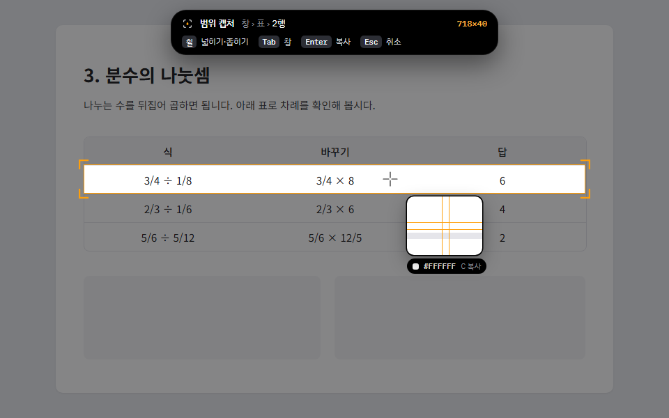

| 항목 | 명세 |
|---|---|
| 진입 | F1 → 정지 스냅숏(이미지 + 창 목록 + 모니터) → 모니터별 오버레이에 깔고 바깥을 50% 어둡게. 진입 p50 ≤ 80 ms(R-CAP-2) — 실측 p50 60 · p95 69 ms(n=100) |
| 기본값 | **커서가 있는 모니터 전체(작업 표시줄 포함)가 처음 강조** → F1 + Enter = 그 화면 전체. 커서를 움직이면 요소·창 인식이 이어받음(2026-11-25 확정) |
| 강조 | 고른 조각만 밝게 + 주황 1.5px 테두리 + 네 귀 꺾쇠(2.5px). 모서리 둥근 요소도 사각 테두리 |
| 섬(위 가운데) | 1줄: 범위 아이콘 · **범위 캡처** · 경로 `창 › 표 › 2행`(지금 단계 흰색) · 크기 `718×40`(주황, 물리 px) / 2줄 키 안내(`휠` 넓히기·좁히기 · `Tab` 창 · `Enter` 복사 · `Esc` 취소)는 **처음 3번과 `?`를 누를 때만** — 그 뒤엔 한 줄(그림은 처음 상태) |
| 확대경 | 커서 오른쪽 아래(화면 밖이면 반대쪽), 108×84, 9배 격자, 가운데 칸 주황 십자 · 아래 `#FFFFFF` + "C 복사"(Shift = RGB) |
| 조작 | 휠 ↑ 부모 / ↓ 자식 · Tab 창↔요소 · WASD 1px 커서 · 클릭 = 확정(S08) · 드래그 = 직접(S09) · Ctrl+A 모니터 전체(한 번 더 = 전체) · R 직전 범위 · `,` `.` 지난 범위 · `` ` `` 커서 넣기 · 우클릭 = 취소 |
| 인식 | [08-smart-capture](08-smart-capture.md): 근거 5개 융합 · 첫 강조 ≤ 진입 + 30 ms · 이동 질의 ≤ 5 ms |
| 겹치는 UI | 섬이 강조와 겹치면 섬이 아래쪽 가운데로 옮겨 감 |

## S08 F1 결과

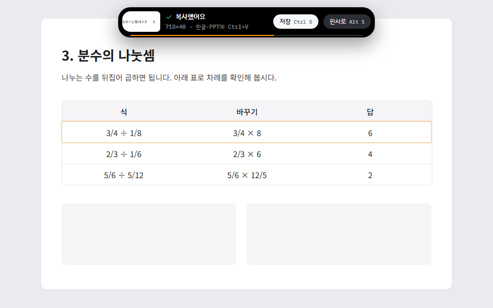

| 항목 | 명세 |
|---|---|
| 확정 뒤(바로 결과 전) | 테두리 유지 + 네 귀 손잡이 · 방향키 1px 이동 · Ctrl+방향 늘리기 · Shift+방향 줄이기 · Enter/Ctrl+C/더블클릭 = 결과 · Ctrl+S 저장 · 우클릭 = 다시 고르기 |
| 선택 툴바(R-CAP-27) | 확정하면 범위 **오른쪽 아래 바깥 8px**에 다크 알약(섬과 같은 `--ink-island-*` 토큰, 높이 40, 단추 32×32·아이콘 20, 묶음 사이 세로 구분선). 아래 공간이 모자라면 범위 **위 8px**, 둘 다 없으면 범위 **안 오른쪽 아래 8px**. 모니터 가장자리 8px 안으로 가로 밀어 넣음. 여러 모니터에 걸치면 오른쪽 아래 귀의 모니터에만. 순서(왼→오): 사각형 · 타원 · 화살표 · 펜 · 형광펜 · 모자이크 · 글자 · 지우개 │ 실행 취소 · 다시 실행 │ 취소 · 저장 · **복사(주황 채움)** — 주석 도구는 R-CAP-28이 붙을 때 함께 보인다(그 전에는 취소·저장·복사만). 마우스를 올리면 툴팁 "복사 · Enter"(지금 설정된 키). 툴바 위 클릭·끌기는 범위를 건드리지 않음. 드래그를 다시 시작하면 툴바는 숨고 놓으면 다시 |
| 캡처 주석(R-CAP-28) | 도구를 고르면 범위 안에서만 그린다(커서 = 도구 모양). 색·굵기는 판서와 같은 값(S12 색 6). 그린 것은 결과(복사·저장)에 합성. Ctrl+Z/Ctrl+Y. 도구를 다시 누르면 고르기(범위 조정)로 돌아감 |
| 결과 섬(한 줄) | 썸네일(왼쪽 둥근) · ✓ **복사했어요** · `718×40 · 한글·PPT에 Ctrl+V` · [저장 Ctrl S] [판서로 Alt 1] · 바닥 주황 진행선 1.2초. **추천 칩은 지금 할 수 있을 때만** 단추 하나로 더함(1차 = 단색이면 [HEX 복사]) — "다음 버전" 같은 예고는 화면에 쓰지 않는다 |
| 머묾 | 마우스를 올리면 진행선 멈춤, 나가면 다시 1.2초 |
| 판서로 | 결과 섬의 [판서로] = 방금 범위를 확대한 채 Alt+1 판서 시작 |
| 잔상 | 고른 자리에 주황 테두리가 35%로 0.4초 남았다 사라짐 |
| 저장 | 저장 폴더 + 이름 규칙(R-OUT-1), 성공 섬 "저장했어요 [폴더 열기]" |

## S09 F1 드래그 · 모서리 자석

S07과 같은 체계로 그린다(별도 그림 없음).

- 빈 곳을 드래그 → 사각형이 그려지고 섬 1줄에 크기 `W×H`가 실시간. 가까운 경계(창·요소·**화면 이미지 경계선**, 8px × 배율 안)에 붙으면 그 변에 주황 안내선(1px, 길이 = 경계 길이). 떨어지려면 12px 넘게.
- Alt를 누르는 동안 자석 끔(섬에 "자석 끔"). 확대경은 끝점을 따라감.

## S10 F2 창 캡처

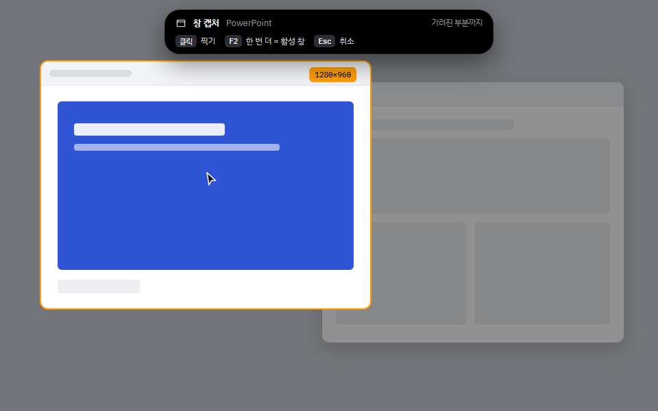

| 항목 | 명세 |
|---|---|
| 강조 | 커서 아래 창 전체를 밝게 + 주황 2px 테두리(창 모서리 둥글기 그대로) + 오른쪽 위 크기 꼬리표(주황 바탕, 고정폭) |
| 섬 | 창 아이콘 · **창 캡처** · 앱 이름(창 제목 아님) · "가려진 부분까지" / `클릭` 찍기 · `F2` 한 번 더 = 활성 창 · `Esc` |
| 결과 | WGC로 그 창만(가려진 부분 포함), 노란 캡처 테두리 없음 · 둥근 모서리는 투명 PNG · 보호 화면이면 섬 "이 창은 가져올 수 없어요" |

## S11 F3 녹화 중

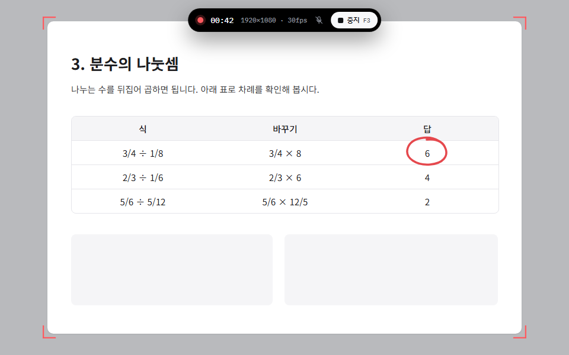

| 항목 | 명세 |
|---|---|
| 시작 | F3 → S07과 같은 고르기(모니터는 클릭 한 번) → 3·2·1 없이 바로 시작 |
| 범위 표시 | 범위 밖 22% 어둡게 + 네 귀 빨간 꺾쇠 — **영상에 안 찍힘**(`WDA_EXCLUDEFROMCAPTURE`) |
| 섬(계속 보임) | 빨간 점(맥박 1.6초) · `00:42` · `1920×1080 · 30fps` · 마이크 꺼짐 아이콘 · [■ 중지 F3] |
| 트레이 | 아이콘 방울이 빨간 점으로 |
| 첫 녹화 안내 | 처음 녹화 때만 섬이 2초 동안 "판서는 영상에 함께 · 이 알약은 안 찍혀요"를 보인 뒤 녹화 상태로 줄어듦(따로 알약을 띄우지 않음 — 섬은 하나) |
| 끝 | F3 · [중지] · 잠금·절전·모니터 해제 → 섬 "녹화를 저장했어요 · 00:42 · 18 MB [폴더 열기]" |

## S12 Alt+1 판서

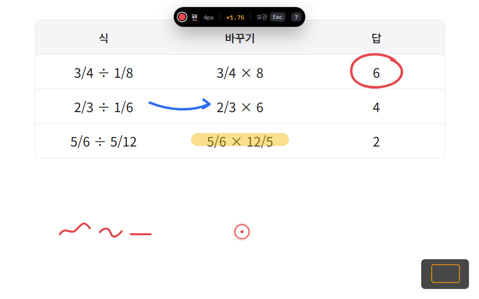

| 항목 | 명세 |
|---|---|
| 진입 | 커서 모니터를 멈춤(확대 상태 이어받기 가능) · 툴바 없음 |
| 섬(계속 보임, 작게) | **지금 색 하나**(고리) · 도구 이름 · 굵기 · 배율(주황) · `보관 Esc` · `?`. 색 키를 누르거나 색 점에 마우스를 올리면 6색이 0.8초 펼쳐짐. 4초 동안 움직임이 없으면 투명도 40%로 물러남, 커서가 가까이 오면 위로 비켜 감 |
| 커서 | 펜 색 고리 + 가운데 점(굵기 크기) |
| 위치 지도 | 확대 중에만 오른쪽 아래 96×60, 주황 사각 = 보이는 곳 |
| 조작 | P M T S D E · 색 R Y G O B L · W/K 칠판 · Shift 직선 · Ctrl 사각 · Ctrl+Shift 화살표 · Tab 원 · +Alt 점선 · 휠 확대 · Ctrl+휠 굵기 · 우클릭 손 모드 · Space 가운데 · Ctrl+Z/Y · Esc |
| 스마트 | 떨림 보정 · ±4° 곧게 · 0.5초 멈추면 도형 후보(섬에 "원으로 바꿀까요? 그대로 쓰면 유지") · 한글 입력 중 도구 키 무시 |
| 나가기 | Esc → 보관 + 섬 "판서를 보관했어요 · Alt+Shift+1" |

## S13 Alt+2 실시간 확대

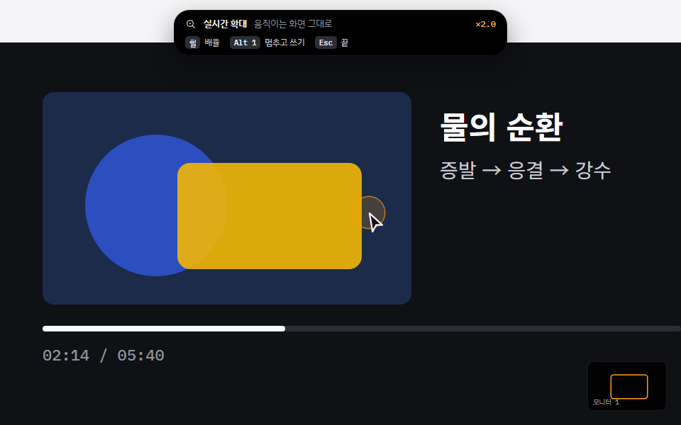

| 항목 | 명세 |
|---|---|
| 확대 | Magnification API, 움직이는 화면 그대로, 커서 따라 이동(부드럽게/바로) |
| 섬 | 확대 아이콘 · **실시간 확대** · "움직이는 화면 그대로" · `×2.0` / `휠` 배율 · `Alt 1` 멈추고 쓰기 · `Esc` 끝 |
| 커서 | 주황 후광(44px) — 확대 화면에서 커서를 잃지 않게 |
| 위치 지도 | 오른쪽 아래 112×70, 모니터 이름 |
| Alt+1 | 그 순간 장면을 멈춰 판서로(배율 유지, ≤ 150 ms) |

## S14 Alt+3 칠판

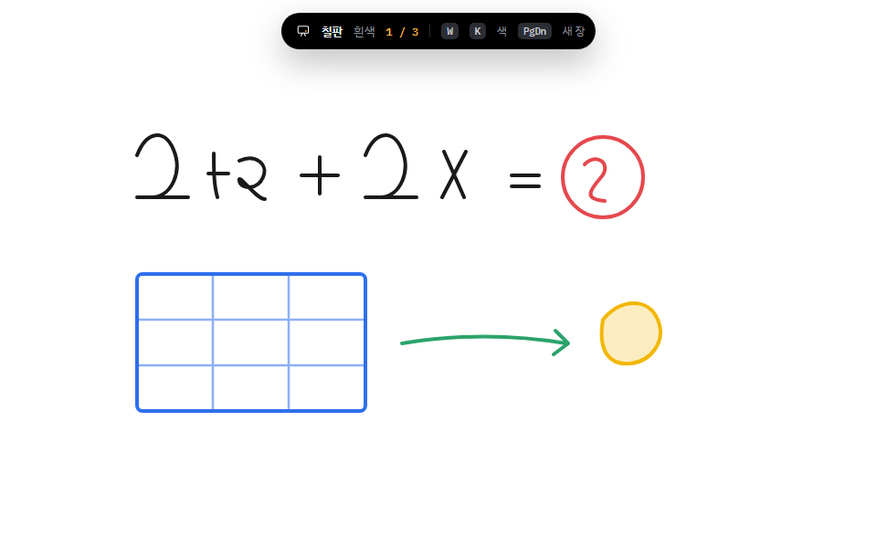

| 항목 | 명세 |
|---|---|
| 바탕 | 흰(기본) / 검은(K). 검은 칠판에서 검정 펜은 흰색으로 자동 |
| 섬 | 칠판 아이콘 · **칠판** · 흰색 · `1 / 3`(P1 여러 장) · `W` `K` 색 · `PgDn` 새 장 |
| 도구 | 판서와 같음 |

## S15 창 항상 위 고정

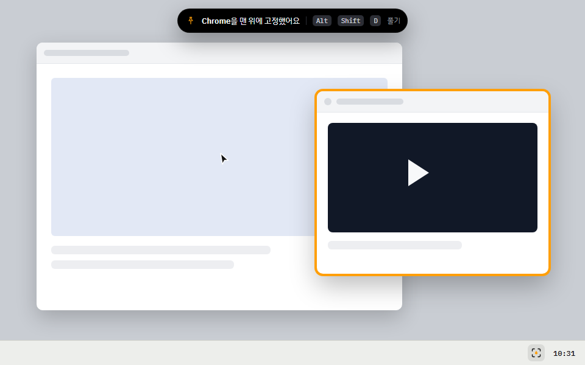

| 항목 | 명세 |
|---|---|
| 고정 | Alt+Shift+D → 지금 앞 창 · 주황 테두리만(기본 4px, 둥근 모서리 그대로, 배지 없음 — 제목 막대 단추와 겹치지 않게) — 테두리는 캡처에 안 찍힘 |
| 섬 | 핀(주황) · "**Chrome**을 맨 위에 고정했어요" · `Alt` `Shift` `D` 풀기 — 1.2초 |
| 개수 | 트레이 아이콘에는 배지를 붙이지 않고, 팝오버 "창 항상 위" 줄 오른쪽 숫자와 트레이 툴팁 "고정한 창 2개"로 |
| 예외 | 원래 맨 위 창 · 관리자 창 · PowerToys가 고정한 창 → 섬으로 이유(R-TOP-1·3·4) |

## S16 단축키 한 장(?)

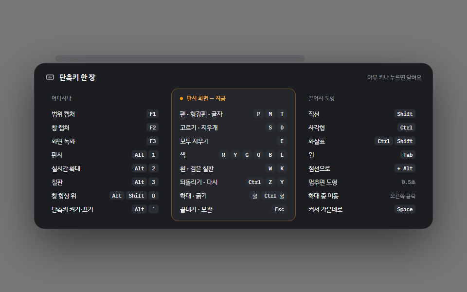

- 세 열: **어디서나** 8 · **지금 화면**(주황 테두리, 판서/캡처/확대에 따라 바뀜) 8 · **끌어서 도형** 8. 아무 키나 누르면 닫힘. 값은 설정의 현재 단축키에서 만든다(확정본이 아니라 사용자가 바꾼 값).

## S17 섬 상태 모음

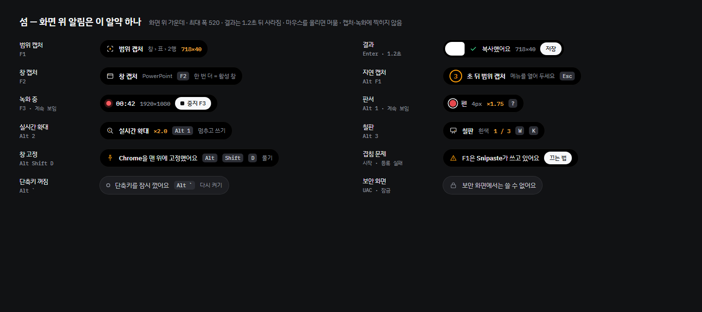

| 상태 | 내용 | 머묾 |
|---|---|---|
| 범위 캡처 · 창 캡처 | 두 줄(상태 + 키) | 모드 동안 |
| 결과 | 썸네일 · ✓ · 크기 · [저장] · 추천 칩 | 1.2초 + 올리면 머묾 |
| 지연 캡처 | 주황 원 안 숫자 3·2·1 · "초 뒤 범위 캡처" · `Esc` | 카운트 동안 |
| 녹화 중 · 판서 · 확대 · 칠판 | 한 줄 | 모드 동안 |
| 창 고정 · 바꾼 단축키 | 한 줄 + 되돌리기/풀기 | 1.2초 |
| 겹침 · 문제 | 주황 경고 · [끄는 법]/[해결] | 6초 + 올리면 머묾 |
| 단축키 꺼짐 · 보안 화면 | 회색 섬 | 2초 |

규칙: **기본은 한 줄(높이 38~44)** — 키 안내 둘째 줄은 그 모드를 처음 3번 쓸 때와 `?`를 누를 때만 · 화면 위 가운데 14px · 최대 폭 520 · 한 번에 하나(새 알림이 오면 이전 것을 밀어냄, 결과는 모드 상태 위에 0.8초 겹쳐 보인 뒤 모드 상태로 돌아감) · 캡처·녹화에 안 찍힘 · 클릭 통과(단추 위만 클릭 받음).

---

### 구현 때 측정으로 정할 것

- 확대경 배율(9배)과 크기 — 4K·150% 모니터에서 다시 본다.
- 섬의 1.2초 — 교실 시연 3회로 조정(0.9~1.8초).
- 판서 섬이 물러나는 4초 · 투명도 40%.
