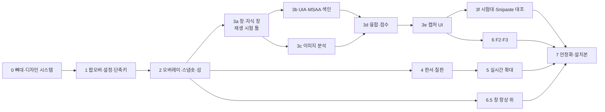

# 07. 마스터플랜 · 세부 계획

2026-11-25 · PRD v3.0 부속 · AI 에이전트와 함께, Windows 먼저. 작업일은 추정. 각 단계 끝에 **측정(벤치) + 시나리오 카드 + 자동 시험**을 돌리고 결과를 `bench/results/`에 쌓는다. 관문(Gate)을 못 넘으면 다음 단계로 가지 않고 PRD 6절 "다시 정할 조건"을 따른다.

## 1. 무엇으로 이기나 — 로직 원칙 7개

벤치마크 앱(Snipaste · 아이캔 줌잇 · ZoomIt · PowerToys 항상 위)보다 "더 많은 기능"이 아니라 **더 맞는 판단**으로 이긴다. 모든 단계의 설계 검토는 이 7개로 한다.

| # | 원칙 | 벤치마크의 약점 | screen-ink |
|---|---|---|---|
| 1 | **근거를 합친다** | Snipaste 요소 인식은 MSAA 하나([08 §1](08-smart-capture.md)) | 창·자식 창·UIA·MSAA·화면 이미지 5개 근거 융합 + 서로 검증([08 §4](08-smart-capture.md)) |
| 2 | **같은 순간을 본다** | 판단 도중 화면이 바뀌면 흔들림 | 정지 스냅숏(이미지 + 창 목록 + 모니터)을 한 번 찍고 그 값만 본다(02 §0) |
| 3 | **다른 앱에 묶이지 않는다** | 커서를 움직일 때마다 다른 앱에 질의 → 느린 앱에서 굳음 | 진입 때 한 번 색인, 움직일 때는 내 메모리만 · 시간 예산 · 느린 앱 자동 처리 |
| 4 | **좌표는 하나** | 아이캔 줌잇 시스템 DPI만 · 혼합 배율 오차 | 물리 픽셀 가상 화면 하나, 변환은 순수 함수 하나(R-DPI-1) |
| 5 | **추측은 보여 주고 되돌릴 수 있게** | 잘못 잡으면 처음부터 | 휠·Tab·드래그·1px 키·Ctrl+Z로 한 번에 고침, 고른 "층"을 기억(02 §1.3) |
| 6 | **원인을 말해 준다** | 키가 안 먹어도 이유 모름 · PowerToys 겹침은 등록 시험으로 안 보임 | 겹친 앱 이름 · 대체 앱이면 "끄는 법" 먼저 · 저수준 훅 앱은 설정 파일로 확인(R-KEY-2·5) |
| 7 | **잰 것만 믿는다** | — | 단계마다 M1~M10 측정, 인식은 스냅숏 재생 시험으로 CI에서 회귀 검사(08 §5) |
| 8 | **한 목소리로 말한다** | 말풍선·툴바·배지·창이 제각각, 수업 화면을 가림 | 화면 위 안내는 섬 하나, 색은 토큰 한 벌·강조 하나, 설정은 바로 반영([10](10-design-system.md), R-UI-1~5) |

## 2. 단계 한눈에

| 단계 | 내용 | 작업일 | 끝나면 되는 것 | 관문 |
|---|---|---|---|---|
| 0 | 저장소 뼈대 + **디자인 시스템**(토큰·글꼴·아이콘·부품·앱/트레이 아이콘) | 2 | `cargo test`·`node --test`·`svelte-check` 통과, 가짜 어댑터로 ink-ui 미리보기, 라이트·다크 부품 판 | — |
| 1 | 트레이 팝오버·설정(바로 반영)·단축키(59칸)·저장소 | 2.5 | S01~S06이 실제 앱에서 동작, 단축키 입력 즉시 등록, 입력표와 같은 겹침 판정 | G1 |
| 2 | 오버레이 기반·정지 스냅숏 + **섬 호스트** | 2.5 | 모니터별 오버레이, 투명도 재지정, 이미지 + 창 목록 같은 순간, 섬 12상태, **M1 첫 측정** | G2 |
| 3 | **F1 스마트 캡처 v2**(인식 엔진 + UI + 시험대) | 8.5 | RB-01~16 Top-1 ≥ 90%, Snipaste 대조 보고서 | G3·G4 |
| 4 | Alt+1 판서 · Alt+3 칠판 | 3 | S10·S12·S14, 보정·보관·복원 | G5 |
| 5 | Alt+2 실시간 확대 | 2 | S11, Alt+1 전환 | G6 |
| 6 | F2 창 캡처 · F3 녹화 | 3 | S13, 10분 녹화, 자기 창 제외 | — |
| 6.5 | 창 항상 위 고정(P1) | 1 | R-TOP-1~4 | — |
| 7 | 안정화·설치본 | 2.5 | M1~M10, S1~S15, 혼합 배율, NSIS + 포터블 ZIP | G7 |
| — | **합계** | **약 27일** | 1차 프로토타입(P1 단계 6.5를 빼면 26일) | |
| 8 (2차) | 원격(PostHog·업데이트) · Tidy 통합 · macOS | 별도 | [06-remote](06-remote.md), [03 §6](03-architecture.md) | |

v0.3 계획(18일)보다 늘어난 9일: 인식 엔진 v2(+5.5일: 근거 융합·이미지 분석·시험대·Snipaste 대조), 단축키 59칸 설정(+0.5), 창 항상 위(+1), 안정화의 인식 회귀(+0.5), **디자인 시스템·아이콘(+1)**, **섬 호스트(+0.5)**.

3b와 3c는 서로 기다리지 않는다(에이전트 두 갈래로 나눠도 됨). 단계 4·5는 단계 2만 있으면 시작할 수 있다.

## 3. 관문

| 관문 | 시점 | 통과 조건 | 못 넘으면 |
|---|---|---|---|
| G1 | 단계 1 끝 | 입력표 판정 = 앱 판정(59칸 × 2 OS 시험 자료 공유), 키 입력 즉시 등록 롤백 시험, Snipaste를 켠 채 실행하면 F1 계열 원인 안내, **실제 창의 S01~S06이 최종 시안(v3)과 같고 AI slop 점검표 10개 통과** | 단계 2로 가지 않음 |
| G2 | 단계 2 끝 | M1 캡처 단계 p50 ≤ 55 ms · M3 ≤ 150 MB · 창 목록과 이미지가 같은 순간(메뉴를 연 채 F1 → 둘 다에 메뉴) | xcap `wgc` → windows-capture 모니터 → 상시 세션 / 오버레이 지연 생성 |
| G3 | 3c 끝 | V 혼자 RB-01·03 Top-1 ≥ 80%, V 전처리 4K ≤ 40 ms | 문턱값 조정 1일, 그래도 미달이면 V는 경계 맞춤 전용으로 낮추고 웹·WebView2 목표를 Top-1 ≥ 75%로 |
| G4 | 3f 끝 | RB 전체 Top-1 ≥ 90% · Top-3 ≥ 98% · 경계 ≤ 1 px · 굳음 0 · **Snipaste 이상 + Snipaste 실패 점 70% 이상 맞춤** · Snipaste 알려진 결함 D1~D22 재발 0([08 §3](08-smart-capture.md)) | 실패 유형별로 08 §4.6 가족 표 보정, 최대 +2일 |
| G5 | 단계 4 중간 | M5 펜 지연 p95 ≤ 50 ms | 네이티브 렌더러(Direct2D 계층 창) 검토, +2일 |
| G6 | 단계 5 끝 | 1080p ≥ 30 fps, 4K는 기록 | 2안 GPU 경로를 2차로, 1080p 기준으로 마감 |
| G7 | 단계 7 끝 | 산출물 체크리스트(§6) 전부 | 릴리스하지 않음 |

## 4. 단계별 세부

### 단계 0 — 저장소 뼈대 + 디자인 시스템 (2일)

| # | 작업 | 완료 기준 |
|---|---|---|
| 0.1 | cargo workspace + npm workspaces, 폴더 구조([03 §2](03-architecture.md)) | `cargo build` · `npm run check` |
| 0.2 | `ink-domain`: geometry · naming · shortcuts 파서(순수) + **`shortcuts::DEFAULTS`를 [defaults-v1.json](../shortcuts/defaults-v1.json)에서 생성** | [02 §8](02-smart-logic.md) geometry·naming·shortcuts 시험 통과, JSON과 상수가 다르면 빌드 실패 |
| 0.3 | `ink-app` 포트 trait + `Noop`·`Fake` 구현(`WindowPinner` 포함) | 유스케이스 하나(설정 읽기)가 가짜로 돎 |
| 0.4 | `packages/ink-ui` 토큰: `--ink-*` 라이트·다크 두 벌([10 §2](10-design-system.md)) → Tailwind 4 `@theme` · 테마 전환(시스템 따라) · IBM Plex Sans KR·Mono woff2 서브셋 · 하드코딩 색 린트 | 두 테마 토큰 판이 F02와 같음, 색 하드코딩 0 |
| 0.4b | `<Icon>` 24종(F01) + 부품 14종(`TrayPopover`·`MenuRow`·`Group`·`Row`·`Keycap`·`Switch`·`Segmented`·`Banner`·`Sheet`·`Island`·`SelectionFrame`·`Magnifier`·`MiniMap`·`PinFrame`) — 바탕은 `bits-ui` | 부품 판(라이트·다크·상태 5종)이 F01·F02와 같음, 키보드 포커스·대비 4.5:1 자동 검사 |
| 0.4c | 앱 아이콘 1024 벡터 원본 → `pnpm tauri icon` · 트레이 PNG 16·20·24·32(라이트·다크·녹화·꺼짐) · 맥 템플릿 | 16px에서 세 상태 구분(눈 검사 3명) |
| 0.5 | `apps/screen-ink` Tauri 껍데기(single-instance, autostart) | 실행하면 트레이 아이콘 |
| 0.6 | 로그(순환·금지 항목) + 계측 줄 함수 | `launch time N ms` 기록 |

### 단계 1 — 트레이·설정·단축키·저장소 (2.5일)

| # | 작업 | 근거 | 완료 기준 |
|---|---|---|---|
| 1.1 | `SettingsStore` 원자적 JSON + 백업 교대 + 손상 복구 + v3 스키마·검증·마이그레이션 | [05 §1](05-crud.md) | 손상 파일 → 백업 복구, 반쯤 쓰기 없음, v4 읽기 전용 |
| 1.2 | 포터블 표시 파일 판정(`screen-ink.portable`) · 위치 표시 | R-SET-1 | 표시 파일 유무로 위치 바뀜 |
| 1.3 | 트레이 팝오버(S01): `tauri-plugin-positioner` 위치 · 상태 점 4종 · 상황 따라 바뀌는 줄(녹화 중지·고정 개수) · 단축키 스위치(`` Alt+` ``) · 라이트/다크 피부 · 열기 140 ms | R-SET-0, [04 S01](04-screens.md) | 항목 전부 해당 유스케이스 호출, 키보드만으로 조작 |
| 1.4 | **`shortcuts::analyze`** — 입력표 판정 규칙 이식(운영체제 예약·한/영·다른 앱 주의·대체 앱·같은 화면 중복·모드 키 = 전역 키·맥 ⌥ 특수 문자) + 참고 목록 자료(입력표 `REF`를 JSON으로 빼서 둘이 같이 씀) | R-KEY-5 | **입력표와 앱이 59칸 × 2 OS에서 같은 판정**(같은 시험 자료) |
| 1.5 | `HotkeyRegistry` **키 입력 즉시** 등록 트랜잭션 + 원인 찾기(`ProcessProbe` + PowerToys 설정 파일 읽기) + 줄마다 다른 추천 + "대체 앱 끄는 법" 먼저 | [02 §6](02-smart-logic.md), R-KEY-2·3 | Snipaste 켠 채 실행 → F1 계열 주황 점 + 맨 위 알림, PowerToys 항상 위 켠 채 Alt+Shift+D → 안내, 실패 줄만 되돌림 |
| 1.6 | 설정 창(S02~S05) — 사이드바 4 + 정보, **바로 반영**(원자적 저장), 창 안 Ctrl+Z 되돌리기 기록, 단축키 탭: 전역 16 + 화면 안 43 나눔, 묶음 [기본값] | [04 S02~S05](04-screens.md), [05 §1·2](05-crud.md) | 실제 창이 F04~F07과 같음, 시안 qa 시나리오(S02)를 손으로 통과 |
| 1.7 | 첫 실행 시트(S06) + 단축키 한 장(S16) 자료(현재 단축키에서 생성) | R-FIRST-1 | 첫 실행 1회만, 다시 보기 가능 |
| 1.8 | 설정 내보내기·가져오기(바뀌는 항목 수 시트 → 확인 뒤 반영)·묶음 기본값·모두 처음으로(확인 시트, 3초 뒤 활성) | [05 §1](05-crud.md) | 가져오기 취소 시 변경 0 |

### 단계 2 — 오버레이 기반·정지 스냅숏 + 섬 호스트 (2.5일)

| # | 작업 | 완료 기준 |
|---|---|---|
| 2.1 | `MonitorProbe`(`QueryDisplayConfig`·`GetDpiForMonitor`) + 구성 지문 + 변경 이벤트 | 모니터 뽑기·꽂기·배율 변경에 오버레이 재생성 |
| 2.2 | 모니터별 오버레이 창 미리 만들기(숨김·클릭 통과·최상위·작업 표시줄 안 보임) + 보일 때마다 투명도 재지정 | R-SYS-6: 대기 1시간·배율 변경 뒤 검은 화면 0 |
| 2.3 | `ScreenSource`(xcap) 정지 프레임 + `ink://frame/<id>` 프로토콜 | 프레임 base64 전송 없음 |
| 2.4 | **`Snapshot` = 이미지 + 창 목록 + 모니터를 같은 순간에**(오버레이를 보이기 전) | 메뉴·툴팁을 연 채 F1 → 이미지와 창 목록 둘 다에 남음 |
| 2.5 | 계측 `overlay ready [N ms] (capture N, show N)` · `highlight first [N ms]` | **M1 첫 측정 n≥100** |
| 2.6 | `SystemEvents`(잠금·절전·보안 데스크톱) | S12·S13 시나리오 카드 |
| 2.7 | **섬 호스트**: 커서 모니터 위 가운데 작은 창(맨 위 · 단추 밖 클릭 통과 · `WDA_EXCLUDEFROMCAPTURE`) + `Island` 12상태(S17) + 알림 큐(R-UI-5: 하나씩·밀어냄·1.2초·올리면 머묾·범위와 겹치면 아래로) + 스프링 늘기·줄기 | 녹화·캡처 결과에 섬 0 px, 상태 전환 시험 12개 |

### 단계 3 — F1 스마트 캡처 v2 (8.5일)

세부 명세는 [08-smart-capture](08-smart-capture.md). 3b와 3c는 병렬 가능.

| # | 작업 | 근거 | 작업일 | 완료 기준 |
|---|---|---|---|---|
| 3a | W·H 근거: 거르기(DWM·cloaked·hung·자기 창·제외 앱 + **투명 덮개 · 최대화 자르기 · UWP 틀↔내용 이어 붙이기**) + 자식 창 + **스냅숏 재생 시험 틀** | 08 §4.2, §5.2 | 1 | RB-15·16 자동 통과, 재생 시험이 CI에서 돎 |
| 3b | A·M 근거: **미리 깨우기** · 캐시 요청 하위 트리 색인 · R-tree · 느린 앱 자동 처리 · MSAA 대체 · DPI 모르는 창 좌표 보정 | 08 §4.2, §4.7 | 1.5 | Chrome 첫 강조 ≤ 진입 + 30 ms, 멈춘 앱 시험 굳음 0, 커서 이동 질의 ≤ 5 ms |
| 3c | V 근거: 전처리(경사·곧은 경계·적분 영상) · 상자 사다리 · 평탄 영역 · 경계 지지율 | 08 §4.3 | 1.5 | G3 |
| 3d | 융합: 검증 · 경계 맞춤 · 보이지 않는 그릇 빼기 · 중복 합치기 · 점수 · 첫 강조 · 깊이 기억 · 숨은 "인식 근거 보기" | 08 §4.4~4.5, 02 §1.3 | 1 | RB 중간 측정 Top-1 ≥ 85% |
| 3e | `CaptureOverlay` UI([04 S07~S09](04-screens.md)): 50% 어둡게 · `SelectionFrame`(주황 1.5px + 꺾쇠) · 섬 두 줄(경로·크기·키) · `Magnifier` · 드래그 + 모서리 자석(**V 경계선도 자석 후보**, 주황 안내선) · 확정 뒤 키 · **결과 섬**(썸네일·다음 행동 2개·추천 칩·진행선·잔상, R-CAP-26) · 클립보드 DIB+PNG·저장·기록 | 02 §1.4~1.6, [05 §3·4](05-crud.md) | 2 | 실제 화면이 F09·F10과 같음, 한글(HWP)·PPT에 붙여 넣어 크기·색 확인, [판서로] 이어받기 ≤ 150 ms |
| 3f | 시험대 RB-01~20(시험 문서·자동 정답·사람 정답 도구·멈춘 시험 앱) + **Snipaste 대조 하네스** + 보고서 `bench/results/recog-*.csv` | 08 §5 | 1.5 | G4 |

### 단계 4 — Alt+1 판서 · Alt+3 칠판 (3일)

| # | 작업 | 근거 | 완료 기준 |
|---|---|---|---|
| 4.1 | `inkEngine.js`(순수): 문서·명령 실행 취소·One Euro·RDP·도형 판정·화면 기준 굵기 | [02 §3](02-smart-logic.md), [05 §6](05-crud.md) | `node --test` 전부 |
| 4.2 | `DrawCanvas` 렌더러(굳힌 아래층 + 지금 획, 합쳐진 포인터 이벤트) | — | **M5 측정**(G5) |
| 4.3 | 도구·도형·색·굵기 키, 칠판 W/K, Space — 키는 설정값에서 읽음(확정본 기본값) | [확정본 v1](../shortcuts/README.md) | S10·S12, 설정에서 바꾼 키가 바로 반영 |
| 4.4 | 휠 확대 단계·고정점·가두기 · 가장자리 밀기 · 스마트 우클릭(손 모드) | [02 §3.4·3.5](02-smart-logic.md) | 아이캔 줌잇 사용자 시나리오 |
| 4.5 | 글자 T(IME 보호) · 고르기 S · 다시 고치기 | [02 §3.7](02-smart-logic.md) | "가나다" 입력 중 P·M 무시 |
| 4.6 | 나가기 규칙(Esc 단계/바로) · 보관 · Ctrl+Shift+R 복원 · **Alt+Shift+1 = 판서 열고 바로 복원** · 트레이 "직전 판서" | [05 §7](05-crud.md) | 장면 1(문제 풀이) |
| 4.7 | 판서 결과 복사·저장(배경 + 판서 합성) | — | |
| 4.8 | 판서 섬(펜 색 6 · 도구 · 굵기 · 배율 · 4초 뒤 물러남 · 커서가 오면 비켜 감) · 펜 색 고리 커서 · 확대 중 `MiniMap` · 칠판 미리 보기(S14) | [04 S12·S14](04-screens.md), R-ZOOM-6 | 실제 화면이 F13·F15와 같음 |

### 단계 5 — Alt+2 실시간 확대 (2일)

| # | 작업 | 완료 기준 |
|---|---|---|
| 5.1 | `Magnifier`(Magnification API, 클릭 통과, 필터 목록) | 영상 재생 중 S9, **M6**(G6) |
| 5.2 | 커서 따라가기 다듬기(0.35 · 10% 죽은 영역) · 휠 단계 · 배지 | 흔들림 없음 |
| 5.3 | Alt+1 전환(원본 사각형·배율 넘기기) | 전환 ≤ 150 ms |
| 5.4 | 4K에서 30 fps 미달이면 2안(WGC→GPU) 판단 기록 | 결정 메모 |
| 5.5 | 확대 섬 · 커서 주황 후광 44px · `MiniMap`(모니터 이름) — 모두 돋보기 원본에서 제외 | F14와 같음, 확대 화면 안에 섬·지도 0 |

### 단계 6 — F2 창 캡처 · F3 녹화 · 바로 캡처 (3일)

| # | 작업 | 완료 기준 |
|---|---|---|
| 6.1 | F2: WGC `CreateForWindow` + 테두리 끄기 + 대체 경로 + 검은 화면 판정 + 두 번 누르기 · 창 고르기는 08의 W 근거 재사용 | S7, 보호 화면 안내 |
| 6.2 | **바로 캡처 키**: Shift+F1 직전 범위(구성 지문이 같을 때만) · Ctrl+F1 커서 모니터 · Shift+F2 활성 창 · Alt+F1 지연(3·5·10초, 남은 초 알약은 캡처 제외) | 각 키 결과가 대화 없이 클립보드에, 직전 범위가 없으면 안내 |
| 6.3 | F3 범위 고르기(F1 재사용) + `Recorder`(windows-capture 인코더) | 1080p30 10분 끊김 없이, 기본 플레이어 재생 |
| 6.4 | 녹화 섬(빨간 점 맥박·경과·크기·마이크·[중지 F3]) · 범위 네 귀 빨간 꺾쇠(캡처 제외) · 첫 녹화 안내 1회 · 트레이 빨간 점 · 판서 겹치기 | 영상에 판서만 찍힘, F12와 같음 |
| 6.5 | 자동 중지(잠금·절전·모니터) · 1초 안 중지 · 임시 파일 복구 · 마이크(기본 끔) | [05 §8](05-crud.md) 전부 |

### 단계 6.5 — 창 항상 위 고정 (1일, P1)

| # | 작업 | 근거 | 완료 기준 |
|---|---|---|---|
| 6.5.1 | `WindowPinner`(windows-rs): 대상 고르기 · 고정/풀기 · 표시 · 원래 맨 위 창 판정 · PowerToys 표시 판정 | R-TOP-1·4, [02 §9](02-smart-logic.md) | 크롬·한글·PPT·탐색기·카카오톡 100회 오류 0 |
| 6.5.2 | 테두리 창(클릭 통과·캡처 제외) + out-of-context WinEvent 따라가기 | R-TOP-2 | 끌기·최대화 16 ms 안에 따라옴, F1 결과에 테두리 0 px |
| 6.5.3 | 정리: 창 닫힘 · 끝낼 때 · 다음 시작 때 남은 표시 · 트레이 "모두 풀기 (n)" | R-TOP-3, [05 §12](05-crud.md) | 강제 종료 뒤 다시 실행 → 남은 고정 0 |

### 단계 7 — 안정화·설치본 (2.5일)

| # | 작업 | 완료 기준 |
|---|---|---|
| 7.1 | 벤치 M1~M10 학교 PC + 혼합 배율(100%+150%) | PRD 5절 목표 |
| 7.2 | 시나리오 카드 S1~S15 — Snipaste·아이캔 줌잇·ZoomIt과 나란히 | ○/△/× 기록 |
| 7.3 | **인식 회귀**: 시험대 전체 다시 + 스냅숏 재생 CI 기준선 고정 | G4 수치 유지 |
| 7.4 | 200회 진입·종료 반복 → 메모리 +5% 미만, 핸들 증가 0 | M9 |
| 7.5 | 릴리스 체크리스트: R-NET-2(`cargo tree`에 HTTP 없음 + rea `inspect-pe-imports`에 winhttp·wininet·ws2_32 없음) · R-LOG-1(창 제목 0건) · 표준 사용자 · 백신 오탐 · UPX 금지 | 전부 통과 |
| 7.6 | NSIS 설치본 + 포터블 ZIP(`screen-ink.portable` 포함) | 표준 사용자 계정 설치·실행 |
| 7.7 | **디자인 관문**: 실제 화면 S01~S17을 v3 시안과 나란히 찍어 비교 · AI slop 점검표 10개 · 대비 4.5:1 자동 검사 · Windows 고대비·줄임 모드 · 라이트/다크 전환 | 차이 목록 0(또는 의도한 차이만 기록) |

## 5. 위험 관리

| 위험 | 신호 | 대응 |
|---|---|---|
| 캡처 단계가 55 ms를 넘음 | G2 | PRD 6절 개선 순서 |
| 이미지 분석이 없는 상자를 만듦(헛사각형) | RB에서 Top-1은 높은데 경계 지지율 낮은 첫 강조가 많음 | 지지율 문턱 올리기 · 접근성 근거가 있는 창에서는 V를 경계 맞춤 전용으로 |
| Chromium 미리 깨우기가 브라우저를 무겁게 함 | 시험대에서 Chrome 메모리 +10% 이상 | 커서 아래 창만, F1 때만 깨우기 유지 · 그래도 크면 웹 내용은 V만 |
| 앱 가족 표가 학교 PC의 실제 앱을 못 덮음 | 시험대 밖 앱에서 Top-1 급락 | 단계 3 시작 때 학교에서 자주 쓰는 앱(한글·PPT·엑셀·브라우저)을 **개인 정보가 없는 시험 문서**로 열고 `uia-probe` 실측 → 가족 표 갱신(학생·교직원 정보 화면은 재지 않음) |
| 펜 지연 | G5 | 네이티브 렌더러 |
| 실시간 확대 4K 성능 | G6 | 1080p 기준 마감 |
| 녹화 안정 | 단계 6 | 녹화를 1차 끝으로 미루고 나머지 먼저(v0.1 13.8 원칙) |
| 일정 초과 | 누적 +3일 | P1(6.5 창 항상 위 · V 글 덩어리·그림) 먼저 뺌 |

## 6. 산출물 체크리스트 (1차 완료 정의)

- [ ] PRD 4절 P0 요구사항 전부 합격 기준 통과(표로 기록)
- [ ] PRD 5절 성능 목표 M1~M10 학교 PC 기록
- [ ] 인식 시험대 RB-01~20 결과 + Snipaste 대조 보고서 + 결함 D1~D22 시험(G4)
- [ ] 시나리오 카드 S1~S15 기록(대상 앱 3개와 비교)
- [ ] 단위 시험: domain·app·ui 전부 통과, 스냅숏 재생 CI 통과
- [ ] 입력표 ↔ 앱 단축키 판정 일치 시험
- [ ] 시안 자동 조작 시험 통과(시안이 바뀌었으면 다시)
- [ ] 디자인 관문 7.7: 실제 화면 = 최종 시안 v3, 점검표 10개, 대비·고대비·줄임 모드, 앱·트레이 아이콘 전 크기
- [ ] 릴리스 체크리스트 7.5
- [ ] 설치본·포터블 ZIP
- [ ] 2차 준비: `Telemetry`·`Updater` 포트 호출 자리, 저장소 공개 결정([06 §2.2](06-remote.md))
