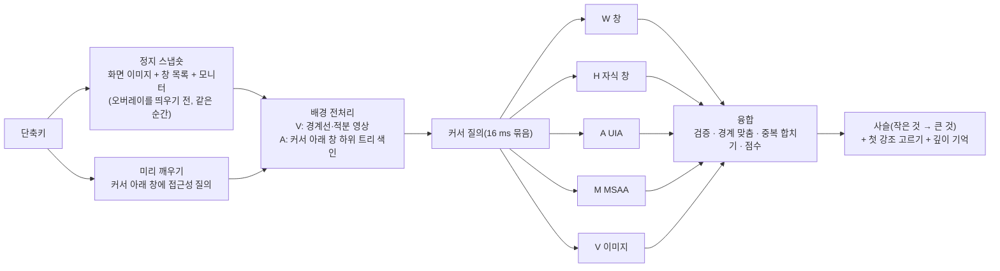

# 08. 스마트 캡처 v2 — Snipaste 인식 결함을 넘는 설계

2026-11-25 · PRD v3.0 부속 · F1 범위 캡처(그리고 F2 창 고르기·F3 범위 고르기가 같이 쓰는 부분)의 **인식 엔진** 명세. [02-smart-logic](02-smart-logic.md) §1의 사슬·깊이 기억·자석·키 조작은 그대로 쓰고, 이 문서는 그 앞단인 **"어떤 사각형들이 후보인가"**를 다시 설계한다. 02 §1.1·§1.2와 다른 곳은 이 문서가 우선한다.

## 0. 목표 — 판정할 수 있는 말로

| 목표 | 합격선 | 재는 곳 |
|---|---|---|
| 첫 강조가 사람이 가리킨 조각 | **Top-1 ≥ 90%** (정답과 IoU ≥ 0.9) | 인식 시험대 RB 전체(§5) |
| 휠 두 칸 안에 정답 | **Top-3 ≥ 98%** | 같음 |
| 경계 오차 | **≤ 1 물리 px**(그림자·반투명 테두리 제외) | 같음 |
| 강조 갱신 | 커서를 옮기고 **p95 ≤ 50 ms**, 첫 강조 ≤ 진입 + 30 ms | 앱 계측 줄 |
| 굳음 | 어떤 앱 위에서도 **0회**(UI가 100 ms 넘게 멈추지 않음) | 시험대 + 멈춘 앱 시험 |
| 헛강조 | 보이지 않는 창·화면 밖 사각형·투명 덮개 강조 **0회** | RB-15·16 |
| **Snipaste보다 낫다** | 같은 점 집합에서 Top-1이 Snipaste 이상 **그리고** Snipaste가 틀린 점의 ≥ 70%를 맞춤 | §5.4 대조 하네스 |
| 알려진 결함 재발 없음 | §3의 D1~D22 각각 해당 시험 통과(D23은 2차) | §3 시험 칸 |

## 1. Snipaste는 어떻게 찾나 (정적 근거, 클린룸)

[Snipaste 분석](../benchmark/snipaste-2.11.3.md)에 실행 파일 문자열·식별자 검사를 더했다(디컴파일 없음, 2026-11-25).

- 구성 이름: `WindowDetector` · `ThreadedWindowDetector` · `WindowDetector_win` · `requestRectDetection` · `handleDetectedRect` · `elementDetectionStarted/Ended` · `subElementRect` · `startForegroundWindowDetection`. 설정: `detect_windows` · `detect_ui_elements` · `snip/exclude_from_detection`.
- 창: `EnumWindows` · `EnumChildWindows` · `DwmGetWindowAttribute` · `IsHungAppWindow`.
- **요소: MSAA만.** `AccessibleObjectFromWindow`와 `IAccessible` IID는 있고, UIA의 `CUIAutomation`·`CUIAutomation8` CLSID와 `IUIAutomation` IID는 **없다** → UI Automation을 쓰지 않는다고 본다 [정적 근거로 강한 추정]. 이슈 기록도 MSAA 기반이다(#796 2018 · #3535 2025, §3).
- 없는 것: `GetLayeredWindowAttributes`(투명 덮개 창 거르기 흔적 없음), 창별 DPI API(`GetDpiForWindow`·`LogicalToPhysicalPoint…` — Qt에 맡김), 화면 이미지로 경계를 찾는 흔적 없음 [추정].

**뜻**: Snipaste의 요소 인식은 "MSAA가 내놓는 것"이 한계다. MSAA는 Win32 표준 컨트롤에는 강하지만 WPF·UWP·WinUI·Chromium·WebView2에서는 얕거나 비어 있다(§2 실측).

## 2. 이 PC 실측 (2026-11-25)

[bench/results/2026-11-25-school-pc-uia-probe.md](../../bench/results/2026-11-25-school-pc-uia-probe.md) — 창 하나를 30점으로 나눠 UIA·MSAA가 돌려준 사각형만 쟀다(이름·제목은 읽지 않음).

| 앱 | 창 절반보다 작은 요소를 받은 점 | 첫 질의 | 이후 |
|---|---|---|---|
| Chrome | UIA 20% · MSAA 20~23% | **121 ms**(2회차 48 ms) | 1~2 ms |
| Tidy Task(Tauri · WebView2) | UIA **0%** · MSAA **0%** | 1 ms | 1 ms |

창 그림자 16 px(`GetWindowRect` − DWM 경계).

→ **접근성 트리만 믿는 도구는 웹·WebView2 화면에서 창 단위로 떨어진다.** 화면 이미지 분석이 1급 근거여야 하고, Chromium은 첫 질의를 미리 깨워야 한다.

## 3. 결함 목록 → 원인 → screen-ink 대응

출처: Snipaste 공식 이슈 트래커 `github.com/Snipaste/feedback/issues/N`(아래 `#N`), 공식 위키(변경 기록 CL · 고급 설정 AC · 문제 해결 TS), Microsoft·Chromium 문서 — 2026-11-25 조사, 연 페이지만 인용. 원인 칸의 [확인]은 메인테이너·공식 문서가 밝힌 것, [추정]은 추론. Reddit·知乎·V2EX에서는 결함 불만을 찾지 못했다(기능 소개 글뿐).

### 3.1 창 수준

| # | 결함 | 출처 | 원인 | screen-ink 대응 | 시험 |
|---|---|---|---|---|---|
| D1 | **투명 덮개 창이 잡혀** 실제 창 대신 바탕 화면·작업 표시줄만 강조(Lenovo 앱, NVIDIA 오버레이, PowerToys Command Palette 숨은 창) | #3019 · #2746 · #3754(미해결) · ShareX #9280 | 커서 아래 최상위 창으로 투명 덮개가 뽑힘 [확인] — "투명 창 무시"가 클릭 통과·알파가 남은 창은 못 거름 [추정] | W 거르기를 **OS 클릭 판정과 같은 규칙**으로: `WS_EX_TRANSPARENT` · 계층 창 투명도 0 · 창 영역(`GetWindowRgn`) 밖 · 클릭 통과 도구 창 → 빼기. 모니터를 거의 덮는 맨 위 계층 창은 "덮개 의심"으로 첫 강조에서 빼고, 같은 덮개 아래 창을 사용자가 Tab으로 거듭 고르면 제외 목록 추가를 제안 | RB-16 |
| D2 | 다른 가상 데스크톱 창 경계가 잡힘 | #313 | cloaked 창은 `WS_VISIBLE`이 남아 `IsWindowVisible`로 못 거름 [추정·Old New Thing] | `DWMWA_CLOAKED` 검사(02 §1.1) | RB-18 |
| D3 | 사각형이 1~2 px 작거나 2 px 검은 띠(VS Code·QQ·mpv·웹 팝업) | #3579 · #3028(미해결) | 2.11부터 내용 영역을 잡고 일부 앱만 따로 보정 [확인] | DWM 확장 프레임 + **V 경계 맞춤**(±3 px 안 실제 화면 경계로 붙임, §4.4-3) — 앱별 보정표 없음 | RB-01·04·05 경계 ≤ 1 px |
| D4 | 둘째 모니터 전체 화면 창이 작업 표시줄 높이만큼 잘림 | #584 | 작업 영역 보정을 다른 모니터 기준으로 [추정] | 작업 영역은 그 창이 있는 모니터의 값으로만(`MonitorProbe`), 전체 화면 창(모니터와 같은 사각형)은 작업 영역으로 자르지 않음 | RB-15 |
| D5 | Win11 둥근 모서리 무시 | #1992(미해결) | 직사각형만 다룸 [추정] | 창 단위로 고른 결과는 창 모서리 설정(`DWMWA_WINDOW_CORNER_PREFERENCE`)을 읽어 모서리 바깥을 투명하게(P1, F2는 R-WIN-1로 이미 투명) | RB-05 |
| D6 | 제목 표시줄 위에서 창 대신 제목 글자 요소가 잡힘 | #832 · ShareX #5428 | 의도를 판별 못 함 [확인] | **제목 표시줄 규칙**: 커서가 UIA `TitleBar` 안이거나 창 위쪽 비클라이언트 띠 안이면 첫 강조 = 창(제목 글자는 휠 아래로) | RB-04·05 |
| D7 | 새 사진 앱에서 그림 대신 창 테두리만 | #3296 | 사진 앱이 멈춰 자동 블랙리스트 + 새 앱은 MSAA 미지원 [확인] | A(UIA)로 질의 + **V가 그림 영역을 찾음** — 앱 이름 블랙리스트 대신 시간 예산·자동 강등 | RB-14 |
| D8 | 타일링 창 관리자(FancyWM)에서 실패 | #2487 | 미기재 | 창 목록을 Z 순서 + DWM 경계로만 판단(창 관리자 종류와 무관), RB에 FancyZones 배치 추가 | RB-15 |

### 3.2 요소 수준

| # | 결함 | 출처 | 원인 | screen-ink 대응 | 시험 |
|---|---|---|---|---|---|
| D9 | **Chromium(Chrome·Edge·Whale 류) 웹 페이지 안 요소가 안 잡히고 탭·주소창만** — 2017~2026 반복, 사용자가 `chrome://accessibility`·실행 플래그를 직접 켜야 함 | #603 · #1849 · #2007 · #2457 · #3457 · #3509 · #3609 · #3618 · TS | Chromium은 보조 기술을 감지하기 전에는 웹 접근성 트리를 켜지 않음 [확인·Chromium 문서]. 코드 수정 없이 안내만 | ① Chrome 138부터 기본인 UIA로 질의(Snipaste는 MSAA) ② 단축키 순간 커서 아래 렌더 창에 **미리 깨우기** ③ 웹 내용 안 조각은 **V가 주 근거** — 사용자가 브라우저 설정을 바꿀 필요 없음. 시스템 전체 "화면 읽기 프로그램 켜짐" 플래그(`SPI_SETSCREENREADER`)는 다른 앱 동작을 바꾸므로 **건드리지 않는다** | RB-01·02 |
| D10 | Firefox에서 창 전체가 요소 하나 · 실행 파일 이름이 다르면 동작 안 함(Waterfox) | #928 · #2307 · #3454(미해결) | e10s와 접근성 공존 문제 [확인], 실행 파일 이름으로 판별 [확인] | 가족 판정을 **창 클래스**(`MozillaWindowClass`)로 · 웹 내용은 V | RB-19 |
| D11 | 요소 인식이 창·큰 패널에서 멈춤(얕아짐) | #3535(중복 #3370·#3477) | MSAA 호출을 일꾼 스레드로 옮기며 `CoInitialize` 누락 [확인] | 질의 스레드는 시작할 때 MTA로 명시 초기화 + **자기 시험**(앱 시작 때 자기 설정 창을 UIA로 한 번 질의해 트리가 보이는지 확인, 실패하면 로그와 함께 V 강화 모드) | 단위 시험 + 시작 계측 |
| D12 | DPI > 100%에서 요소 위치·크기 어긋남(Qt 5·Blender·LibreOffice) | #796 · TS "DPI가 100%가 아니면 부정확" | MSAA 좌표가 틀림, UIA는 정상 [확인] | **UIA 우선** · MSAA는 DPI 모르는 창일 때 좌표 변환 · 모든 접근성 사각형을 V 경계로 확인 | RB-12 |
| D13 | 부모·자식 계층이 시각과 다름 · 흐린 경계 누락 · 휠 순서 꼬임 · **이미지 기반 경계 검출 요청은 "계획 없음"으로 닫힘** | #2743 · #3435 · #2867 · #3334 · #2579 | 접근성 트리 ≠ 보이는 경계 [추정] | **V 근거 + 융합**(§4.3·4.4): 보이지 않는 그릇 빼기, 경계 지지율, 사슬은 엄격히 중첩·휠 한 칸마다 강조가 반드시 바뀜(02 §1.1) | RB 전체 Top-3 |
| D14 | 특정 앱(Spyder·SAP·시작 메뉴 타일)에서 요소 없음 | #3417 · #2143 · #1593 | 앱의 접근성 노출 부족 [추정] | V 주 + H 자식 창 | RB-04·17 |

### 3.3 좌표·DPI·여러 모니터

| # | 결함 | 출처 | 원인 | screen-ink 대응 | 시험 |
|---|---|---|---|---|---|
| D15 | 고DPI·혼합 DPI에서 창 인식 회귀가 버전마다 반복 | CL v1.3 · v1.8 · v2.2.2 · v2.8 | 논리·물리 화소 혼용 [추정] | 좌표는 물리 화소 가상 화면 하나, 변환 함수 하나(R-DPI-1) + **혼합 배율 스냅숏을 재생 시험에 고정**해 회귀를 CI에서 잡음 | RB-12 |
| D16 | 혼합 DPI(100/150/100%)에서 캡처 화면이 확대·깨져 보임 | #3794(미해결) | 미상 | 모니터별 오버레이 + 모니터별 프레임(가상 화면 한 장을 늘리지 않음, R-DPI-1·R-CAP-1) | RB-12 · S10 |

### 3.4 시간·멈춤

| # | 결함 | 출처 | 원인 | screen-ink 대응 | 시험 |
|---|---|---|---|---|---|
| D17 | **Snipaste가 통째로 멈춤**(DrRacket·Project 2016·VS 등) | #116 · #95 · #290 · #1696 · #1803 | 대상 앱의 `accHitTest`가 돌아오지 않음, MSAA 자식이 끝없음 [확인]. 시간 제한·스레드 강제 종료는 "비용 과다"로 거절 [확인] | **UI 스레드는 다른 앱을 기다리지 않는다**: 모든 질의는 전용 MTA 일꾼 + 마감 시간 · `IUIAutomation2` 연결·처리 제한을 기본 2초에서 200/100 ms로 · 마감을 넘긴 일꾼은 버리고 새 일꾼(멈춘 일꾼은 끝낼 때 정리) · 색인 개수·깊이 상한(1500개·8단) · 질의 전 `SendMessageTimeout(SMTO_ABORTIFHUNG, 50 ms)`로 응답 확인(WebRTC 방식) | RB-20(멈춘 시험 앱) |
| D18 | 특정 앱 위에서 커서 이동이 버벅임(Eclipse·Epic) | #174 · #1311 · #2429 | 앱 구현에 따라 다름 [확인] | 커서 이동 때 다른 앱에 묻지 않음 — 진입 때 색인, 이동은 메모리 R-tree(§4.1-3) | 커서 이동 질의 ≤ 5 ms |
| D19 | 접근성 질의로 대상 앱이 죽거나 멈춤(IDEA·사진 앱) | #1067 · #3296 | 부실한 구현이 조회에 죽음 [확인] | 질의 수 최소(진입 1회 색인 + 캐시) · 대상 프로세스가 사라지면 그 후보만 버림 · 같은 앱 2회 초과 시 자동 강등(R-CAP-15) | RB-20 |

### 3.5 잠깐 뜨는 UI

| # | 결함 | 출처 | 원인 | screen-ink 대응 | 시험 |
|---|---|---|---|---|---|
| D20 | 시작 메뉴를 연 채 캡처하면 작업 표시줄이 오버레이 위에 뜨거나 캡처가 끝남 | #839 · CL v2.0.1·v2.1 | 셸 UI의 Z 순서·포커스 [추정] | 정지 이미지를 **먼저** 찍고 오버레이를 띄움(R-CAP-1) · 오버레이는 셸 위 최상위 + 포커스 실패해도 키는 단축키 스레드가 받음 | RB-17 |
| D21 | 툴팁이 캡처 순간 사라짐 | #3645 | 단축키 입력·포커스 이동이 hover를 풂 [추정] | 이미지 + 창 목록을 **같은 순간** 찍으므로 툴팁 창이 사라져도 후보로 남음(§4.1-2) · 그래도 안 되면 Alt+F1 지연 캡처 | RB-11 |

### 3.6 그 밖

| # | 결함 | 출처 | 원인 | screen-ink 대응 | 시험 |
|---|---|---|---|---|---|
| D22 | 앱별 하드코딩 목록(`crashes=`·실행 파일 이름)이 깨지기 쉬움 | AC · #2307 · #3296 | 설계상 한계 [확인] | 가족 판정 = 창 클래스·UIA 프레임워크 종류 + **잰 행동**(시간·빈 트리)으로 자동 강등, 목록은 코드가 아닌 자료 | RB 전체 |
| D23 | (맥) 알림이 떠 있으면 커서 위 창 인식 실패 | #3795 · #3706 · #3791 | 알림 센터 전체 화면 창이 잡힘 [추정] | 2차 macOS: D1과 같은 덮개 규칙을 `CGWindowList` 층·알파로 | 2차 |

### 3.7 Snipaste에서 그대로 가져올 것

Tab(창 ↔ 요소) · 휠(부모 ↔ 자식) · WASD·방향키 1 px · 제외 목록(`exclude_from_detection`) · 응답 없는 창 건너뛰기 · 투명 창 무시(규칙은 D1처럼 넓힘) · 전체 화면 창에서 작업 표시줄 빼기 · 그림자 뺀 경계와 그림자 포함 선택 · 진단 로그(창 제목 없이) · 캡처가 멈추면 트레이 아이콘으로 빠져나오기(우리는 단축키를 한 번 더 눌러도 취소) · 인식을 메인 스레드 밖으로.

## 4. 설계: 근거 다섯 개를 합치는 인식 엔진

### 4.1 흐름

원칙(02 §0에 더해):
1. **어느 한 근거도 혼자 믿지 않는다.** 접근성 사각형은 화면 경계선으로 확인하고, 화면 경계선은 창·접근성 구조로 이름을 붙인다.
2. **창 목록·이미지는 같은 순간**에 찍는다(오버레이를 띄우기 전). 메뉴·툴팁처럼 잠깐 뜨는 것도 둘 다에 남는다.
3. **커서가 움직일 때 다른 앱에 묻지 않는다.** 질의는 진입 때 한 번(색인)에 몰고, 움직일 때는 내 메모리만 본다 → 느린 앱이 있어도 굳지 않는다.

### 4.2 근거별 규칙

| 근거 | 얻는 것 | 규칙 |
|---|---|---|
| **W** 창 목록 | 최상위 창·팝업(메뉴 `#32768`·툴팁·콤보 목록·Chromium 팝업) 사각형, Z 순서 | 02 §1.1 거르기 + **투명 덮개 빼기**(`WS_EX_TRANSPARENT`, 계층 창 투명도 0 `GetLayeredWindowAttributes`, 클릭 통과 도구 창, 알려진 덮개 클래스 목록) · **최대화 창은 모니터 작업 영역으로 자르기**(최대화 창은 화면 밖 8 px까지 나감) · 경계 = DWM 확장 프레임 · 바탕 화면 = 모니터 작업 영역 |
| **H** 자식 창 | Win32 자식 컨트롤(대화 상자·옛 앱·한글 일부) | 커서 아래 창의 `EnumChildWindows`(보이는 것만, 깊이 4) · `RealChildWindowFromPoint`로 확인 |
| **A** UIA | 컨트롤 종류·사각형·부모 관계 | 진입 때 커서 아래 창의 하위 트리를 **캐시 요청**(`BoundingRectangle`·`ControlType`·`IsOffscreen`·`RuntimeId`)으로 한 번에 받아 R-tree에 색인(예산 60 ms · 1500개 · 깊이 8). 커서가 다른 창으로 가면 그 창을 게으르게 색인. `IsOffscreen`·크기 0·커서를 안 담는 사각형은 버림 |
| **M** MSAA | UIA가 빈 옛 앱의 요소 | A가 비거나 시간 초과일 때만 `AccessibleObjectFromPoint` + `accLocation` 20 ms · **DPI를 모르는 창은 좌표를 `LogicalToPhysicalPointForPerMonitorDPI`로 바꿈**(MSAA는 가상화 좌표를 줄 수 있음) |
| **V** 이미지 | 화면에 실제로 보이는 경계 | §4.3 — 접근성이 없는 앱(WebView2·게임·원격 데스크톱·영상·PDF·그림·한글 본문)의 유일한 근거, 다른 근거의 경계 맞춤 기준 |

### 4.3 V — 정지 화면에서 사각형 찾기

**전처리(정지 직후 배경 스레드, 4K 한 장 ≤ 40 ms, 그동안 사용자는 이미 고르기 시작)**

1. 모니터별로 밝기 Y(8bit)와 경사 크기(가로·세로 차이)를 만든다.
2. **곧은 경계 조각**: 가로 경사가 24 px 넘게 이어진 줄, 세로도 같게 — 행·열별 구간 목록으로 저장.
3. **적분 영상**(경계 화소 수) — 어떤 사각형이든 네 변이 경계 위에 얼마나 놓였는지(경계 지지율)를 O(1)로 잰다.

**커서 질의(≤ 4 ms)**

| 찾는 것 | 방법 | 잡히는 예 |
|---|---|---|
| 상자 사다리 | 커서를 가로지르는 가장 가까운 위·아래 가로 경계와 왼·오른 세로 경계 → 사각형 → 그 바깥으로 한 겹씩 넓혀 중첩 상자 3~5개 | 표 칸 → 표, 카드, 입력 칸, 버튼, 대화 상자 |
| 평탄 영역 | 커서 점의 배경색과 같은(채널별 ±6) 이어진 영역을 화소 예산(30만) 안에서 채워 바운딩 박스 | 패널·사이드바·슬라이드 바탕 |
| 글 덩어리 (P1) | 평탄 영역 안 경계 화소 덩어리를 줄 높이로 묶음 | 문단·줄 |
| 그림 (P1) | 분산이 큰 영역 + 둘레의 평탄한 여백 | 사진·도표 |

각 후보에 **경계 지지율**(네 변 화소 중 경계 화소 비율)을 매긴다. 지지율 < 0.6은 버린다.

### 4.4 융합

1. **좌표 하나로**: 모든 사각형을 물리 픽셀 가상 화면 좌표로(02 §0.2).
2. **검증**: 커서를 담지 않음 · 창 경계 밖으로 2 px 넘게 나감 · 넓이 < 16 px² · 모니터 밖 → 버림.
3. **경계 맞춤**: A·M·H 사각형의 각 변을 ±3 px 안의 V 곧은 경계(지지율 ≥ 0.6)로 붙인다 → 1 px 어긋남·그림자·DPI 반올림이 사라진다.
4. **보이지 않는 그릇 빼기**: 종류가 그릇(Pane·Group·Custom)이고 경계 지지율 < 0.15인 접근성 사각형은 첫 강조 후보에서 뺀다(휠로는 남김). Snipaste가 "안 보이는 큰 상자"를 잡는 경우를 막는다.
5. **중복 합치기**: IoU ≥ 0.92면 한 마디로 합치고 근거 집합을 합친다. 사각형은 경계 맞춤된 것을 쓴다.
6. **사슬**: 커서를 담는 마디를 넓이 순으로 줄 세우고 02 §1.1 다듬기(부모와 ±1 px 같은 단계 빼기 등)를 한다.
7. **점수**: `s = 0.35·경계지지 + 0.25·의미(컨트롤 종류) + 0.20·근거 수 + 0.20·크기 적합` — 의미 점수는 Button·ListItem·DataItem·TabItem·MenuItem·Hyperlink·Image·Edit·Table·Document 높음, Pane·Group·Custom 낮음. 크기 적합은 24×16 px 이상 · 창의 60% 이하에서 1.

### 4.5 첫 강조 고르기

- **진입 순간(커서를 움직이기 전)의 기본값 = 커서가 있는 모니터 전체(작업 표시줄 포함)**(사용자 확정 2026-11-25) — F1 다음 바로 Enter면 그 화면 전체가 찍힌다. 최대화 창 위에서 눌러도 작업 영역으로 줄이지 않는다. F2는 커서 아래 창이 기본.
- 커서를 움직이면 아래 규칙(인식 사슬)이 강조를 이어받는다.
- 깊이 기억(02 §1.3)이 있으면 그것이 먼저.
- 없으면 **점수 ≥ 0.5인 마디 중 가장 작은 것**(글자 한 개·아이콘 테두리 같은 너무 작은 조각은 크기 적합에서 걸러짐). 없으면 창.
- 결정에 쓴 근거를 기억한다(로그 없이 메모리에만) — 숨은 설정 "인식 근거 보기"를 켜면 마디마다 근거 색(W 파랑 · A 초록 · M 청록 · V 주황)과 점수를 그려 시험대 정답 만들기에 쓴다.

### 4.6 앱 가족별 전략

| 가족(창 클래스·프로세스로 판정) | A·M 상태 | 전략 |
|---|---|---|
| Win32 표준(탐색기·메모장·대화 상자) | 풍부 | A 주, V 경계 맞춤 |
| Chromium·Electron(`Chrome_WidgetWin_*`) | 첫 질의가 느리고 웹 내용은 큰 Group · Chrome 138부터 UIA 기본 지원(Chrome 개발자 블로그 2025-08-14) | **단축키 순간 미리 깨우기**(렌더 창에 접근성 질의) · 프로세스별 "깨움" 기억 · 웹 내용 안 조각은 V 주 · 탭·도구 막대·주소 칸은 A |
| WebView2(Tauri·새 Teams·새 Outlook) | 비어 있음(실측 0%) | **V 주** + H(WebView2 자식 창 경계) |
| UWP·WinUI(`ApplicationFrameWindow`) | 풍부하나 틀 창과 내용 창이 다름 | 틀 창 → 안쪽 `Windows.UI.Core.CoreWindow`로 이어 붙여 하나의 창으로 · 숨은(cloaked) 일시 중지 창 제외 |
| Office(워드·엑셀·PowerPoint) | 풍부하지만 리본이 느림 | A 색인 예산을 초과하면 리본 부분만 건너뜀 · 엑셀 칸 = DataItem · 슬라이드 쇼 = 전체 화면 창 하나 + V |
| 한글(HWP) | 얕음 [실측 필요] | V 주 + H(대화 상자·도구 상자) |
| Java·Qt·게임·원격 데스크톱·VM·영상 | 거의 없음 | V만 |
| 관리자 권한 창 | UIPI로 A·M이 막힐 수 있음 | W + V, 한 번 안내(R-SYS-3) |

가족 판정은 표로 두고(코드가 아닌 자료), 시험대 결과로 고친다.

### 4.7 시간 예산 (진입 한 번)

| 단계 | 예산 | 넘으면 |
|---|---|---|
| 정지 캡처 + 창 목록 | ≤ 55 ms(R-CAP-2) | PRD 6절 개선 순서 |
| 미리 깨우기(병렬) | 캡처와 겹쳐서 0 ms 추가 | — |
| 첫 강조(커서 점 A 질의 + V 질의) | 진입 + 30 ms | V만으로 첫 강조, A는 도착하면 갱신 |
| A 하위 트리 색인 | 60 ms · 1500개 | 거기까지만 쓰고 나머지는 커서 점 질의로 |
| V 전처리 | ≤ 40 ms(4K) — 실측(2026-11-25, 합성 UI, dev opt3) 4K 17 ms · 1080p 5 ms · 커서 주변 1024² 4~5 ms · 질의 ≤ 0.7 ms | 커서 주변 1024² 먼저 |
| 커서 이동 질의 | ≤ 5 ms(메모리 안) | — |
| 같은 앱에서 색인 150 ms 초과 2회 | — | "느린 앱"(A 끔, W·H·V만)에 자동 추가 + 알림(R-CAP-15) |

### 4.8 실패할 때의 순서

`융합 사슬` → (A 없음) `W·H·V 사슬` → (V 실패) `W 사슬` → `모니터 작업 영역` → `모니터` → `가상 화면`. 어느 단계에서도 **화면은 멈추지 않고**, 드래그·방향키로 직접 고를 수 있다.

## 5. 인식 시험대 (M8)

### 5.1 고정 시험 세트

| ID | 대상 | 정답 만드는 법 |
|---|---|---|
| RB-01 | 시험용 HTML(상자·표·버튼·그림·문단) — Chrome | 페이지가 아는 배치(CSS px) × 배율 + 문서 영역 원점 → **자동 정답** |
| RB-02 | RB-01 — Edge | 같음 |
| RB-03 | RB-01 — WebView2 시험 껍데기 | 같음 |
| RB-04 | Win32 표준 컨트롤 시험 앱(우리가 만듦) | 컨트롤 사각형 자동 |
| RB-05 | 탐색기(자세히 보기·탐색 창·리본) | 사람이 한 번 표시 |
| RB-06 | 설정·계산기(UWP·WinUI) | 사람 |
| RB-07 | PowerPoint 편집 화면 + 슬라이드 쇼 | 사람 |
| RB-08 | 워드 표 · 엑셀 칸 | 사람 |
| RB-09 | 한글(HWP) 시험 문서(표·문단·그림) | 사람 |
| RB-10 | Edge PDF(표가 있는 시험 PDF) | 사람 |
| RB-11 | 열린 오른쪽 클릭 메뉴 · 툴팁 · 콤보 목록 | 사람 |
| RB-12 | 혼합 배율(100% + 150%)에서 RB-01·RB-04 | 자동 |
| RB-13 | 관리자 권한 창(작업 관리자) | 사람 |
| RB-14 | 캔버스·영상(WebGL 시험 페이지) | 자동 |
| RB-15 | 최대화 창 · 작업 표시줄 · 바탕 화면 | 자동(모니터 정보) |
| RB-16 | 투명 덮개 창(우리가 만든 클릭 통과 계층 창 · 투명도 0 계층 창 · 모니터 전체 맨 위 계층 창) 위 | 자동 — 덮개가 강조되면 실패(D1) |
| RB-17 | 시작 메뉴·작업 표시줄 미리 보기를 연 채 F1 | 사람(D14·D20) |
| RB-18 | 다른 가상 데스크톱에 창을 둔 채 F1 | 자동 — 그 창이 강조되면 실패(D2) |
| RB-19 | RB-01 — Firefox | 자동(D10) |
| RB-20 | **멈춘 시험 앱**(메시지 루프를 막고, MSAA `accHitTest`가 돌아오지 않고, 자식을 끝없이 보고하는 앱을 우리가 만듦) | 자동 — UI가 100 ms 넘게 멈추면 실패(D17·D19) |

시험 문서는 모두 우리가 만든 내용만 쓴다(학생·교직원 정보·실제 업무 화면 금지).

### 5.2 스냅숏 재생 시험

진입 순간의 `FrameSnapshot`(시험 문서 화면) · `WindowCatalog` · A 색인을 **이름·제목을 지운 채** 파일로 떠 두고(`bench/recog/cases/*.json` + PNG), `ink-domain` 융합 엔진을 OS 없이 재생한다 → 같은 입력이면 같은 사슬. 로직을 바꿀 때마다 CI에서 Top-1·Top-3·경계 오차를 비교해 떨어지면 실패로 친다.

구현(2026-11-25): 사례 형식 `ink_app::case::Case`(스키마 1) · 재생 `ink-platform-fake::replay`(진짜 서비스·고르기·융합·V 엔진, 점마다 새 진입, 휠 위·아래 3칸) · 기준선 `bench/recog/cases/baseline.json` · 보고서 `cargo run -p ink-platform-fake --bin recog-replay` → `bench/results/recog-replay.csv`. **사람 정답 도구** = 앱을 `SCREEN_INK_CASE_DIR`와 함께 띄우고 F1에서 정답 범위를 확정하면 그 순간이 사례로 써진다(우리 창 제외). 절차는 [bench/recog/README.md](../../bench/recog/README.md).

### 5.3 지표

- 점마다: 첫 강조 IoU, 휠 몇 칸 만에 정답(0~3, 실패), 변별 경계 오차(px), 강조 지연(ms).
- 묶음별 Top-1 · Top-3 · 평균 경계 오차 · p95 지연 · 굳음 수 → `bench/results/recog-<날짜>.csv`.

### 5.4 Snipaste 대조 하네스

같은 커서 점에서 Snipaste F1을 띄우고 화면을 찍는다. Snipaste는 강조 바깥을 어둡게 덮으므로 **원본 화면과 화소가 같은 영역 = Snipaste의 강조 사각형**으로 자동 판독한다(같은 방법을 ShareX 등에도 쓸 수 있음). 결과를 screen-ink와 같은 표에 나란히 적는다. Snipaste 설정은 기본값, 창·요소 감지 켬.

## 6. 구현 순서 (마스터플랜 단계 3 세부)

| # | 작업 | 끝 기준 |
|---|---|---|
| 3a | 스냅숏(W·H) + 투명 덮개(D1)·가상 데스크톱(D2)·최대화·작업 영역(D4)·제목 표시줄(D6)·UWP 이어 붙이기 + 재생 시험 틀 | RB-15·16·18 자동 통과, 스냅숏 재생이 CI에서 돎 |
| 3b | A 엔진: MTA 일꾼 + 자기 시험(D11) · 마감 시간·일꾼 교체·응답 확인(D17) · 미리 깨우기(D9) · 캐시 요청 색인 · R-tree(D18) · 느린 앱 강등(D19·D22) · M 대체 · DPI 좌표 보정(D12) | Chrome 첫 강조 ≤ 진입 + 30 ms, RB-20 굳음 0 |
| 3c | V 엔진: 전처리 · 상자 사다리 · 평탄 영역 · 경계 지지율 | V 혼자 RB-01·03 Top-1 ≥ 80% |
| 3d | 융합 · 점수 · 첫 강조 · 깊이 기억 · 근거 보기 | RB 전체 Top-1 ≥ 90%, Top-3 ≥ 98% |
| 3e | 오버레이 UI(02 §1.4~1.6, 기존 계획 3.4~3.8) | 시안 S07~S09 조작 |
| 3f | 시험대 RB-01~20 정리 + Snipaste 대조 하네스 + 보고서 | §0 "Snipaste보다 낫다"·"알려진 결함 재발 없음" 판정 |

## 7. 열린 점

- 한글(HWP)·PowerPoint·엑셀이 이 PC에서 UIA로 얼마나 보이는지 — 단계 3 시작 때 `bench/uia-probe.ps1`로 잰다(그 앱을 연 상태에서).
- Chromium을 깨우면 그 브라우저가 접근성 모드로 남아 메모리를 조금 더 쓴다 [추정]. 커서 아래 창에만, F1을 눌렀을 때만 깨우고, 시험대에서 메모리 차이를 잰다.
- V의 문턱값(경사 24 · 길이 24 px · 지지율 0.6)은 첫 값이다. RB 결과로 고른다.
